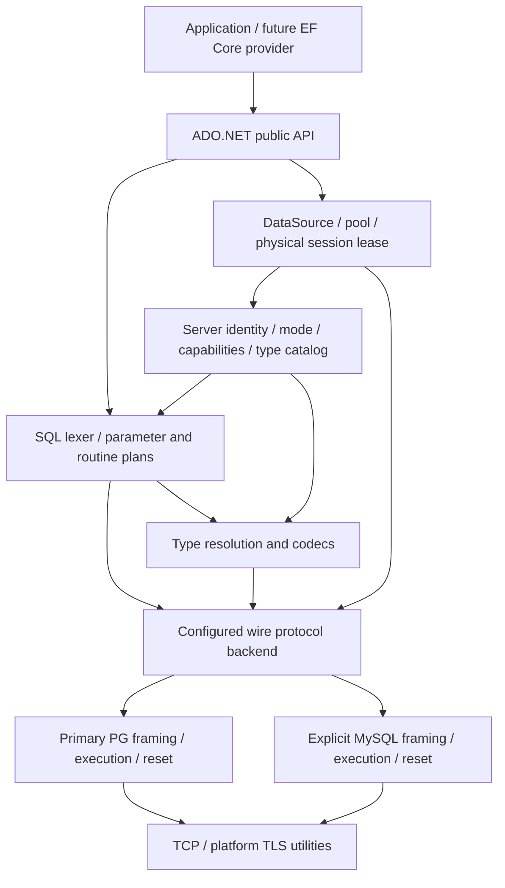

# KingbaseConnector Unified ADO.NET Driver Design

Baseline date: 2026-11-23. Last updated: 2026-11-25. Status: documentation baseline ready to guide development. Specific API, configuration, and release-policy proposals remain subject to confirmation. At this baseline, the repository contains no product projects or tests, and there are no live-server acceptance results. Ongoing implementation status is maintained in the [development guide](kbconnector-development.md) and [development progress](kbconnector-development-progress.md).

Current working directory: `D:/Code/dotnet/kbconnector-dotnet`. The earlier design and evidence inventory have been moved here, and source materials are tracked with repository-relative paths. Renaming the directory does not finalize the package ID or public type names.

Companion documents: [feature and version matrix](kbconnector-feature-matrix.md), [official DLL static evidence inventory](reference/official-driver-inventory.json), [development guide](kbconnector-development.md), and [development progress](kbconnector-development-progress.md). Feature IDs in the matrix provide a common index for implementation, tests, defects, and release notes. This design defines the intended contracts; the progress document records their current implementation and verification status.

## 1. Confirmed Goals and Design Proposals

### 1.1 Scope confirmed by the user

1. Independently develop a .NET ADO.NET driver for KingbaseES. Analyze the official driver's features, implementation approaches, and version differences without depending on the official DLL at runtime or treating all official behavior as a correct specification.
2. Ultimately support both V9 and V8, completing V9 first and then extending support to V8. V8 remains in scope; V9 work must not imply that V8 compatibility has already been established.
3. Cover PG, Oracle, MySQL, and SQL Server modes in V9 all-mode servers, together with the combinations actually available in the corresponding standalone compatibility editions. All deployment forms share one driver package.
4. Use `D:/Code/dotnet/obconnector-dotnet` as a reference for engineering organization: NuGet Central Package Management, `.slnx`, a shared project version, and multiple target frameworks.
5. Provide a stable ADO.NET, type, and metadata foundation for a separately developed EF Core provider. The initial deliverables are this design and the matrix; implementation proceeds according to the development documents.
6. Use PG v3 for normal deployments in all four compatibility modes. Also cover the exceptional deployment that disables the PG endpoint and exposes only a MySQL-protocol endpoint, through an explicit additional backend. This does not make MySQL the default protocol.
7. Provide built-in ADO.NET connection pooling, including ownership, bounded capacity, session isolation, clearing, and disposal for both protocol backends.

### 1.2 Specific proposals requiring confirmation

- The provisional package and namespace are `KingbaseConnector`, with public types such as `KingbaseConnection`. Binary replacement of the official `Kdbndp` API or assembly is not a compatibility goal.
- Use a fully managed core targeting `netstandard2.0;netstandard2.1;net8.0;net9.0;net10.0`. These are TFMs, not CPU architectures. Operating systems and x64/ARM64 require separate validation dimensions.
- Use the user-provided `V8R6C9B14` as the first V8 validation anchor. Earlier V8 releases remain explicit research items; one DLL does not establish their coverage.
- Default `CompatibilityMode` to Auto and identify the database mode from the server. An explicit value selects the driver's compatibility rules; it does not change the server mode or wire protocol. Keep expected-version validation separate. Return clear errors and diagnostics for unrecognized or conflicting server identities rather than silently assuming PG mode.
- Classify features as V9 required, V9 conditional, later independent work, or unconfirmed. The matrix defines classification and acceptance rules. Conditional features still require explicit conclusions before release.

These are design proposals, not a record that the user has individually approved each public API, default setting, or release rule.

## 2. What the Available Materials Establish

### 2.1 Local facts

- When research began, the repository contained only `.gitignore`, `.source-code`, and Git metadata, with no driver projects or tests.
- The official materials contain 25 copies of `Kdbndp.dll`, representing 10 distinct binaries after SHA-256 deduplication. Six receive detailed comparison; their aliases appear in matrix section 2. Hashes, TFMs, and assembly references are also retained for the other four older .NET Framework assets.
- The added `.source-code/V8R6C9B14/netstandard2.0/Kdbndp.dll` is a distinct binary. It declares `.NETStandard,Version=v2.0` and assembly version `4.0.7.1222`.
- Official V9 R1, R2, and R4 directories contain duplicate binaries. Different contents also share the same FileVersion. Neither directory names nor FileVersion alone establish implementation identity.
- The path containing `D9-100` includes `netstandard2.0`, but its actual TFM is `.NETFramework,Version=v4.5`. Assembly metadata takes precedence.
- The V8 DLL also contains a four-mode enumeration and MySQL/SQL Server handler classes. This establishes client implementation evidence, not that V8 servers provide every deployment/mode combination.

The inventory records complete SHA-256 hashes, relative paths, versions, actual TFMs, assembly dependencies, built-in type attributes, and key symbols. Decompiled source is used only for temporary analysis; it is neither product source nor a committed deliverable.

The 25 paths and 10 complete hashes were checked against the inventory. All built-in type attributes in the six principal samples were compared again, covering 525 attributes. Empty `builtInTypes`/`declaredTypes` arrays for the four older Framework samples mean extraction was incomplete, not that those assemblies lack types or APIs; `builtInTypeCount` was counted separately. Static implementation locations use the full sample hash, type, member, and token where available; temporary decompiler line numbers are not stable evidence locations. Additional static details are retained in the JSON `reviewDetails` field.

### 2.2 Evidence levels

| Marker | Meaning | Permitted conclusion |
| --- | --- | --- |
| DOC | Explicitly described in official documentation | The documented release line claims the behavior; the documentation version must still match |
| SYM | A DLL declaration or attribute exists | The API, type name, or OID table entry exists; correctness is not established |
| BODY | The implementation path was inspected statically | Describes the logic of that particular DLL; does not establish live interoperability |
| SIM | The new driver's protocol simulation/unit tests pass | Meets the tested contract for controlled inputs; does not replace server acceptance |
| LIVE | The new driver passes in a recorded real environment | Covers only the recorded server version, deployment form, mode, authentication, and test scope |

At the 2026-11-23 documentation baseline, evidence is DOC/SYM/BODY only; no new-driver SIM/LIVE results exist. Subsequent implementation and validation results belong in the progress document; update matrix requirements when new evidence changes a contract. The official DLL is one behavioral comparator. Server responses, official protocol/documentation, and independent validation also inform decisions; official defects must not be copied.

## 3. Implementation Approach

| Approach | Benefits | Costs and applicability | Design decision |
| --- | --- | --- | --- |
| Wrap or select official DLLs at runtime | Fast initial integration | Retains version differences, defects, and deployment restrictions; does not produce an independent core | Rejected: the user explicitly requested independent redevelopment |
| Use an existing driver such as Npgsql as the runtime core and add adapters | Some basic functionality already exists | Requires evaluating internal extension boundaries and Kingbase-specific authentication/messages/types; upstream behavior adds another compatibility surface | Not the proposed runtime dependency strategy |
| Implement one ADO.NET core and pool manager, a primary PG backend, and an explicit MySQL backend for exceptional deployments | Control over public APIs, failure semantics, and version policy; shared ownership and compatibility logic | Additional MySQL handshake, execution, codec, and pool-reset acceptance work | Recommended; PG remains the normal path |

The official static implementation writes protocol version `196608` in `StartupMessage`. Its Parse/Bind/Execute and COPY paths establish a PG v3-style connection path in those DLLs. They do not establish a native MySQL implementation. A database in MySQL compatibility mode normally still uses this PG path; selecting that mode does not require another wire protocol.

### 3.1 Normal PG path and exceptional MySQL endpoint

PG is the default and primary backend for all-mode servers and the corresponding standalone editions in PG, Oracle, MySQL, and SQL Server compatibility modes. An application using the normal PG endpoint needs no protocol setting. Most MySQL-compatible deployments therefore continue to use exactly the same PG path as the other modes.

The additional MySQL backend covers the exceptional installation that disables or does not expose the PG endpoint. Implement it in the same independent core package with the same ADO.NET API and pool management. Share transport utilities, deadlines, leases, diagnostics, and public value contracts where appropriate. Keep handshake/authentication, framing, command/result state machines, wire types, cancellation, and reset specific to each backend. Do not wrap an external driver's pool inside this pool or introduce a separately deployed driver/plugin per mode.

### 3.2 Protocol selection is separate from compatibility mode

The proposed canonical keyword/property is `WireProtocol`, with `KingbaseWireProtocol.PostgreSql` and `MySql` values. The default is PostgreSql; no Auto value is proposed. The canonical mode keyword/property remains `CompatibilityMode`, default Auto, as defined in section 6.3. A protocol is selected before the handshake; mode is selected after authentication from server information or explicit configuration.

| Endpoint and configuration | Connection behavior |
| --- | --- |
| Normal Kingbase PG endpoint; WireProtocol omitted or PostgreSql | PG v3; default port 54321. Auto detects any supported database mode after authentication. Explicit CompatibilityMode selects its client rules. |
| Exceptional MySQL-only endpoint; WireProtocol=MySql | Use the MySQL backend and require an explicit Port. Initial compatibility coverage is MySql mode only. Auto still requires verified server-mode discovery; the protocol name alone is not that discovery. |
| MySQL wire with explicit PostgreSql, Oracle, or SqlServer mode | Reject the unsupported combination during configuration validation. Further combinations require separate evidence and an explicit scope change. |
| Configured protocol does not match the endpoint | Fail with a bounded protocol/handshake diagnostic; do not switch protocols, scan ports, or retry through another protocol. |

Proposed connection strings, with placeholder credentials:

```text
Host=server.example;Port=54321;Database=app;Username=app;Password=<secret>;CompatibilityMode=Auto;Pooling=true
Host=server.example;Port=3307;Database=app;Username=app;Password=<secret>;WireProtocol=MySql;CompatibilityMode=Auto;Pooling=true
```

Port 3307 is the user's reported MySQL endpoint layout, not a universal default or protocol detector. Use the actual configured port; it may differ from both 3306 and 3307. Explicit `CompatibilityMode=MySql` can replace Auto in either example. It selects client semantics but still requires actual product/version/catalog facts and rejects a conflicting reported mode. Neither setting starts a disabled listener or changes the server's mode.

Do not infer MySQL merely from a port number or every startup failure. If received bytes positively identify a MySQL greeting while PG was selected, suggest configuring WireProtocol=MySql with the actual MySQL endpoint, or using the administrator-provided PG endpoint. Under MySQL selection, reject invalid/unsupported greetings without attempting a PG startup. All reads and errors remain length- and time-bounded; this diagnostic recognition does not implement protocol auto-selection.

### 3.3 Applicability and evidence boundary

The existing Kdbndp evidence concerns PG connections. W20 explicitly documents MySQL protocol compatibility in KingbaseES MySQL-compatible Release V009R003C010. This is DOC evidence for that release line, not evidence that every edition exposes that endpoint or that a given installation disables PG. MySQL protocol specifications W14-W16 define reference wire behavior; they do not prove that Kingbase implements every MySQL capability. U07 covers the actual Kingbase native-endpoint product/mode queries, authentication, catalogs, reset, and cancellation behavior. A generic MySQL greeting/version string or successful SELECT does not prove Kingbase identity, product build, or compatibility mode.

PG-specific APIs such as COPY, LISTEN/NOTIFY, OID large objects, and refcursor are not promised on MySQL wire. Record applicability per feature and protocol profile and reject unsupported calls before sending protocol-specific messages. Do not silently substitute LOAD DATA, emulate notifications, or invent PG OIDs. Shared ADO.NET commands, transactions, readers, metadata, and pooling still need their own native-endpoint acceptance. Native TDS and arbitrary MySQL-server compatibility are outside this extension's scope.

## 4. Engineering Structure and Packages

The proposed structure is shown below. The documentation baseline adds `docs/`; product scaffolding is tracked as development work.

```text
KingbaseConnector.slnx
Directory.Build.props
Directory.Packages.props
src/
  KingbaseConnector/
  KingbaseConnector.DependencyInjection/
tests/
  KingbaseConnector.UnitTests/
  KingbaseConnector.ProtocolTests/
  KingbaseConnector.IntegrationTests/
  KingbaseConnector.ConsumerTests/
eng/
docs/
```

- Enable CPM in `Directory.Packages.props`; individual `PackageReference` entries carry no versions. Introduce TFM-specific dependencies only where necessary.
- Use `Directory.Build.props` for shared versions, nullability, deterministic builds, and common compilation settings. Product packages share one version. Server V8/V9 does not determine the package major version or .NET TFM.
- Manage product and test projects in `KingbaseConnector.slnx`. Use an installed SDK that supports net10.0 and slnx; do not pin its version in `global.json`. Record the SDK used for validation. Do not copy test dependency versions from the reference repository without validation.
- Provide all modes in one core package, with an optional separate DI integration package. The core does not depend on EF Core, embed the official driver, or split V8/V9 into different core packages.
- Prefer the standard library. Use `Microsoft.Extensions.Logging.Abstractions` for logging and `ActivitySource`/`Meter` for diagnostics. If algorithms such as SM3 require dependencies, select maintained libraries instead of automatically retaining the old `BouncyCastle.dll` or copying an embedded TLS implementation.
- Validate minimum netstandard dependency versions on actual hosts. Running tests on net10.0 does not justify raising every product dependency to the same minimum. The NuGet dependency graph is an acceptance target.
- Following the user's 2026-11-24 instruction and the local `obconnector-dotnet` CPM reference, Microsoft.Extensions dependencies use inclusive minimum ranges without an upper bound: `[8.0.0,)` for net8.0, `[9.0.0,)` for net9.0, and `[10.0.0,)` for net10.0 and both Standard assets. Declare per-TFM versions centrally; add package references only where used. The DI layer uses Abstractions, while its service-container tests use DependencyInjection. Verify generated nuspec groups and minimum-version consumers when those references ship; central declarations alone do not establish a packaged dependency or older-host support.
- Execute real consumer tests for the .NET 8/9/10 assets. Validate netstandard2.0/2.1 assets using hosts that explicitly select those assets; automatic NuGet selection of a modern asset does not count as Standard testing.
- Validate Windows and Linux x64 by default. Add ARM64 as a separate validation item. Fully managed code does not certify untested platforms. Standard2.0 targeting alone does not establish .NET Framework host support.

DP01 engineering selection (2026-11-24): validation used SDK 10.0.403; the repository does not pin an SDK version, following the user's development preference. The shared package version is 0.1.0, with no prerelease suffix, as requested by the user. This version format does not establish release readiness. The five-target core has no explicit runtime dependency at this stage. VSTest 18.0.1, xUnit 2.9.3 and its Visual Studio adapter 3.1.5 are test-only. `eng/verify.ps1` is the local restore/build/test/pack/explicit-consumer entry point; the development guide defines host/asset selection and the fail-closed live opt-in. These engineering decisions do not settle U06 licensing/publication or validate server functionality.

## 5. Architecture and Public Contracts



### 5.1 Public objects

| Proposed type | Responsibility |
| --- | --- |
| `KingbaseConnection` | DbConnection; synchronous/asynchronous open and close, transactions, mode/version information, GetSchema |
| `KingbaseCommand` | DbCommand; execution, explicit Prepare, cancellation, parameter and result lifetimes |
| `KingbaseParameter` / `KingbaseDbType` | DbParameter; explicit provider type, type name, direction, precision, and scale |
| `KingbaseDataReader` / `KingbaseDbColumn` | DbDataReader; streaming, consistent CLR mappings within each mode, column metadata |
| `KingbaseTransaction` | DbTransaction; commit, rollback, savepoints, and error state |
| `KingbaseFactory` | DbProviderFactory; standard factory registration |
| `KingbaseDataAdapter` / `KingbaseCommandBuilder` | DataTable/DataSet and command generation based on keys and schema |
| `KingbaseDataSourceBuilder` / `KingbaseDataSource` | Immutable configuration, private pool, type registration, diagnostics, and lifetime |
| `KingbaseException` / server exception subtype | SQLSTATE, error classification, server fields, and execution outcome certainty |
| `KingbaseServerInfo` | Raw version, product version, mode, confirmed deployment form, and capability provenance |

Modern assets derive DataSource from `DbDataSource`; Standard assets provide an equivalent entry point with the same name without declaring an unavailable BCL base class. Use conditional compilation for BCL capabilities such as `DbBatch`, IAsyncDisposable, and DateOnly/TimeOnly. The matrix makes API differences explicit; these TFM differences do not change core behavior.

The deliverable includes a separate `KingbaseConnector.DependencyInjection` package, explicitly requested by the user on 2026-11-24 with `obconnector-dotnet` as the registration/lifetime reference. Applications opt into this package; shipping it is part of G02. It references the core and Microsoft DI abstractions, leaving the core independent of DI. Provide `AddKingbaseConnection` for closed transient connections and `AddKingbaseDataSource` for a container-owned singleton DataSource; modern assets also provide keyed DataSource registration. Preserve an existing unrelated unkeyed BCL alias, reject duplicate provider/key registrations before mutating services, and test typed/BCL resolution, service lifetimes and container disposal. Implement these entry points alongside usable Connection/DataSource ownership rather than placeholder services. This does not copy the reference driver's backend or accept its server behavior.

Each connection permits at most one active execution/Reader/COPY operation. Reject concurrent operations explicitly; concurrent applications obtain multiple connections from a DataSource. Do not initially implement a multiplexing state machine or interpret an official connection option with that name as proof of modern protocol multiplexing.

The standard connection contract also covers `State`/`StateChange`, reopening after close, disposed-object behavior, and `ChangeDatabase`. Changing databases must reject active transactions and Reader/COPY operations. The initial proposal rejects a change to another database on a DataSource-created connection before releasing its current lease; create another DataSource for the target database. This preserves the owner's immutable database identity, private pool, capacity, and disposal boundary. Directly constructed connections may close/reopen with the new database configuration: return the old session only to its original pool, and rebuild the target session's identity, catalog, and pool association. On failure, expose a clear connection state. Official D9-107 closes, changes configuration, and reopens. This does not promise an in-place server database switch or preservation of the old session on failure. Clone is an optional convenience API; if provided, it copies configuration only, never an active session or transaction.

### 5.2 Internal responsibilities

| Module | Initial responsibility; split files according to actual complexity rather than creating an assembly for every box |
| --- | --- |
| Transport | TCP, DNS, endpoint connections, platform SslStream, deadlines, cancellation |
| Protocol backends | Primary PG and explicit MySQL message boundaries, authentication, query/result state machines, and reset; no automatic switching |
| Session | Protocol-specific backend identity/status, transaction state, encoding, lease generations, resource ownership |
| Compatibility | Product version parsing, mode confirmation, deployment evidence, precise difference rules |
| TypeSystem | Type catalog, PG OID codecs or MySQL type-code/flag/collation codecs, parameter type resolution, provider values |
| Commands | Lexing, placeholder plans, routine resolution, Prepare, sequential Batch |
| Schema | SQL selected by catalog capabilities; stable ADO.NET metadata and metadata needed by a future EF provider |
| Pool | Bounded capacity, waiting, reset, expiry, clearing, disposal of failed sessions |
| Diagnostics | Logs, Activity, metrics, redaction, failure-stage classification |

### 5.3 First public PG execution slice

KingbaseConnection : DbConnection, KingbaseCommand : DbCommand, KingbaseFactory : DbProviderFactory and KingbaseException : DbException compose the physical initializer, parameter resolver and buffered Reader. This execution slice requires a confirmed PostgreSql compatibility mode; reject ambient system transactions and native MySQL without silently ignoring settings. Configured CA trust follows section 6.5. E24 integrates default ordinary PG pooling, with Pooling=false retaining dedicated physical ownership. Open/OpenAsync performs the full existing identity/catalog initialization before publishing Open; failures leave Closed. StateChange reports transitions, Close aborts an opening/active exchange and closes an owned Reader, and reopening acquires another exclusive physical lease or creates a dedicated session. Dispose is terminal. ConnectionString round-trips configuration before successful Open, then hides Password while retaining private credentials for reopening. ServerVersion returns the confirmed full Kingbase product string only while open. Direct ChangeDatabase requires an open connection without active work and closes/reinitializes; failure leaves Closed with the new configuration.

Only Text commands execute in this slice. They use the current confirmed standard_conforming_strings status and actual catalog through the bounded single-statement planner and Extended Query binding path; there is no SQL interpolation. ExecuteReader returns KingbaseDataReader, ExecuteScalar returns the first result value (null for no row, DBNull for SQL NULL), and ExecuteNonQuery returns checked RecordsAffected. CommandTimeout inherits the connection setting unless explicitly assigned; zero is unlimited and every nonnegative Int32 second value is accepted. The budget includes local preparation and the exchange. Pre-cancellation/local failures preserve the physical session. An ordinary server error drains to Ready and exposes a safe public SQLSTATE exception without replay. Malformed wire framing/phase or interrupted exchanges make State Broken and close the physical session. A malformed affected-count tag or unsupported value layout detected after confirmed Ready remains a local result-validation failure; it does not invalidate synchronization. Caller cancellation, explicit Cancel and timeout remain distinguishable. Cancel currently aborts the in-flight exchange/session; graceful cancellation-channel synchronization remains DP04 work. Successful completion detaches operation cancellation so late Cancel/token cancellation cannot close a reused session.

Each connection owns at most one active command or returned Reader, even though the first Reader is fully buffered. Reject another execution or prepared control until Reader closure; generation/reference checks keep an old Reader from releasing or closing a reopened connection. Close invalidates an owned Reader. Reader close releases ownership and applies CloseConnection when requested. Default, CloseConnection, SingleResult and SingleRow are supported over completed results; SingleRow also suppresses later results. E47 adds SchemaOnly through statement description without execution; E48 adds bounded catalog-backed KeyInfo. Explicit SequentialAccess uses the network row/column path described below; combining it with KeyInfo remains unsupported before I/O. Explicit PG preparation is defined in section 7.2; system transactions and remaining object schema collections remain pending. Local transaction execution is defined in section 7.4. A command may be disposed independently of a returned buffered Reader; the connection retains Reader ownership.

The factory creates the implemented connection/command/parameter/builder objects and is available through DbProviderFactories.GetFactory(connection). Applications may explicitly register its singleton; the library does not mutate global factory registration. KingbaseException retains SQLSTATE and explicit server MessageText/Detail/Hint fields, while Message/ToString omit raw server text and no raw server exception is attached as an inner exception. Non-server transport/validation/cancellation/timeout exceptions retain their own distinct categories. No real-server or complete all-mode acceptance is implied by the offline public API slice.

### 5.4 DataSource and DI ownership

KingbaseDataSourceBuilder exposes ConnectionStringBuilder and Build snapshots its validated configuration. The DataSource supports ordinary pooled or dedicated PG-wire execution in the four implemented compatibility modes. Build validates local settings without network access; MySQL wire rejects, while Auto and all four explicit compatibility modes may build. Open discovers the actual mode for Auto and rejects an explicit mode that conflicts with a server-reported database_mode. Without that status, an explicit mode is trusted. Root Certificate files are loaded only when creating a physical session, as section 6.5 defines. Building a pooled source creates no socket. Builder changes after Build cannot affect an existing source. DataSource.ConnectionString always redacts passwords, while its private snapshot retains credentials for new connections.

CreateConnection returns an independent closed KingbaseConnection associated with its immutable source; typed OpenConnection/OpenConnectionAsync return an initialized connection and dispose it on failure. Modern assets derive from DbDataSource and support BCL creation/open; Standard assets expose equivalent typed entry points. A source-created connection cannot replace ConnectionString or ChangeDatabase; use another source for different configuration. Disposing a source rejects creation/open/reopen and cancels pending opens, including the publication race, without closing already-open connections or Readers. Existing active sessions remain usable until their owners close them. Disposed sources/connections are terminal, and repeated sync/async disposal is harmless. Private pool leases, mode-bound reset and clearing are implemented with the acceptance limits in the progress tracker; direct DataSource commands remain unimplemented and callers must create a connection first.

KingbaseConnector.DependencyInjection targets the same five TFMs, references the core and Microsoft.Extensions.DependencyInjection.Abstractions, and leaves DI out of the core. Microsoft.Extensions package ranges have lower bounds 8.0.0 on net8.0, 9.0.0 on net9.0, and 10.0.0 on net10.0/Standard. AddKingbaseConnection snapshots a connection string and registers closed transient typed connections plus an unkeyed DbConnection alias when absent. AddKingbaseDataSource registers a lazy container-owned singleton source and a DbDataSource alias on modern assets when absent. Its optional Action<IServiceProvider, KingbaseDataSourceBuilder> configures the builder before Build. Modern AddKeyedKingbaseDataSource registers matching typed/BCL singleton aliases for a concrete non-null key. Duplicate provider registrations and keyed typed/BCL conflicts reject before mutating services; preserve unrelated existing unkeyed BCL aliases. Resolving services never opens a network connection; container/scope disposal owns resolved objects. These lifetimes support ordinary pooled/dedicated PG execution; server and system-transaction pool acceptance remain pending.

## 6. Server Identity and Version Compatibility

### 6.1 Information model

Keep the following information separate rather than collapsing it into one `Version`:

| Information | Source and use |
| --- | --- |
| Raw handshake parameters such as `server_version` | Preserve verbatim as protocol/kernel clues; do not assume they equal the complete Kingbase product version |
| Kingbase product version and build | Confirmed read-only version query and explicit format parsing; selects verified release-specific rules |
| PG/Oracle/MySQL/SQL Server mode | PG status parameters or verified `SHOW database_mode`; on MySQL wire use independently verified Kingbase discovery (U07). Affects type and command semantics |
| All-mode/standalone compatibility edition | Confirm only from reliable returned information; otherwise record Unknown rather than guessing from directories or version strings |
| Catalog capabilities, session parameters, codec settings | Confirmed catalog structure, encoding, time zone, and other facts that determine operation availability |
| Identity source and confidence | Actual responses, documentation rules, controlled configuration; supports diagnosis and prevents unjustified capability promotion |

Public `DbConnection.ServerVersion` returns the confirmed Kingbase product version string. If that version cannot be confirmed, do not invent it: Open fails according to the following rules and retains redacted diagnostics. Expose the raw handshake string separately through ServerInfo.

### 6.2 Open sequence

1. Validate connection configuration and establish one overall connection timeout budget. Pool waiting, DNS, TCP, TLS, authentication, and initialization share that budget.
2. Rent an eligible session or reserve capacity for a new physical connection (section 9). For a new session, use the configured WireProtocol and endpoint; complete that backend's TLS and authentication. Version probing through application SQL is unavailable before authentication.
3. Collect PG ParameterStatus/BackendKeyData or the MySQL backend's verified identity, negotiated capabilities, status, and encoding. Use only implemented, validated authentication algorithms. Do not automatically downgrade to a weaker algorithm after failure.
4. On PG, read `database_mode` from server ParameterStatus when supplied. With CompatibilityMode=Auto, fall back to the verified read-only `SHOW database_mode` path if necessary. With an explicit CompatibilityMode, use the configured compatibility rules and reject a conflicting server-reported mode; a mode-selection query is not required solely to select an already configured mode. Identify the product version through the bounded version-query path and load the actual required catalog metadata in either case. Decode unknown result types using an explicitly requested text format; identifying the mode must not require loading the entire type system first. The official comparison paths remain D8-91 querying the mode and D9-107 reading the startup parameter and querying when its mode remains NoMode.
   For MySQL wire, replace PG-specific startup/mode/catalog queries with the separately verified Kingbase native-endpoint bootstrap (U07). Do not send PG SHOW/catalog syntax solely because it works through the normal endpoint. Auto fails if discovery cannot establish the mode. Explicit MySql can select semantics without pretending the server reported that value; product/version and required catalog facts must still be established. Reused sessions must have a valid reset/generation and compatible identity; expire or revalidate caches according to their contracts.

5. Select read-only catalog queries for the identity and confirm basic types, session encoding, and required capabilities. Use a fixed, bounded candidate query set; do not scan large numbers of system tables by trial and error or probe features through DDL/writes.
6. Validate any explicit compatibility-mode constraint and expected version, then produce the verified session compatibility context. For an ordinary rent/new session, publish Open only after confirming protocol idle state and absence of an unexpected transaction. A session reserved for the same active system transaction follows section 9.3 instead: preserve that transaction and verify its usable state, without applying an idle-session reset.
7. Close the physical session and return a clear classification for unsupported authentication, unconfirmed identity, an inadequate type catalog, unknown formats, or initialization failure.

Static investigation on 2026-11-24 confirms `SELECT version();` in the V9 administrator guide (W24), with the full product grammar in the V9 version-rules reference (W25). E29 corrects the E23 candidate to the live-observed protected query `SELECT pg_catalog.version();` for the independent PG identity probe so a configured search_path cannot redirect discovery through an application function; the first four-mode bootstrap cases exercise this qualified spelling; broader builds/profiles remain pending. Never substitute the raw handshake `server_version` or invent `kingbase_version()`. A result must be exactly one non-NULL text scalar, followed by idle ReadyForQuery. Accept the live-observed release-only branded token `VxxxRxxxCxxx` and the full KingbaseES-prefixed product token `VxxxRxxxCxxx[Mxxx[customer]]Bxxxy[PSxxx]`, preserving the full token/raw result, customization/customer/patch fields and separate build/process-correction digits. For release-only output, preserve absent build/process-correction fields as unknown instead of inventing zeros. Parsing a syntactically matching version does not establish release-specific capabilities. This first probe accepts only major 9; V8 remains subsequent scope.

Use the startup `database_mode` when present, mapping only PG/Oracle/MySQL/SQLServer case-insensitively to known driver modes. With Auto and no reported mode, run exactly `SHOW database_mode` and require one known non-NULL scalar. An explicit mode does not require that query; reject conflicting or unknown reported modes. Preserve configured, effective and reported mode plus the source of reported information. The owner exclusively holds this internal session during probing. Before any I/O, reject cancellation, invalid local mode values or a non-idle starting session without retiring it. Once probing begins, any error, unsupported/malformed identity, mode conflict or non-idle result retires the session without query fallback or replay. Require idle state after each probe query. Identity parsing alone does not establish deployment form, complete type behavior, public execution or release adaptation. E29 supplies bounded four-mode identity/catalog and PG public LIVE evidence; U01/U02 still require broader builds, edition/deployment facts and feature-specific acceptance.

### 6.3 Combining detection and version rules

- Version rules describe known differences and minimum applicable ranges; the actual catalog supplies current OIDs, namespaces, and structures. Both select codecs. A comparison such as `Major >= 9` is insufficient.
- Implement version rules as bounded internal data/selection functions, without a dynamically loadable adapter plugin system or a complete implementation copy for every patch version.
- Associate each difference rule with a matrix ID, source, and regression example. Share implementation across versions without demonstrated differences; add branches when evidence requires them.
- A version match does not enable capabilities absent from the client implementation. Unknown versions do not automatically inherit every newer proprietary capability. A verified common profile determines whether a basic subset may be exposed; experimental connections do not establish official support.
- Initially keep the type catalog on each physical session to avoid unsafe global caching across servers. Separate reusable immutable rules from each session's OID/encoding state.
- Use `CompatibilityMode`, not ExpectedMode, for the automatic/explicit selection contract below. `ExpectedServerVersion` remains a separate optional validation proposal, not a version override or a required connection setting. Do not provide a public fake-version bypass by default.
- Explicit CompatibilityMode is part of the connection contract. It selects driver behavior without claiming that the value was automatically discovered. A configured mode never enables unimplemented features or permits guessing unsupported wire formats.

### CompatibilityMode naming and behavior

The canonical keyword and C# property are `CompatibilityMode`; the proposed enum is `KingbaseCompatibilityMode`, with Auto, PostgreSql, Oracle, MySql, and SqlServer values. Normalize the server's `pg` value to PostgreSql. Connection-string keyword/value matching is case-insensitive. Do not introduce misspelled CompalibilityMode or the separate CompatibleMode/ExpectedMode aliases in this new API.

| Configuration | Mode selection |
| --- | --- |
| Omitted or CompatibilityMode=Auto | Obtain mode through the selected backend's verified discovery: PG parameters/SHOW database_mode, or the confirmed MySQL-endpoint bootstrap. Fail if it cannot be established. |
| Explicit PostgreSql/Oracle/MySql/SqlServer | Use the selected compatibility rules. If the server reports a different mode, fail Open rather than silently switching. Still establish the actual version, catalog, and codec facts required by the selected path. |

Keep configured mode, effective mode, and server-reported mode/source distinguishable in the session identity. Auto is a configuration policy, never the effective mode of an open session. Include the configured selection policy in pool identity so explicit and automatically selected contexts cannot be mixed accidentally. This property does not issue SET commands to change the server database mode, select another protocol, translate arbitrary application SQL, or change endpoints. Report unavailable server mode information as unavailable, not as an automatically confirmed value copied from configuration.

### 6.4 Session changes

Mode is part of the session compatibility context. After a user makes an unrecognized mode/encoding change, stale codecs must not continue operating. Handle PG ParameterStatus and verified MySQL session tracking/status for known mutable parameters. Track lexical settings as well as codec settings: PG standard_conforming_strings affects parameter parsing, and native MySQL SQL-mode/charset facts affect quoting and escape rules. Do not assume that either backend reports every application-issued state change. Where reliable tracking is impossible, mark the session ineligible for pooling and require reconnection before using affected APIs.

Support explicit type-catalog reload. External DDL, dropping/recreating types under the same name, and OID reuse require separate regression cases and a reload contract; a one-time cache is not permanently correct. Do not guess binary formats for unknown OIDs or replay an entire command after the application statement may already have executed.

### 6.5 Connection configuration, credentials, and transport policy

W4 describes the official product, not the new driver's defaults. Its settings already differ from local DLLs. Before implementation, centralize configuration names, aliases, units, zero/negative-value semantics, defaults, and the stage at which each takes effect. The initial proposal is WireProtocol=PostgreSql with port 54321 (explicit Port required for MySql), an explicitly specified database, Pooling=true, minimum pool size 0, maximum pool size 100, connection timeout 15 seconds, command timeout 30 seconds, and automatic preparation disabled. Section 9 defines additional proposed pool lifetimes and ownership. Review and test these as this project's contracts rather than attributing them to every official version.

The following DLL values come from `KdbndpConnectionStringBuilder` DefaultValue attributes and static constructor/Init paths that initialize properties. No Builder instance was created and no server was connected. Conclusions apply only to these two samples, not every V8/V9 package.

| Setting | W4 text | D8-91 | D9-107 | Proposed project treatment |
| --- | --- | --- | --- | --- |
| Port | 54321 | 5432 | 54321 | 54321 for PG; explicit Port required for MySql |
| Database | Required | No default on the Builder property | test | Require an explicit database; do not guess |
| Timeout, seconds | 15 | 15 | 1000 | Initially 15; 1000 is not a common documented default |
| Command Timeout, seconds | 20 | 30 | 30 | Initially 30; separately test 0 as unlimited |
| Minimum Pool Size | 1 | 0 | 0 | Initially 0 |
| Maximum Pool Size | 100 | 100 | 100 | Initially 100, with boundary validation |
| Max Auto Prepare | Not established here | See symbol inventory | See symbol inventory | 0 disables automatic PG preparation; accepted range 0..64 |
| Auto Prepare Min Usages | Not established here | See symbol inventory | See symbol inventory | 5 by default; accepted range 1..Int32.MaxValue |
| Use SSL Stream | false, misspelled SLL in the manual | true | true | Use platform SslStream; do not copy old internal TLS |

- Define parsing rules for unknown keywords, duplicate keywords, and alias conflicts. Use standard Builder semantics for connection-string quoting, semicolons, and Unicode. Hiding passwords does not make every setting safe to log; log only allowlisted fields.
- Separate password sources from authentication algorithms. The first release supports explicit passwords and a DataSource-level credential callback invoked for new authentication, normally physical creation and also a verified reset path that reauthenticates, with cancellation and token renewal. An ordinary pool rent does not invoke it. Reject simultaneous explicit-password and callback configuration as ambiguous; a failed callback must not fall back to an old password. Passfile/`KESPASSFILE` is conditional work requiring source precedence, escaping, permissions, and endpoint matching rules. Do not implicitly read PG-family environment variables by default.
- Pool isolation includes credential-source identity; host/user alone is insufficient. New authentication uses rotated credentials. Clear pools to close idle old sessions and retire active ones on return; immediate revocation also requires closing/terminating the active leases. Changing a callback does not refresh existing authentication.
- The initial TLS proposal requires encryption and certificate-chain/hostname validation by default. Plaintext requires explicit configuration. If Prefer is offered, state that it permits plaintext fallback. Skipping certificate validation is a separate explicit option. The official three-value `SslMode` and `Trust Server Certificate` do not define the new API's semantics. TLS enablement and certificate validation are separate concerns; the official W4/W5 SSL Disable default is not this project's security-policy contract. Verify fallback and identity-validation options with negative cases.
- Cover ApplicationName, SearchPath, ClientEncoding, and Timezone in startup settings. Restrict configurable parameters instead of concatenating arbitrary startup/initialization SQL. Distinguish server session settings, internal I/O buffers, and socket buffers; include reset and timeout behavior in the shared contract.

Automatic Prepare thresholds and LRU behavior are defined in section 7.2. Remaining configuration coverage includes total connection, command, and internal recovery budgets; SQL/TCP keepalive units and permitted states; composite-type loading and catalog reload; Enlist; and infinity-date behavior. A ConnectionStringBuilder class alone does not establish complete configuration support. Matrix groups C01-C21, P01-P03, Q05/Q07-Q08/Q18, G07/G11, T01/T10/T27/T32, and X04 track the relevant contracts.

#### Settled first configuration slice (DP03, 2026-11-24)

`KingbaseConnectionStringBuilder : DbConnectionStringBuilder` is shared across all five assets. `KingbaseWireProtocol`, `KingbaseCompatibilityMode` and `KingbaseSslMode` are public enums. The settings below have a local configuration contract; internal networking is described separately, while public connection integration, factory registration, callbacks and pool behavior remain later work. `Validate()` checks complete local configuration without contacting a server. Connection/command/Reader/exception signatures will be settled with their execution path instead of publishing unsupported stubs.

Keywords and enum names are case-insensitive; enum integers and undefined enum values are rejected. Canonical multi-word keys also accept their no-space form. Parsing/quoting follows the BCL builder, including Unicode and quoted semicolons. Repeated canonical or alias keys use the last occurrence consistently, including through a `DbConnectionStringBuilder` reference; this deterministic BCL rule resolves duplicate alias values. Programmatic reassignment replaces the old value. Unknown keywords and invalid values throw `ArgumentException` without including supplied values or conversion inner exceptions. Null assignment removes an explicit setting. Empty/default settings are not serialized until assigned. ContainsKey/ShouldSerialize mean explicitly assigned; TryGetValue returns defaults for supported unset keys and false for unknown keys.

| Canonical keyword / property | Additional aliases | Default / accepted values | Application point |
| --- | --- | --- | --- |
| Host / Host | Server, Data Source, DataSource | Empty; non-whitespace required by Validate | Endpoint selection |
| Port / Port | - | 54321; integer 1..65535; explicit assignment required for MySql wire | Transport |
| Database / Database | Initial Catalog, InitialCatalog | Empty; non-whitespace required | Startup |
| Username / Username | User ID, UserID, User Name, User, UID | Empty; non-whitespace required | Authentication |
| Password / Password | Pwd | Empty; explicit source or DataSource provider, mutually exclusive | Authentication |
| WireProtocol / WireProtocol | Wire Protocol | PostgreSql; PostgreSql or MySql, no Auto | Before handshake |
| CompatibilityMode / CompatibilityMode | Compatibility Mode | Auto; Auto/PostgreSql/Oracle/MySql/SqlServer | Bootstrap semantics |
| SSL Mode / SslMode | SslMode | VerifyFull; Disable/Require/VerifyFull | TLS negotiation |
| Root Certificate / RootCertificate | RootCertificate | Empty uses platform trust; otherwise certificate-file path | VerifyFull chain trust |
| Pooling / Pooling | - | true; bool or true/false text | Pool selection |
| Minimum Pool Size / MinPoolSize | Min Pool Size, MinPoolSize | 0; nonnegative integer, no greater than maximum | Pool retention |
| Maximum Pool Size / MaxPoolSize | Max Pool Size, MaxPoolSize | 100; positive integer | Pool capacity |
| Timeout / Timeout | Connection Timeout, ConnectionTimeout | 15 seconds; 0 means unlimited; negative rejected | Whole Open including pool wait/init |
| Command Timeout / CommandTimeout | CommandTimeout | 30 seconds; 0 means unlimited; negative rejected | Whole command |
| Cleanup Timeout / CleanupTimeout | CleanupTimeout | 5 seconds; strictly positive | Internal recovery independent of application cancellation |
| Connection Idle Lifetime / ConnectionIdleLifetime | ConnectionIdleLifetime | 300 seconds; 0 disables idle pruning | Pool lifecycle |
| Connection Pruning Interval / ConnectionPruningInterval | ConnectionPruningInterval | 10 seconds; strictly positive | Pool lifecycle |
| Connection Lifetime / ConnectionLifetime | ConnectionLifetime | 0 seconds disables total-age expiry; nonnegative | Pool lifecycle |
| Application Name / ApplicationName | ApplicationName | Empty | Startup/session baseline |
| Search Path / SearchPath | SearchPath | Empty | Startup/session baseline |
| Client Encoding / ClientEncoding | ClientEncoding | UTF8; UTF8/UTF-8 normalized to UTF8, other encodings rejected in this slice | Startup/codecs |
| Timezone / Timezone | Time Zone | Empty | Startup/session baseline |

All integer values are bounded by Int32.MaxValue unless a tighter range is shown; fractional/boolean object assignments are rejected rather than rounded. Text settings reject NUL before wire encoding. Validate requires explicit Host/Database/Username and coherent pool bounds. MySql wire accepts only Auto/MySql compatibility and an explicit port, even if that port is 54321. PG wire supports every listed mode; no setting infers another protocol or server identity. `Require` enforces encryption **without** authenticating the server certificate; `VerifyFull` requires both chain trust and hostname validation. There is no Prefer/fallback or Trust Server Certificate switch in this slice.

`ConnectionString` deliberately contains explicitly assigned credentials for caller round-tripping. `GetRedactedConnectionString()` returns a copy with Password removed and `ToString()` uses that copy. Redaction leaves all other settings intact and does not make them safe to log; diagnostics must still use an allowlist. E26 adds a DataSource password provider and rotation on physical creation; passfile/environment precedence and later settings remain open in C16/G11. Do not read environment/passfile credentials implicitly.

#### DataSource password provider contract (E26, C16)

KingbaseDataSourceBuilder.PasswordProvider accepts a KingbasePasswordProvider delegate returning Task<string> from an immutable KingbasePasswordContext and CancellationToken. Context exposes only Host, Port, Database, Username and WireProtocol, with no password/full connection string or mutable builder. Build snapshots the delegate and configuration without invoking it. Reject any explicitly stored Password/Pwd, including a typed or quoted empty value, when a provider is selected, before serializing the builder. Unquoted Password= follows existing BCL semantics and removes that setting; use Remove to clear an existing value explicitly. Direct connection construction remains explicit-password only; each DataSource keeps its private authentication context and pool. The existing DI builder configuration hook can set the provider without another registration API.

Invoke once per attempted new physical initialization before opening a socket, under the original Open token/deadline (including previous pool waiting). Trust, password, MD5 and SCRAM use the selected password source consistently; validate returned text/aggregate credential limits before transport creation. Empty passwords are valid; null result/task, invalid credential text or provider failure throws KingbasePasswordProviderException with fixed safe text and no inner exception. Do not fall back to an old/explicit password. Caller cancellation and Open timeout retain their existing classifications. Dispatch the provider on a worker so synchronous Open cannot capture a caller's synchronization context or block before cancellation can be observed. Bound waiting even if the returned task ignores its token; observe abandoned faults without exposing them. Provider work may outlive cancellation, but late completion cannot open a socket, publish a connection or replace credentials of another attempt. Callbacks must support concurrent invocations; the provider owns any external work and should honor cancellation.

Reuse/SELECT 1 validation and ordinary DISCARD reset do not invoke the provider. Clearing/expiry/failure/new capacity invokes it for the next physical creation and therefore sees newly returned credentials. Clear still lets existing leases finish; it does not revoke an authenticated login. No periodic refresh/cache or new connection-string keyword is introduced. Keep returned passwords out of source/connection strings, pool keys and reusable session/reset state; immutable returned strings cannot be erased. Password-file/environment precedence and a reset path that reauthenticates remain separate work. Evidence must include both dedicated and pooled public opens, provider isolation/snapshotting, DI, cancellation/disposal/late completion and capacity cleanup; LIVE credential policy remains unaccepted.

#### PG password/MD5 authentication subset (DP03, 2026-11-24)

Implement standard PG AuthenticationOk (type 0), cleartext-password challenge (3) and four-byte-salt MD5 challenge (5) according to W21/W22. Send a PasswordMessage only for the algorithm explicitly requested by the server. Allow initial AuthenticationOk for trust authentication, or exactly one supported challenge followed by AuthenticationOk. Reject unsupported algorithms, invalid sizes, repeated challenges and messages after completion/failure without fallback. The internal handler performs no network I/O and does not establish TLS or a logged-in session. The caller owns/clears the generated password frame after transmission. Clear temporary credential/hash byte arrays; existing immutable credential strings cannot be erased. MD5 is legacy server-requested compatibility only. The separate SCRAM-SHA-256 contract follows below; SM3 remains independent work. A standard-PG vector does not establish Kingbase LIVE support.

#### PG SCRAM-SHA-256 authentication contract (E25, DP03)

Extend the same authentication owner for AuthenticationSASL (10), Continue (11), Final (12), then AuthenticationOk (0). Select exactly SCRAM-SHA-256 from a completely validated, NUL-terminated mechanism list, with no algorithm fallback after an exchange begins. SCRAM-SHA-256-PLUS/channel binding and SCRAM-SM3 remain separate work; a PLUS-only offer rejects explicitly. The GS2 flag n declares that channel binding is unavailable. PG uses the Startup username as authoritative; the SCRAM username is the escaped configured username. Use a fresh cryptographic 24-byte client nonce, retaining no cross-session credential/key cache.

Follow W32 (RFC 5802/7677) for SHA-256/HMAC/PBKDF2 proof derivation and constant-work 32-byte server-signature comparison. Require nonce extension, exact attribute ordering/uniqueness and strict UTF8/Base64/positive decimal grammar. Ignore well-formed optional extensions but reject mandatory m extensions. Bound each SASL payload to 16 KiB, decoded salt to 1 KiB and iterations to 1..1,000,000 before CPU work. RFC 7677 recommends at least 4096; accepting a lower positive server value is compatibility behavior, not a recommended server policy. Reject unsupported/malformed/error/bad-signature/premature-Ok exchanges permanently with safe diagnostics. Authentication succeeds only after a verified server Final and subsequent AuthenticationOk. Clear temporary password/derived-key/proof bytes and expected signature on success, failure or startup disposal; immutable credential/transcript strings cannot be erased.

W33 defines the PG password profile: apply RFC 4013 SASLprep using Unicode 3.2 mapping, NFKC, prohibited/unassigned and bidi tables; if preparation fails, use the original valid UTF8 password. Existing local credential validation still rejects NUL/invalid UTF16. Freeze Unicode 3.2 tables, including the five normalization corrections differing in later Unicode versions; current-runtime character categories alone are insufficient. The generated classification data derives from RFC 3454 through Python's Unicode 3.2 stringprep tables, with a reproducible development-only generator; no Python runtime/product dependency. PBKDF2 checks the initialization cancellation token during bounded work, and the existing overall Open deadline aborts failed initialization. No SASL or cryptographic payload enters exception text. Published vectors and loopback login establish SIM only; Kingbase algorithms, password profiles and TLS/channel policy need LIVE evidence.

#### Internal PG startup exchange subset (DP03/DP04, 2026-11-24)

The startup coordinator accepts an already selected/secured `PgWire`; it does not select TCP/TLS or establish Kingbase identity. Send StartupMessage, complete the supported authentication exchange, and accept session parameters plus exactly one BackendKeyData before idle ReadyForQuery. Require confirmed UTF8 client encoding before exposing the startup result. Authentication and startup control messages must follow their protocol phase. Bound startup to 256 backend frames and 1 MiB aggregate backend payload; store the latest value of repeated ParameterStatus names. Parse NoticeResponse with the same structured-field rules as ErrorResponse and discard it during startup; E58 delivers notices only under logical command/Wait ownership. A server ErrorResponse at any stage throws an internal error with safe SQLSTATE text and explicit raw-field access. On any failure after starting, retire the wire; pre-cancellation does no I/O. Clear outgoing password frames after successful or failed writes. This coordinator alone does not make public Open usable or prove server version/mode/catalog, lexical settings, complete authentication algorithms, or session pooling/reset behavior.

#### Internal TCP/platform-TLS transport subset (DP03, 2026-11-25)

The transport takes an explicit host, port, SSL mode and optional Root Certificate path, owns its TcpClient/stream, and supports synchronous/asynchronous creation. Disable sends no SSLRequest. Require/VerifyFull send exactly one PG SSLRequest, require the single-byte `S` acknowledgement, and perform platform SslStream authentication before returning a stream. `N`, unexpected replies, truncation and failed TLS authentication close the transport without plaintext fallback. VerifyFull uses certificate-chain and platform target-host checks; Require explicitly disables certificate verification. Use system TLS protocol selection and require an encrypted/signed negotiated stream. Revocation remains disabled; revocation policy and client certificates remain separate work. It accepts no credentials and participates in public physical initialization.

Root Certificate is valid only with VerifyFull. An empty path uses platform trust; a nonempty path replaces the allowed trust anchors with the file's self-issued CA certificates. Load on each physical creation, before TCP, without changing machine/user trust stores; source Build/DI and pooled reuse do not read the file. Accept one DER certificate or a strict PEM CERTIFICATE bundle, bounded to 1 MiB and 32 CA certificates. Reject private-key/PFX input, non-certificate text, invalid/non-CA entries, missing certificate-signing key usage when a key-usage extension is present, and bundles lacking a self-issued root. Other bundled CAs supply intermediates, not trust anchors. Fixed safe load errors omit file paths, contents and inner exceptions. Bounded async file reads check the existing Open cancellation token; no new timeout is started.

Modern assets use X509Chain CustomRootTrust. Standard assets use ExtraStore with AllowUnknownCertificateAuthority, require a successful chain build with no other waived errors, and compare the final chain certificate's complete DER bytes to an explicitly configured root. Both enforce server-authentication purpose and preserve platform hostname/missing-certificate errors, certificate validity, signatures and constraints. No user callback can bypass these checks. Chain building remains a synchronous platform operation; Standard APIs do not expose DisableCertificateDownloads, so untested legacy hosts' certificate retrieval latency remains unaccepted. Root-file changes apply to newly created physical sessions; clearing a pool causes a later creation to reread the file, while already authenticated leases keep their existing TLS session. Live Kingbase TLS and other-OS acceptance remain independent gates.

Cancellation during creation aborts the owning socket and closes unsuccessful streams; pre-cancellation performs no connection attempt. Modern assets additionally pass the token into BCL connect/TLS APIs. Standard fallback APIs use socket-abort cancellation; DNS completion latency on untested Standard hosts remains unaccepted. A caller supplies the overall initialization-budget token; this helper does not start a fresh timeout or yet implement shared pool-wait/DNS/login budgeting. Cancellation registrations are removed before returning a successful transport, so later token cancellation does not own an established session.

#### Internal physical initialization composition (DP03/DP04, 2026-11-24)

`PgPhysicalSession.Open/OpenAsync` takes a connection-string snapshot and composes transport, bounded startup/authentication, V9 product/mode probing and required-built-in catalog loading on one owned socket. Validate local settings, Unicode, aggregate startup-frame length, password-frame length and combined MD5 credential-byte limit before transport creation; reuse the same size helpers in encoding/authentication. Reject MySql wire; apply configured CA trust through the transport contract above. Encode the full startup frame once and reuse it for login. Send nonempty ApplicationName, SearchPath and Timezone as fixed StartupMessage keys application_name, search_path and TimeZone, preserving literal UTF8 values without SQL concatenation. Empty values are omitted and existing default startup bytes remain unchanged. Successful startup is protocol acceptance of these supplied values, not verified per-mode effective settings, temporal/lexical format selection or reset acceptance.

One monotonic Timeout budget in seconds covers DNS/TCP, SSL/TLS, authentication, identity/mode and catalog initialization together. Zero is unlimited; accepted large integer values are scheduled in bounded timer chunks without narrowing seconds to overflowing milliseconds. Check the remaining budget between phases and at final handoff. Caller cancellation preserves its original token and takes precedence over concurrent budget expiration; budget exhaustion throws a safe TimeoutException. Both abort the physical socket and discard all partially initialized state. Keep socket-abort cancellation registered throughout initialization, remove it before the final success check, and stop/await the timer before exposing the owner so later cancellation of the creation token does not close a ready session.

The returned internal owner retains immutable startup/identity/catalog results and the bounded query session; disposal closes query/wire and transport idempotently. Failed initialization closes all created resources without fallback, reconnection or SQL replay. This internal constructor has no pool lease/wait, public Connection state/exception/Reader lifecycle, complete authentication, codec/session-format or LIVE acceptance. Those remain with the corresponding parent features and future Connection/DataSource/DI work.

Official `Server Compatibility Mode=Redshift/NoTypeLoading` controls catalog-loading compatibility, not Oracle/MySQL/SQL Server mode selection. Do not copy it as a bypass for identity and type-catalog validation. Names such as `UseReadWriteSep` and `Multiplexing` do not establish automatic application SQL routing or concurrent-query support. Official No Reset On Close, Windows performance counters, and EF Template Database also do not automatically become public options: session isolation, Activity/Meter, and the future EF project determine the relevant contracts.

## 7. Protocol, Execution, and Failure Handling

### 7.1 Protocol core

The following messages belong to the primary PG backend:

- Explicitly handle startup, SSL requests, authentication, ParameterStatus, BackendKeyData, ReadyForQuery, and Error/Notice/Notification.
- Cover Simple Query and Parse/Bind/Describe/Execute/Sync/Close, with a shared state machine for multiple results. Register extension messages only after evidence confirms them.
- Validate packet lengths, row/column lengths, nesting, allocation budgets, truncation, and invalid message sequences. Fragmented reads and single reads must behave consistently.
- Track send stage, current result, transaction state, and session resynchronization per operation. Closing a partially read Reader performs bounded draining and confirms ReadyForQuery; destroy the session if recovery fails.

DP04's initial offline subset uses an internal `PgWire` that owns its stream and permits one framed read/write at a time. The materialized control/small-result path caps the PG length field at 64 MiB (including its four length bytes, excluding message code), rejects lengths below four or above the cap before allocating/reading payload, and handles fragmented sync/async reads exactly. A pre-cancelled async call performs no I/O; I/O failure, truncation, malformed length or cancellation after entry closes the stream exactly once and permanently rejects further use. This conservative retirement is not query cancellation/resynchronization or the separate CancelRequest-channel closure contract. Stream cancellation support is still required; network deadlines/transport abort are DP03 work.

Initial independent encoders cover PG v3 Startup (explicit user/database and UTF8), SSLRequest, CancelRequest, Simple Query, Sync and Terminate; their existence does not mean authentication, TLS, query execution or cancellation is implemented. UTF8 encoding rejects NUL and invalid Unicode. Strict parsers cover ParameterStatus, BackendKeyData, ReadyForQuery's I/T/E states, and ErrorResponse fields with a five-character uppercase/digit SQLSTATE. Raw server error fields remain internal and require explicit access; ToString only prints validated SQLSTATE. E58 exposes command/Wait-driven structured notices; complete public failure-stage/outcome diagnostics remain open DP04 work. Large row/COPY streaming requires a separate bounded payload path; do not reuse this materializing helper to claim Q15/B01 support. W21 defines the standard layouts; Kingbase extensions still require profile evidence.

#### Bounded internal PG text-query subset (DP04, 2026-11-24)

Bootstrap discovery needs text results before catalog-dependent typed codecs can exist. The internal PgQuerySession takes ownership of an already authenticated UTF8 wire plus its startup state. Permit one complete Simple Query exchange at a time, with sync/async entry points and strict UTF8 text RowDescription/DataRow decoding. Retain column names and raw table/type identifiers, signed attribute/type-size/modifier values, SQL NULL versus empty text, command tags and separate statement results; these raw identifiers are not a Kingbase type catalog. A result becomes visible only after its CommandComplete (or EmptyQueryResponse) and the exchange's ReadyForQuery. ParameterStatus updates and structured notices may arrive between result messages; retain parameters, dispatch notices only to the current logical owner (E58), and retire on a non-UTF8 client_encoding change.

As required by W22, ErrorResponse may interrupt any normal response phase, including the wait for ReadyForQuery following CommandComplete or EmptyQueryResponse. Discard those earlier results, drain the error and report it instead of returning success. The sole-empty-result rule forbids extra statement result messages after EmptyQueryResponse; it does not forbid an asynchronous error or notice.

For this internal small-result path, bound outbound SQL to 1 MiB of UTF8 including its terminator, total backend payload to 1 MiB, frames to 4096, results to 256, rows to 1024 and columns per result to 1024. Retained parameters have a session-wide limit of 256 entries and 1 MiB UTF8 bytes including name/value terminators; replacing a value releases its previous byte allowance. Enforce the remaining exchange byte budget from each frame header before body allocation. RowDescription must use text format, and EmptyQueryResponse is the sole result of an empty query; reject malformed lengths/counts/trailing bytes, binary formats, invalid phases and unsupported messages (including COPY) by retiring the wire. Do not reinterpret unknown type OIDs or silently begin COPY. Local validation, pre-cancellation and concurrent-operation rejection preserve the existing session; cancellation or failure once an exchange starts retires it. A normal ErrorResponse is parsed, then drained through ReadyForQuery before throwing a safe internal SQLSTATE exception; only that confirmed synchronization point permits a subsequent exchange. Interrupted/malformed error draining retires the wire. Discard incomplete rows/results on any exception; do not replay SQL. This is neither public Command/Reader nor general streaming, cancellation-channel synchronization, typed execution, product discovery or pooling acceptance. Exact identity/catalog queries remain U02 work.

The initial internal Extended Query path accepts already planned native positional SQL plus an ordered snapshot of catalog OIDs and CLR values. PgQuerySession.ExecuteExtended/ExecuteExtendedAsync takes the actual PgTypeCatalog and parameter values; PgTextCodecs validates every OID/layout/NULL/input type before any write. SQL and values remain separate Parse/Bind frames. This internal protocol entry point requires its caller to validate the SQL/placeholder plan; named rewriting, local placeholder counts and public Command integration remain DP06 work, not acceptance of this internal interface as a public parameter API.

Send one unnamed Parse, unnamed Bind with text values/NULL and all-text results, Describe portal, Execute with no row limit, then Sync. Bound parameters to 1024 and aggregate encoded outbound frames to 1 MiB; finish all local encoding/validation before I/O and clear outgoing frame buffers on success or failure. Receive exactly ParseComplete, BindComplete, RowDescription or NoData, then one complete statement or EmptyQueryResponse and ReadyForQuery; notices/parameters/errors may interrupt normal phases. Reject malformed, duplicate or out-of-order controls, extra results, binary/COPY/PortalSuspended and premature ReadyForQuery. Reuse the bounded text-result parser, one-exchange ownership, total inbound limits and error-drain rules. A synchronized ErrorResponse may reuse the session; partial writes, cancellation, malformed flow or incomplete error draining retire it without replay. Unnamed statement/portal ownership remains with that physical session and transaction, never a named prepared cache. This is a bounded materialized protocol slice, not Prepare/streaming/parameter planning/cancel-channel/pooling/LIVE acceptance.

The DP11 named-statement protocol uses Parse(name, SQL, exact actual parameter OIDs)/Sync, then Bind with that name and an unnamed portal, Describe portal/Execute/Sync. Close(statement, name)/Sync releases a handle. The physical query session owns at most 64 retained statements and 1 MiB of UTF8 SQL, names and OID signatures; evict the least recently used entry with acknowledged server Close before replacement. Cache identity includes exact SQL, ordered OIDs and the reported standard_conforming_strings value; retain no parameter values or result schema. Handles cannot cross sessions, survive disposal/reset or execute after eviction, closure or lexical-state change. One exchange gate spans cache lookup, eviction and preparation. Validate signatures/values and aggregate outbound bounds before any I/O. Require exact ParseComplete/CloseComplete and ReadyForQuery for controls; use the existing bounded error drain. An error after ParseComplete makes ownership uncertain and retires the session. A synchronized missing-statement Close can remove a stale entry; any other Close error retires it. SQLSTATE 26000 or 0A000 on execution invalidates the affected handle without retry; subsequent explicit preparation closes any retained invalid entry before replacement. Acknowledged DISCARD ALL/DEALLOCATE ALL and session disposal revoke and clear the whole cache. A single DEALLOCATE tag omits its target name, so revoke all handles but retain their resource accounting until acknowledged Close (or missing-statement rejection) releases each entry. Public explicit/automatic integration and their bounded evidence are defined below.

The public PG KingbaseCommand exposes Prepare/PrepareAsync and Unprepare/UnprepareAsync through the same operation lock, total CommandTimeout/caller/Cancel budget, connection execution gate, transaction observation and sanitized exception mapping as execution. Standard 2.0 exposes a typed PrepareAsync counterpart; newer assets override DbCommand.PrepareAsync. Prepare validates the current planned SQL and catalog-bound inputs, including typed NULL, then attaches a cached physical handle and the current logical connection generation. It does not retain parameter values. Repeated Prepare may share a handle with another command. Execution uses fresh bound values only when owner, generation, SQL, ordered OIDs and lexical status still match. SQL/CommandType/connection edits detach immediately; incompatible parameter signatures, eviction, reset/reopen, DEALLOCATE or shared closure detach before the next execution. With automatic preparation disabled, detached execution uses ordinary parameter binding until explicitly prepared again; no failed execution is retried. SQLSTATE 26000/0A000 is returned without replay, and explicit Prepare can acquire a replacement. Unprepare closes the attached shared handle, invalidating other commands' attachments; a closed/stale logical owner only detaches locally. Edits and command disposal perform no network I/O and leave cached resources under the physical cache's limits. An attached control respects active command/Reader/transaction ownership, including a failed transaction's rollback path. Ordinary mutable-parameter snapshot semantics remain unchanged; no new concurrent-mutation guarantee is introduced. E30 records bounded real PG shared-close, schema invalidation/repreparation and failed-transaction recovery; other modes/backends, legacy hosts and broader schema/transaction acceptance remain pending.

Automatic PG preparation is opt-in through Max Auto Prepare (0..64, default 0) and Auto Prepare Min Usages (1..Int32.MaxValue, default 5), including their no-space aliases and builder properties. Both normalized settings participate in pool identity and are immutable for a physical query session. Candidates use exact SQL, ordered actual OIDs and lexical status; only successful unnamed protocol exchanges advance the count. The threshold execution prepares and executes before returning. Candidates are bounded at 128 entries and 1 MiB of encoded SQL/OID signatures, separately from the existing prepared-cache bounds, with LRU replacement and no retained values or schemas. An existing matching valid handle may be reused without another threshold; manual Prepare promotes an automatic handle to explicit ownership. The configured automatic sublimit counts only automatic entries; automatic replacement closes its least recently used automatic entry before Parse. All handles still share the global 64-statement/1 MiB LRU, which may evict explicit handles as well. Unprepare of an attached handle, eviction and SQLSTATE 26000/0A000 discard matching candidate counts; DISCARD/DEALLOCATE and reset discard all candidates. Unprepare before a handle is attached is a no-op and retains candidate counts. Attach a selected automatic handle before execution so a synchronized first-execution SQL error still permits Unprepare. Plan errors are returned without replay; a later caller request starts its count again and may prepare at its threshold. The query exchange gate spans candidate lookup/accounting, eviction, Parse and execution. Validate values and aggregate named-frame sizes before Close/Parse, reuse the command mode/encoding guard after each intermediate response, and keep one total command deadline across all exchanges. Known managed transaction controls bypass automatic preparation. Disabled automatic preparation neither records candidates nor consults the physical cache for detached commands. Arbitrary concurrent parameter mutation, throughput gains and broad server/platform compatibility are not implied.

The additional MySQL backend must independently cover the following (W14-W16 are protocol references, not Kingbase acceptance):

- HandshakeV10, negotiated capabilities, packet sequence numbers, packet fragmentation/reassembly, maximum packet lengths, and bounded allocations. Negotiate only implemented features; leave compression and LOCAL INFILE disabled initially.
- Plugin authentication, AuthSwitch/AuthMoreData sequences, and capability-dependent TLS through SSLRequest followed by platform SslStream before credentials requiring protection. Record a positive list of implemented and Kingbase-verified plugins; reject unsupported plugins. No silent downgrade or unverified retrieval of authentication public keys. PG MD5/SCRAM/SM3 results do not certify MySQL plugins.
- COM_QUERY and COM_STMT_PREPARE/EXECUTE/CLOSE, including COM_STMT_SEND_LONG_DATA for streaming parameters where exposed; define COM_STMT_RESET behavior where used. Support text and binary result decoding, NULL bitmaps, OK/ERR/EOF variants according to negotiated flags, affected rows, last-insert identity, status, warnings, and multi-result completion. Multi-statement execution is a separate explicit capability; do not enable it merely to receive multiple routine result sets.
- Explicit affected-row semantics (matched versus changed rows), generated-value reporting, and warning/error mappings. Preserve native error number and SQLSTATE when supplied; never fabricate PG Notice/Notification or backend-key fields.
- The backend's terminal response and transaction status replace ReadyForQuery. Bounded draining must consume every result and status trailer before reuse; unknown state retires the connection. Close outstanding prepared handles or invalidate their caches after reset.

MySQL commands with parameters use protocol-prepared execution even without an explicit public Prepare call. This is the binding mechanism; the automatic-preparation setting controls retained handle caching/reuse, not whether values are safely bound. Close transient handles after complete result consumption, or retire the session on failure. Parameterless commands may use COM_QUERY. Do not replace binding with SQL interpolation when automatic preparation is disabled.

### 7.2 SQL and parameters

Ordinary `CommandText` remains application-authored SQL for the detected server mode; the ADO.NET driver does not automatically translate arbitrary SQL between dialects. Mode-aware driver behavior applies to parameter lexing/binding, generated routine calls, schema queries, and CommandBuilder SQL. The future EF provider owns LINQ and migration SQL generation, including its separate offline target-profile requirement in section 10.2.

E52 extends public PG-wire text execution to detected Oracle/MySQL/SQL Server modes with Pooling=false. Reuse the same catalog-bound codecs, command/Reader ownership, explicit/automatic preparation and sequential batch engine; do not infer a new backend from the mode. Keep non-PG GetSchema, KeyInfo and generated commands guarded. Provider-generated commands retain a PG-metadata requirement when cached, reassigned or snapshotted into adapter batches. Ordinary manual commands have no such metadata claim. Cross-mode pooling/reset and complete mode-specific types/routines remain separate work.

The planner additionally skips Oracle q/nq bodies with paired or single-character delimiters, SQL Server doubled-close bracket identifiers, and MySQL doubled-backtick identifiers/hash comments. Confirm standard_conforming_strings for ordinary strings in every mode; this setting's on/off behavior is independently exercised on the supplied profiles. Bare @name/:name are reserved provider markers; @@ system expressions and quoted MySQL variable names remain server-owned. Preserve quoted variables before scanning operator runs, and do not consume MySQL backtick/hash delimiters as PG operators. Reject executable MySQL comments and backslashes in SQL bodies delimited by single quotes, double quotes or backticks, including prefixed strings and quoted variables, until SQL-mode interactions are confirmed. Dollar-quoted bodies preserve their exact literal contents and do not use quote-escape interpretation. Parameter values may still contain backslashes because Bind transmits them separately from SQL. Preserve the existing single-statement, size, malformed-body and parameter-use checks. Kingbase's tested MySQL profile recognizes no-space -- as a comment; native MySQL behavior is not inferred.

ReadyForQuery Idle normally ends provider transaction ownership. An active T response retains it for controls such as SQL Server ROLLBACK TRANSACTION savepoint_name or nested controls. Only a recognized PG AND CHAIN replacement detaches the old handle while the session stays active; non-PG chaining rejects before dispatch pending validation. Command completion tags and typed transaction controls keep their existing checks. E52 verifies SQL Server partial rollback against a real temporary fixture as well as active-T ownership through loopback responses. This does not accept arbitrary dialect transaction blocks or distributed transactions.

- Prefer server-side parameter binding. Convert supported named parameters into a PG `$n` or MySQL `?` prepared binding plan for the selected backend. The lexer must recognize each mode's strings, quoted identifiers, comments, PG dollar quoting, Oracle blocks, `::`, and other relevant constructs; do not rewrite SQL with regular expressions.
- Select quoting/escape rules from verified session state as well as CompatibilityMode. D9-107 passes UseConformantStrings into ParseRawQuery and updates it from standard_conforming_strings. For MySQL wire, verify the effects and availability of SQL-mode flags such as NO_BACKSLASH_ESCAPES and ANSI_QUOTES under U07; a mode name or startup default cannot stand in for the current value. Include the relevant lexical-state fingerprint in cached binding plans. After a tracked change, invalidate those plans before parsing the next command. If the required state is unknown, reject parameter rewriting rather than guessing. Do not preparse a multi-statement command across an unhandled lexical-setting change; reject it or use an explicitly validated sequential path.
- Initially propose `@name` and `:name`, retaining native `$n` on PG and positional `?` on MySQL. Repeated MySQL named parameters require repeated positional values. Reject PG-native `$n` on MySQL and unbound/miscounted placeholders before sending; distinguish MySQL user variables from parameter names explicitly. Prohibit mixed binding styles within one command by default to avoid numbering conflicts. Provide examples when freezing public API rules.
- Generate an internal send snapshot without modifying the caller's Value, DbType, direction, or parameter collection. Repeated parameters, typed NULL, empty values, precision/scale, and Unicode require separate contracts.
- Resolve types in this order: explicit database type name, explicit provider type, explicit DbType, CLR inference. Reject inconsistent simultaneous constraints. Parameter precision/scale must not silently round values.
- Do not fall back to string concatenation that imitates parameterization when Prepare fails. Any necessary text path requires separately defined literal, encoding, SQL_MODE, and other boundaries before its support scope is approved.
- Multiple statements are a separate capability, enabled only when lexical boundaries and parameter semantics are established. Initially execute Batch sequentially, without automatic atomicity or retry.

E36 implements the first public sequential PG batch contract. KingbaseBatch/KingbaseBatchCommand/KingbaseBatchCommandCollection derive from the corresponding DbBatch bases on modern assets and provide typed counterparts on Standard assets. The batch's internal command runner retains one connection gate, cancellation owner and total Timeout across all separate synchronized statement exchanges. Each statement uses current confirmed lexical status and its own parameter snapshot; prepared handles require matching physical owner, generation, rewritten SQL, actual OIDs and lexical status. Explicit preparation and existing automatic preparation share the physical bounded cache. Editing/disposal detaches retained command handles without network cleanup outside that cache.

At the first local/server/transport failure, stop without retry or implicit transaction control. FailedCommandIndex retains the zero-based stop location; server exceptions expose BatchCommand. Per-command ExecutionStatus is NotExecuted, Succeeded, Failed or OutcomeUnknown, with RecordsAffected=-1 unless a valid count is available. Acknowledgments describe execution rather than commit durability. Every non-reentrant Execute resets reporting before preflight validation; Prepare preserves execution status/counts. Only attempted Execute/Query frames can cause OutcomeUnknown; failed Parse/Bind/Describe/Close writes before Execute do not imply execution. A synchronized uncertain server error such as SQLSTATE 40003 also retains OutcomeUnknown. Capture acknowledged affected tags before metadata/identity guards; acknowledged success remains visible when local result conversion, aggregate limits or deadline checks fail afterward. Observe transaction state after each statement and revalidate any explicitly assigned transaction before each dispatch; a completed explicit reference cannot silently enter autocommit. Collection detach, connection changes and disposal drop logical prepared attachments while the physical cache owns server handles.

Accept at most 256 statements. Aggregate completed buffered output is bounded to 256 results, 1024 rows, 1024 columns and 1 MiB of text/metadata, with checked Int32 aggregate affected counts; fail before issuing the following statement if a completed result exceeds the remaining capacity. Return one buffered Reader holding connection ownership. SingleRow/SingleResult affect only result visibility. ExecuteScalar validates its first selected scalar before dispatching later SQL and otherwise executes the full sequence; conversion failure retains acknowledgment and identifies that command. Reader getter conversion remains lazy. Existing unsupported CommandBehavior contracts remain rejected. These are the buffered E36 contracts: E52 subsequently adds four-mode PG-wire planning/execution and E62 adds lazy sequential streaming batches as described below. Pipelining and native MySQL batching remain unimplemented.

The initial internal PgParameterPlan covered PostgreSql compatibility mode only; E52 subsequently adds mode-specific PG-wire planning for Oracle, MySQL and SQL Server. Plans require confirmed standard_conforming_strings and apply conservative mode-specific lexical rules. MySQL quoted text rejects backslashes because SQL-mode flags are not supplied to the planner; pool reset's sql_mode capture is a separate mechanism. Validate one statement (optional final semicolon and comments), strict UTF8/NUL, 1 MiB SQL including terminator before and after rewriting, and at most 1024 supplied parameters. Reject a second statement locally rather than parsing across possible session-setting changes. This lexer validates binding boundaries, not complete SQL syntax or server grammar.

Native `$n` remains unchanged and must use every supplied position from 1 through the exact parameter count; reject zero, leading zeros, out-of-range/gapped references and mixed named/native styles. Named `@name`/`:name` uses ASCII letters/underscore followed by ASCII letters/digits/underscore, at most 128 characters. Collection names may have one optional `@`/`:` prefix and match case-insensitively; duplicate normalized, missing, unused or invalid names reject. Repeated names reuse the first occurrence's slot. The immutable plan contains rewritten SQL and original collection indexes in Bind order, without reading values or modifying the caller collection. Public parameter/type resolution and mode-specific name rules remain pending.

Preserve ordinary/escape/Unicode/bit/hex quoted bodies, quoted identifiers, newline string continuation, exact case-sensitive dollar delimiters, identifier-contained dollars, nested block/line comments, `::`, `:=` and PG containment/JSON/text-search operator runs. `@name` is reserved for named binding; applications with an ambiguous custom `@` operator and identifier operand must use native positions or unambiguous spacing. The confirmed lexical setting controls ordinary backslash strings; escaped strings retain their escape behavior across newline continuation with whitespace/line comments, while a block comment ends that continuation context (W29). Malformed quoted/comment bodies and unsupported named-token suffixes fail with diagnostics omitting SQL and names. This is an internal planning subset, not public Command integration, statement batching, plan caching or other-mode/LIVE acceptance.

The initial public input model provides KingbaseParameter : DbParameter, KingbaseParameterCollection : DbParameterCollection and KingbaseDbType scalar selectors. Provider selectors denote names, never fixed wire OIDs. Keep independently assigned DataTypeName, KingbaseDbType and DbType constraints; setting one does not erase another. Getters retain explicitly assigned selectors; absent selectors infer supported exact CLR types, with String/Text as the display default for null and Object/unsupported for an unknown CLR value. DataTypeName is resolved only when catalog context exists. ResetDbType clears all three selectors without changing Value, size, direction, precision/scale or source metadata. Direction and SourceVersion accept defined BCL values; SourceVersion defaults to Current. Null names/source columns become empty strings. Parameters/collections are mutable and not thread safe.

Collection operations retain a single owner per object. Nonempty normalized names are unique case-insensitively after removing one optional @/: prefix; multiple unnamed native parameters are allowed. Validate additions, ranges, replacement and rename before changing ownership or membership. Removing/replacing/clearing detaches the previous object for reuse. Typed and DbParameterCollection access use the same normalization. Invalid names that cannot form supported named markers are rejected by planning; storing a name alone does not claim every mode accepts it.

PgParameterBindings snapshots metadata, applies the current lexical plan, resolves the selected built-in through the actual catalog and validates codecs locally. Type-name selectors are exact unquoted built-in names or sys_catalog-qualified names; aliases, quoted names, user types and missing entries are not inferred. Resolve name, then explicit provider selector, then explicit DbType, then exact CLR inference; reject inconsistent simultaneous constraints. DbType.String constrains the supported string family; StringFixedLength selects bpchar, and Decimal/VarNumeric select numeric. Other initially supported DbTypes are Boolean, Int16/32/64, UInt32, Single, Double, Binary and Guid. No implicit numeric CLR coercion. NULL/DBNull needs an explicit selector despite its display getter default. Only Input is executable in this subset; storing output metadata is not routine/output support.

Size is nonnegative and, when nonzero, limits UTF16 string characters or raw bytes without truncation; it is unsupported on other selected types even for NULL. Precision zero is unconstrained. Explicitly setting Scale, including zero, is a constraint; absent Scale uses the numeric value's existing scale when Precision is constrained. Require exact finite representation at the selected scale, then at most Precision total coefficient digits including fractional places; explicit scale cannot exceed nonzero precision. Trailing zero reduction may prove exactness, but Value/Decimal bits/provider text remain unchanged. Special values are allowed only without precision/scale constraints. These are local input checks; no server typmod or cast is sent. Unsupported/non-numeric constraints reject rather than silently ignoring them. Validate bounded scalar/aggregate input text before copying mutable bytes into the independent send snapshot; the Extended Query encoder still enforces its exact aggregate frame budget before I/O. Public command execution and bounded PG scalar/DATE input-result paths are integrated; output publishing, remaining temporal/other-mode binding and broader live validation remain pending.

The initial KingbaseDataReader derives from DbDataReader and consumes only a completed, bounded PG text exchange plus its actual catalog. Its constructor is internal until Command integration. It owns buffered results, not the session or wire; there is no partial network result to drain. Validate supported column OIDs/layouts before exposing metadata. Read starts before the first row; NextResult resets row position and includes non-row results. HasRows describes the current result independently of the row cursor. After the final result FieldCount is zero. Close/Dispose is idempotent and releases retained result buffers; only IsClosed and RecordsAffected remain available after closure. Concurrent use is unsupported.

Scalar getters require the mapped CLR type without coercion; NULL returns DBNull.Value through object access and throws InvalidCastException through incompatible typed access. Decimal remains the default numeric type, with exact overflow failures and lossless KingbaseNumeric through provider-specific access or GetFieldValue<KingbaseNumeric>. Name lookup prefers an exact ordinal match, then ordinal case-insensitive matching, choosing the first duplicate. GetValues/provider-specific variants copy as many fields as the destination holds. Binary values, GetStream and GetTextReader are independent snapshots; GetBytes/GetChars perform bounded copies using byte/UTF16 offsets and never expose a shared mutable buffer. This buffered foundation does not imply SequentialAccess or streaming.

RecordsAffected is known from the completed exchange: accumulate INSERT/UPDATE/DELETE/MERGE command counts across results, including RETURNING; ignore SELECT and commands without affected-row semantics. Validate recognized tag grammar and checked Int32 arithmetic; reject malformed or overflowing counts without returning a misleading count. No affected command yields -1. Cancellation is checked before each asynchronous buffered operation changes cursor state. CloseAsync/DisposeAsync are available where the target BCL supports them.

Both GetColumnSchema and GetSchemaTable expose known names, ordinals, catalog type names and default CLR types. GetSchemaTable additionally exposes provider CLR types and actual UInt32 OIDs through provider columns, preserving raw table OID, attribute number and type modifier without inventing table/column names. E46 adds VARCHAR/BPCHAR character lengths (modifier minus the four-byte header) and recognized PG NUMERIC precision/signed scale to both APIs. NUMERIC uses the upper sixteen precision bits and signed lower eleven scale bits after removing that header; reserved bits, precision outside 1..1000, scale outside -1000..1000, and unconstrained/unknown modifiers leave facets unset. The bound identifies this decoder's supported encoding, not every server's legal declarations. The current PG LIVE profile accepts positive-scale/bounded-precision declarations but rejects negative scale and scale greater than precision with 22023; their decoder coverage is SIM only. Facets never depend on row values and require no extra queries. Without KeyInfo, nullability, base names and key/identity facts remain unknown. E48 adds the bounded enrichment below; complete Reader behavior and other backends/modes remain later work. E46 records bounded PG public LIVE evidence.

E47 adds public PG SchemaOnly for commands and sequential batches. Validate the usual single-statement lexical/type binding contract, then send unnamed Parse, Describe(statement) and Sync without parameter values, Bind or Execute. Require ParseComplete, a bounded ParameterDescription matching the actual ordered input OIDs, exactly one RowDescription or NoData, and ReadyForQuery. Return supported column descriptions with empty rows and no command tag/affected count; reject execution responses, malformed ordering/types or incomplete synchronization. Preserve the existing caller/command/deadline, Reader ownership and CloseConnection behavior. SchemaOnly does not count automatic usages, evict/promote named preparations, report batch statements executed, or interpret parsed COMMIT/ROLLBACK as an executed transaction end. Synchronized parse errors preserve reuse; interrupted/damaged exchanges retire the socket. Server parse/permission checks still apply, and unsupported result codecs still reject. E47 records PG DML/DDL/volatile-function/transaction nonexecution and prepared-batch reuse.

E48 adds KeyInfo for ordinary/explicitly prepared commands and sequential batches, including SchemaOnly. Discover origins through unnamed statement description, load catalog facts, perform the original operation (another authoritative description for SchemaOnly), then reload catalog facts. Bind a JSON array of actual unsigned table OIDs and positive attribute numbers through the actual text OID; keep catalog SQL, functions, operators and type identities qualified. Validate typed headers, unique requested identities, complete key membership, consistent table facts and bounded metadata. Results keep immutable per-result metadata. Compare full descriptions, published facts and attribute/default/dependency/table/namespace/index version witnesses across both catalog reads. Observed drift throws a payload-free InvalidOperationException without replay; executed batch acknowledgments/counts survive later validation failure. Preflight-only failure leaves the original batch command NotExecuted. This is a conservative drift guard, not an unconditional concurrent-DDL snapshot guarantee.

Visible positive base attributes expose catalog/schema/table/column names and aliases. Result nullability/key/uniqueness/identity/auto-increment/structural-read-only facts require a proven direct projection from a single ordinary or partitioned table. Joins, views, computed fields, SRFs, subqueries, unproven sort expressions and other complex shapes leave guarantees unknown. Qualified sorts must resolve to projected base names; unqualified output aliases are allowed. Ordinary inheritance requires ONLY to preserve a parent key. Choose a fully projected immediate, valid/ready/live primary or unique index over non-null ordinary distinct key attributes with matching column/index collations and pg_catalog default btree operator classes; ignore partial/expression/deferred/repeated-slot indexes and INCLUDE columns. Composite keys do not make each member individually unique. No hidden-key columns or SQL rewrites are introduced.

Identity columns report auto-increment; serial-style defaults require canonical owned built-in nextval(regclass), including a dependency check that excludes same-named application functions. Other owned sequence-dependent expressions remain unknown, and a removed default is false. Generated and ALWAYS identity columns report structural read-only; false does not promise current write privileges. Missing/restricted facts and negative/system/originless attributes retain unknown values. Under server-reported Repeatable Read or Serializable, catalog reads may lag internal relation lookup: suppress all base names and guarantees, while retaining wire types/facets. Both schema APIs share the same facts. Names and version witnesses count toward single-command and aggregate batch byte limits; table index signatures are retained once per table. Complete Reader metadata and other-mode acceptance remain open.

### 7.3 Routines, output parameters, and cursors

- `CommandType.StoredProcedure` builds a call plan from an explicit routine kind and catalog resolution. PG functions/procedures, Oracle package procedures/functions, and MySQL/SQL Server-compatible routines cannot all be inferred from string prefixes.
- Allow necessary explicit routine-kind options. Require parameter types or an explicit selection for ambiguous overloads instead of choosing the first catalog record.
- Validate Input/Output/InputOutput/ReturnValue separately. Publish output parameters atomically only after successfully reading the contracted results and protocol trailer; preserve original values on failure.
- Do not automatically equate a function return value with the first column of the first row. Map ReturnValue only under an explicit contract.
- Bind refcursor as a resource constrained by its current session/transaction. Define ownership for child Readers, paged FETCH, parent Reader close, transaction completion, and pool return. Do not return invalidated cursors.
- Verify mode-specific output-parameter/result-trailer messages. Ordinary SELECT success does not establish routine support, and official output-conversion code is not a protocol specification to transplant.

### 7.4 Transactions, cancellation, and uncertain outcomes

**Current bounded PG implementation (E19/E20/E21).** KingbaseTransaction derives from DbTransaction and exposes typed/BCL synchronous/asynchronous Begin, Commit and Rollback. Unspecified/default sends `BEGIN ISOLATION LEVEL READ COMMITTED`; ReadCommitted, RepeatableRead and Serializable use their exact documented PG keywords (W30). Reject ReadUncommitted rather than accepting the documented server substitution to ReadCommitted; Snapshot and Chaos also reject without aliases. Undefined enum values reject as invalid arguments. IsolationLevel is immutable and records the Begin request, with Unspecified normalized to ReadCommitted; later raw SQL changes are server-authoritative and are not reflected in that property. Live read/isolation guarantees and system transactions remain pending. Standard2.0 supplies typed Task counterparts where the BCL lacks asynchronous transaction APIs; other assets implement the BCL overrides and typed ValueTask Begin methods.

E21 adds `BeginTransaction(IsolationLevel isolationLevel, bool readOnly)` and `BeginTransactionAsync(IsolationLevel isolationLevel, bool readOnly, CancellationToken cancellationToken = default)`. Async returns typed ValueTask on Standard2.1/modern assets and Task on Standard2.0, matching existing Begin APIs. Explicit true appends `, READ ONLY`, false `, READ WRITE` to the same BEGIN. Existing APIs omit the access mode to honor session read-only defaults; every API still selects an explicit isolation level. Do not mutate session defaults, carry characteristics into the next transaction, filter application SQL for writes, or retry a rejected level using a weaker one. Server-side enforcement, concurrent-read/serialization effects, routine/DDL behavior and other modes remain LIVE gates. DEFERRABLE and snapshot import/export are not implemented API options.

E20 adds Save(name), Rollback(name), Release(name), their Task counterparts and SupportsSavepoints=true. Modern assets override the BCL savepoint members; Standard2.0/2.1 expose typed equivalents. Before the first managed BEGIN on a physical session, read `SHOW max_identifier_length` with the same exclusive command gate and overall deadline. Cache only one positive ASCII Int32 scalar with SHOW/Idle acknowledgment, discard the cache with the physical session, and retire on malformed metadata. A synchronized query rejection does not start a transaction and may be retried explicitly. This discovery SQL is a candidate PG-mode contract awaiting Kingbase LIVE acceptance; an unsupported query fails Begin rather than guessing a build limit.

Savepoint names preserve exact case/whitespace as one double-quoted identifier, double embedded quotes, and reject null/empty/NUL/invalid Unicode and UTF-8 lengths beyond the reported identifier byte limit before savepoint I/O. Existing outbound resource limits still apply. Validate SAVEPOINT/T, ROLLBACK/T and RELEASE/T acknowledgments through the same command path; malformed responses retire the session. There is no local savepoint stack: duplicate names, missing names, raw SQL savepoints, and failed-transaction recovery are server-authoritative. All three operations preserve the managed owner on success. Synchronized errors retain only the reported transaction status; Rollback(name) can recover a failed transaction without another metadata query. Interrupted controls retire without replay, and do not imply COMMIT uncertainty or prove rollback. Routine/DDL savepoint effects and all other modes require LIVE profiles.

Transaction controls use the existing bounded Extended Query path, command deadline and exclusive connection/Reader gate. Confirm exact control tags and Ready states: BEGIN/T, COMMIT/I or ROLLBACK/I. COMMIT returning ROLLBACK/I invalidates the owner and throws KingbaseTransactionException with OutcomeUnknown=false. Unexpected control results retire the session. The connection tracks one managed transaction; null Command.Transaction joins the current session transaction, while explicit cross-connection/completed references fail before writing. Close, physical retirement, raw transaction completion and generation changes invalidate the old owner. ChangeDatabase rejects both managed and raw active transactions. Successful raw COMMIT/END/ABORT/ROLLBACK boundaries, including AND CHAIN, detach managed ownership; ROLLBACK TO preserves it. Chained or raw-started transactions must end through SQL before another managed Begin. Boundary detection uses the same validated lexer, including nested comments and PG whitespace.

COMMIT response certainty is independent of later connection ownership changes. A validated completion remains known if Close wins before local publication; no stale completion mutates a reopened connection. The wire records attempted stream writes after local validation/cancellation/ownership checks, so a rejected operation before I/O is not labeled uncertain merely because its session closes. A COMMIT interrupted after an attempted write without a confirmed outcome marks the transaction's OutcomeUnknown and throws KingbaseTransactionException; caller cancellation remains OperationCanceledException and exposes that flag on the transaction. A parsed ERROR rejecting the command before CommandComplete preserves safe KingbaseException/SQLSTATE even when the following Ready is lost; the session still retires. FATAL/localized severity without invariant ERROR, connection-class SQLSTATEs and statement_completion_unknown remain conservative. A synchronized unknown-outcome server error retains its uncertainty even though its Ready state is known. There is no automatic replay. Confirmed control outcomes take precedence over late cancellation.

Transaction Dispose/DisposeAsync is terminal and attempts ROLLBACK with a five-second command deadline, independently of an application's unlimited command timeout. If an active Reader/exchange blocks rollback or cleanup fails, close only the connection still owned by that transaction. Completed/stale disposal cannot roll back or close a newer transaction/session. Physical close is a cleanup boundary, not proof of a database rollback. These are tested loopback contracts, not real-server acceptance.

- Use actually supported isolation levels and semantics for local transactions and savepoints. Do not silently substitute another isolation level for one the database lacks.
- Track PG ReadyForQuery idle/in-transaction/failed-transaction states and verified MySQL status/autocommit/transaction behavior separately. Query cancellation does not imply the transaction can continue. MySQL implicit DDL commits and isolation changes require native-endpoint tests.
- Send PG CancelRequest using the current backend identity and a verified path. PG cancellation has no ordinary query response: the cancellation channel must reach server closure/EOF within a bounded budget, in addition to synchronizing the original channel. A successful socket write alone is not a completion barrier. D9-107 DoCancelRequest reads for this closure; apply this project's explicit bounded recovery budget to that barrier. If cancellation completion cannot be established, destroy the target session before permitting another command or lease.
- MySQL has no PG CancelRequest: use a separately bounded control connection and KILL QUERY only after Kingbase support, permission, exact backend routing, and cancellation races are verified (U07, W19). Otherwise abort and retire the physical session. A proxy that cannot route control cancellation to the same backend makes that path ineligible. The initial proposal permits at most one extra control connection per pool, counted and diagnosed separately from Maximum Pool Size. Waiting for that allowance shares the cancellation budget; on expiry, abort the target session. Never wait for a normal pool slot while that pool is exhausted.
- The original lease remains owned until both cancellation delivery is terminal and the original result is synchronized, or the physical connection is destroyed. Do not run another command on it in that interval. Control-connection timeouts or ambiguous cancel delivery retire the target session, preventing a late cancel from reaching the next command/lease. Cancellation returns a stage/outcome-aware exception; physical abort does not prove that the statement or transaction was rolled back. No automatic SQL replay.
- Distinguish failure before sending, explicit server rejection, response loss after sending, and lost COMMIT responses. Do not automatically replay SQL with an uncertain write/commit outcome.
- Expose SQLSTATE and diagnosable failure stage/outcome certainty through public exceptions. Logs omit parameters, passwords, certificate keys, and complete application SQL by default. Detailed server errors may contain application data and require explicit access with a clear explanation.
- Track single-resource TransactionScope and distributed transactions as separate features. They are not implied by local transaction support. The V9 extension stage must validate them and establish explicit support/limitation conclusions.
- Permit only one local transaction at a time on a physical connection; different connections may each have one. W7's statement that a process can have only one transaction is not a driver constraint. Test explicit EnlistTransaction, automatic-enlist configuration, and escalation caused by concurrently opening a second connection separately. The official volatile resource enlistment does not establish durable recovery after a crash.
- Keep two-phase transaction mechanisms protocol-specific. On PG, investigate the release's PREPARE TRANSACTION/COMMIT PREPARED/ROLLBACK PREPARED path and permissions. On native MySQL, investigate Kingbase's actual XA behavior, backend/session affinity, and recovery capabilities independently; do not send PG transaction commands or assume XA exists from a MySQL greeting. X04/X05 support and recovery claims remain conditional per protocol/profile under U05/U07.

### 7.5 COPY, OID large objects and asynchronous notifications

E59 implements client text COPY and opaque raw binary COPY on PG wire in the four tested modes. Connection.BeginRawBinaryCopy/Async returns KingbaseCopyStream with actual input/output, binary format and column-count facts. BeginTextImport/Async returns KingbaseTextCopyWriter; BeginTextExport/Async returns TextReader. Reuse the mode-aware SQL lexer and a small top-level COPY token consumer to accept one relation/column-list or query statement with FROM STDIN/TO STDOUT. Quoted strings, names, comments and nested parentheses do not invent endpoints. Reject files/PROGRAM and known text-direction mismatches before Q. Actual G/H validates overall and every column format; a wrong import format uses bounded CopyFail cleanup before reporting the format error, without allowing a callback to hide it.

Hold the query-session exchange gate and generation-bound logical command marker for the resource lifetime. Stream d payload directly into caller buffers across partial headers/body reads; materialize only bounded control frames. Input writes split into at most 64KiB payload frames and clear temporary buffers. Retain the 64MiB per-message length cap, but no aggregate data/row buffering limit. Total control/empty-message traffic has an independent 4096-frame/1MiB limit. Modern Span/Memory overrides keep staging bounded; the netstandard2.0 asset guarantees its compiled byte-array path, without new dependencies for later host adapters. COPY input has an owned receive task to process N/S/A/early E while data writes proceed, with one COPY reader and one COPY writer on the wire; ordinary operations retain their existing exclusivity. No receive task remains after COPY. Synchronous handlers reject reentry into their connection, raw stream and text wrappers before changing disposal state.

Parse exact G/H format/count arrays, d, empty c, COPY UInt64 count and Z in their phases; CopyBoth, malformed/truncated messages and unsynchronized outcomes retire. An E between C and Z clears the tentative count and reports the original SQLSTATE. Import receive errors and terminal intent share a lock: an E already observed before Cancel causes waiting for its original Z without sending f or consuming a server-initiated 57014. Only a sent CopyFail with its acknowledged expected cancellation is consumed. Known receive faults propagate from explicit cancellation/disposal. Fatal/connection errors retire, and other synchronized errors preserve independently reported transaction state. Row counts become successful only after final acknowledgment; they survive later application callback errors, while server/protocol errors take precedence.

Raw binary import requires explicit Complete; disposal without it cancels. Text import's Complete or Dispose flushes strict UTF8 without BOM and completes; Cancel discards buffered text and cancels. SQL text/CSV options own delimiter/escaping/NULL semantics. Text export uses strict UTF8 with BOM detection disabled, guarded wrapper disposal and efficient supported Reader overloads. Raw streams do not interpret binary row codecs; the independently observed server signature is KBCOPY. Binary export EOF requires c/C/Z. Disposing either export before acknowledgment retires, including its pool lease. These streams do not promise backup or cross-version restore.

E65 adds typed binary import/export over the same raw lifetime owner. BeginBinaryImport/Export snapshots explicit KingbaseDbType selectors and resolves actual pg_catalog base bool/int2/int4/int8/oid/float4/float8/text/varchar/bpchar/bytea/uuid, including their catalog storage widths, before dispatch. E66 adds numeric/PG temporal codecs and E67 adds json/jsonb/bit/varbit, for 23 base types. The server COPY response confirms count/formats but carries no OIDs, so callers must match column types/order. WriteRow snapshots mutable values, requires exact CLR types and validates the full row before sending its first byte. ReadRow returns a fresh object array with DBNull cells, and null only after validated trailer/count/Ready. Import requires Complete; unfinished disposal cancels. Sync/async row, terminal and disposal operations share one gate with callback reentry rejection.

Typed rows allow 0–1024 columns and at most 1MiB of encoded values per row; framing is separate and cumulative COPY length is unbounded. Encoding checks the remaining budget before encoded allocation and clears temporary payloads. Export bounds allocation, uses strict UTF8 and fixed widths, accepts the observed KBCOPY signature, rejects high16 critical flags including OID rows, ignores low16 flags and skips at most 64KiB of extension. Before raw ownership release, the typed completion validator checks exact export count/trailer and that the acknowledged import count does not exceed sent rows. WHERE and row-suppressing triggers may reduce the inserted count. Truncation/extra data/malformed rows retire. Local pre-dispatch value errors preserve import; failures after row dispatch abort and clean up. B02 remains In progress for other base/native/domain/complex codecs, field streaming and full profile/platform acceptance.

E66 extends that owner with actual catalog numeric/date/time/timetz/timestamp/timestamptz/interval base codecs. Numeric accepts Decimal/KingbaseNumeric and exports KingbaseNumeric with exact coefficient/display scale. The base-10000 header/digits use network order; validate full width, sign, digit range and scale 0–16383. Preserve NaN/positive/negative infinity representations, but do not infer acceptance by a particular server. Scan bounded digits and account for weight, redundant zero groups and display scale before BigInteger accumulation/exponent expansion; reject hidden nonzero precision instead of rounding. Valid values beyond the provider's 16384 coefficient digits throw OverflowException and retire an unfinished export. The provider value's scale16384 rejects locally for binary input.

E67 reuses strict UTF8 String encoding for JSON, with JSONB version byte 1 before its textual representation. Literal NUL/malformed Unicode reject locally; syntax and JSONB normalization remain server-owned. Missing/unknown versions and malformed UTF8/NUL output reject as IO errors. PG bit/varbit require the actual base kind/category V/storage layout and BitArray values. Index zero is the leftmost bit; binary fields contain network int32 bit count and ceil(count/8) MSB-first bytes. Encode into an owned snapshot before row dispatch. Preserve empty/leading-zero/non-byte-aligned values and distinguish SQL NULL. Reuse the text path's 1048576-bit resource bound; validate width/count and overflow-safe byte arithmetic before BitArray allocation, throw OverflowException for valid larger values, reject negative counts/mismatched width/nonzero unused bits as malformed. These failures retire unfinished exports even after a prior successful row. Native MySQL BIT/SQL Server Boolean BIT, XML binary declared encodings and domain/complex mappings remain separate contracts.

Temporal binary payloads use a 2000-01-01 epoch, int32 days for DATE, int64 microseconds for TIME/timestamps, TIME plus int32 seconds west for TIMETZ, and int64 microseconds/int32 days/int32 months for INTERVAL. Translate historical BC years to astronomical years for Gregorian leap arithmetic and use floor division for negative day/time values. Enforce finite DATE days [-2451545,2145031949) and timestamp days [-2451545,106751983), reserving integer extrema for date/timestamp infinities. TIME includes 24:00; timestamps exclude it. TIMETZ reverses the west/east offset sign and requires whole-second magnitude below16h. Reuse existing exact provider/CLR input validators; export KingbaseDate, TimeSpan, KingbaseTimeTz, KingbaseTimestamp, UTC KingbaseTimestampTz and KingbaseInterval. Modern DateOnly/TimeOnly inputs are accepted; DateTime Kind is explicit, and DateTimeOffset normalizes to UTC. No local-zone inference, rounding or month/day folding occurs. Before dispatch, clock/timestamp/interval selectors require actual ParameterStatus integer_datetimes=on; DATE/numeric do not.

Independent four-mode server send functions establish literal formats and calendar extrema; source-built COPY import is checked separately by provider text Reader with explicit UTC projection and server-generated binary export. The tested servers reject numeric infinities (22P02 text,22P03 binary); SQL Server rejects text NaN and displays binary NaN as text zero while preserving binary NaN. An extreme int64 interval is binary-readable even when the server text formatter rejects22008. MySQL BC timestamptz text may lack an offset, which the strict text codec continues to reject; an explicit UTC projection permits independent verification. These server boundaries are recorded separately from binary codec correctness and broader mode/profile acceptance.

Capture one Command Timeout deadline spanning resource lifetime and application pauses (0 unlimited); Begin cancellation remains bound to that lifetime. Pre-canceled operations do no I/O; cancellation after I/O starts and Close abort and retire. Text wrappers check lifetime and current ownership before buffered reads, peeks, writes and flushes, even when no network I/O would occur. An export that already acknowledged its final tail may continue reporting EOF after releasing its connection. Disposal remains available after revocation and cannot affect a later borrower. Import Cancel stops the application timer and uses independent Cleanup Timeout; classify timeout by its actual source rather than elapsed time after stopping a timer. Observe Z transaction state without committing or rolling back the outer handle; all tested modes return E after CopyFail in an outer transaction. Overlapping COPY operations, including Cancel/Dispose while completion is unacknowledged, reject rather than claiming a cancellation outcome. Atomically verify marker/session/generation before abort, detach per-call registrations before logical release and recheck finished state after acquiring resource ownership. Terminated resources are idempotent and cannot affect a later borrower. Synchronous application handlers must return promptly; deadlines bound I/O, not arbitrary handler code.

E58 implements command/Wait-driven server Notice dispatch through Connection.Notice and KingbaseNoticeEventArgs.Notice. KingbaseNotice preserves validated SQLSTATE, localized severity, optional invariant severity, raw message/detail/hint and every raw protocol field in an immutable character-keyed dictionary. Unknown extension fields remain available explicitly. Default ToString includes only SQLSTATE; do not log or interpolate raw fields automatically. Reuse the existing bounded strict ErrorResponse parser for N frames, including UTF8/duplicate/terminator validation. Startup, unowned and reset messages are parsed and discarded.

Notice and Notification share one generation-bound operation gate and first callback failure. Commands finish acknowledgment and result/metadata validation before throwing that failure; server/protocol/schema errors and confirmed rollback retain precedence, and acknowledged writes/batch statuses remain acknowledged. BEGIN failures use the existing bounded cleanup path. Detach both sinks before Reader publication, close and pool return. Wait dispatches notices without counting them as a notification; a captured handler failure ends that idle wait after the complete notice frame so public Wait can propagate it immediately without retiring a synchronized session. A notice without a failing handler continues the existing deadline. The supplied SQL Server profile can emit Error/CommandComplete/Ready after an anonymous-block exception; strict retirement remains in place and synchronized handling of that tail is still an open Q17/Q18 acceptance gap.

This section applies to verified PG profiles. The initial MySQL backend does not expose these PG protocol operations; B05 ordinary LOB binding is assessed separately.

E60 implements B04 with KingbaseLargeObjectManager and KingbaseLargeObjectStream: create/open/read/write, length, 64-bit seek/truncate, close and unlink through qualified catalog functions and actual catalog-bound oid/int4/int8/bytea values. Require an explicit healthy local transaction; never start or commit one implicitly. Hold one generation-bound command marker across every internal statement of an operation, including Length's tell/end/restore sequence and acknowledged partial writes. Byte-array reads/writes use at most 64KiB per function call, without whole-object buffering; inherited BCL Span/Memory adapters have no bounded-allocation promise. A single monotonic Command Timeout bounds the operation, and independent Cleanup Timeout bounds explicit/deferred close and cleanup of unpublished resources. Cancellation after I/O or uncertain/invalid results retires the physical session without replay; no-I/O cancellation preserves the transaction.

Each descriptor records logical transaction, physical session/generation, OID, access and creation sequence. Commit/rollback/close/pool reset invalidates handles. Exact public savepoint metadata retains sequence marks; rollback-to invalidates only later descriptors, including children of released scopes. Raw scope controls discard untrusted marks; raw rollback invalidates all descriptors conservatively. Duplicate server descriptors invalidate older client handles before publication. Verified lo_unlink closes that OID's descriptors, so invalidate them without a second lo_close. Choose immediate close, failed-transaction deferral or stale-handle forget under one connection lock. Recovery closes surviving pending descriptors before the next large-object operation, without user callback delivery; transaction end releases all. Stale handles cannot close a later borrower's reused descriptor.

Validate exactly one scalar result with the expected CLR type and valid acknowledgment. Defer Notice/Notification handler failures until cursor/handle updates finish, retaining the primary server/protocol error across secondary StateChange failures. An acknowledged but unpublished Create/Open uses independent bounded unlink/close cleanup or retires; it must not leak a resource into a successful commit after a callback failure. Separate B04 OID streaming from B05 ordinary BLOB/CLOB/NCLOB and locator investigation; no file import/export or locator emulation is implied.

Binary import distinguishes completion from disposal. Report success only after explicit Complete succeeds and the server completion result is received. Disposal without Complete uses cancellation/recovery. Define closing semantics independently for text import and raw COPY streams; do not mechanically apply binary-importer rules. COPY failure or cancellation does not imply rollback of the enclosing transaction; inspect transaction state. Raw COPY preserves a transport stream for specified tables/columns, without promising database backup, cross-version migration, or CDC.

Dispatch notifications while reading command messages and during explicit Wait/WaitAsync. The first release does not promise continuous delivery by a background thread. Wait occupies the same session and obeys timeout/cancellation; user callbacks must not reenter commands on that connection. Notifications are not a durable queue, and reconnection/re-LISTEN does not replay missed messages. Send SQL keepalive only in protocol-permitted idle states. TCP/read timeouts and related mechanisms separately detect connection loss during long queries.

E57 implements the PG-wire notification contract. A messages require a positive int32 process ID and two exact strict-UTF8 C strings, a nonempty channel and no trailing data. Accept them between query/control/error-tail messages without changing result or transaction state. The per-operation logical owner installs a generation-bound callback sink; initialization, pool validation/reset and unowned sessions parse and discard notifications. Detach the sink before Reader publication, close and pool return, and clear pending callback failures only for their owning generation. Validate mode/encoding before invoking application handlers. Same-connection commands, schema calls and waits reject during a handler.

Capture handler failures while finishing the current query exchange. Server/protocol/result/metadata errors and definite COMMIT-to-ROLLBACK outcomes take precedence; otherwise rethrow the first handler error after acknowledgment and before publishing the Reader, including final KeyInfo enrichment and batch results. Preserve acknowledged batch statuses/counts and do not attribute an after-completion callback error to a failed statement. If BEGIN was acknowledged but its handle cannot be returned because of a callback failure, use the existing independently bounded transaction cleanup before surfacing the original error; close on restoration failure. No command or transaction is replayed.

Wait/WaitAsync returns bool with int/TimeSpan timeout overloads and caller cancellation. -1ms is infinite, zero polls, finite TimeSpan values require exact milliseconds within Int32. Require idle, transaction-free logical ownership. Consume notifications, bounded notices and reported settings under one monotonic deadline and the existing frame/aggregate byte limits; unexpected idle messages, malformed data, fatal errors and EOF retire. Timeout/cancellation keeps one pending whole-frame task, including partial header/body, using a lifetime token rather than cancelling/loss of stream bytes. A later operation consumes that same task and applies its own cumulative byte budget; the retained frame has an independent hard 1MiB payload cap. Honor the timeout winner and elapsed deadline before consuming a late frame. A pending idle read can coexist with a subsequent command write, while ordinary active logical wire operations remain exclusive. No callback or next-frame read runs as a background pump. Normal query cancellation still retires the physical session. Explicit Close cancels the waiter, removes its sink, disposes pending I/O as needed and prevents stale-generation events/errors from affecting a new borrower.

### Network SequentialAccess

The explicit SequentialAccess path holds the logical command and physical query gate until ReadyForQuery or retirement. Parse/Bind/Describe returns immutable result metadata before DataRow bodies are consumed; row payloads use a separate bounded wire path and do not count toward buffered aggregate limits. Retain the 64MiB frame cap and cumulative 1MiB/4096 control-frame bounds, forward field lengths, exact tails, strict UTF8 and per-row date/interval styles. Share named/automatic preparation selection and invalidation with buffered execution; never replay a failed exchange.

Scalar getters explicitly materialize one current field and cache its raw text; returned byte arrays remain independent. Small scalar codec limits remain in force, while mapped text and bytea fields can exceed buffered value limits. Binary streams incrementally decode hex and legacy octal/backslash forms. Text readers preserve BOM data, reject NUL/invalid UTF8 and count UTF16 offsets. Partial APIs and child resources share a forward cursor; invalid type/backward requests reject before consuming data. Advancing a row or column invalidates previous child reads, and stale disposal cannot alter a later owner. Callback and concurrent access checks cover cached data as well as network I/O.

An initial null-buffer partial length request may materialize the field and leave it available for forward access. After actual partial consumption, length calculation scans the remainder and consumes it; backward reads reject. Bounded field staging does not bound explicit scalar/length allocations or application-owned result buffers.

Transfer the command's lifetime to the Reader. Keep ExecuteReader cancellation, Command.Cancel and a monotonic command deadline active across application pauses; command disposal after publication does not cancel the Reader. Normal early Reader close detaches destructive application cancellation and drains with Cleanup Timeout. The original execution deadline still gates every newly started batch statement, including the boundary after automatic preparation. Cancellation, connection revocation and terminal failures freeze later dispatch. Preserve per-item acknowledgments, failed command identity, affected counts, synchronized SQLSTATE and unknown write outcomes. Child cleanup is local; only Reader cleanup drains the exchange. Connection close uses an internal invalidation path to interrupt pending reads without the public concurrent-close guard.

SchemaOnly uses the existing description-only contract even with SequentialAccess. Strong streaming KeyInfo consistency remains open and the combination rejects before I/O. SingleRow/SingleResult suppress visible later results while draining/executing the remaining normal batch within the dispatch limits above. E64 adds Stream/TextReader parameter input below; broader profile/platform acceptance and other open Q15/Q16/B05 contracts remain separate work.

## 8. Type System and Mode Differences

### 8.1 Type descriptions and binding

For PG, catalog records include OID, qualified type name, category, base type, element/member types, typmod, and related information. Use actual server OIDs. Built-in tables supplement verified profiles rather than defining a global rule that an OID always represents one type.

The initial offline PG catalog loader uses a single fixed, fully qualified read-only join of `sys_catalog.sys_type` and `sys_catalog.sys_namespace`, derived from the documented W26 fields. E29 selects defined records only in the live-observed `pg_catalog` type namespace, restricted to bool, int2/int4/int8, oid, float4/float8, numeric, text/varchar/bpchar, bytea, uuid, date/time/timetz/timestamp/timestamptz/interval and json/jsonb. This is the required-built-in bootstrap subset, not a full database catalog or UDT loader. Require exactly one twelve-column result, idle ReadyForQuery, consistent positive namespace/type IDs, unique OIDs and exact qualified names, and defined base bool/int2/int4/int8/text/bytea entries. Preserve unsigned OIDs and raw lengths, kind/category, base/element/array references and typmod without assigning codecs. References may point outside the loaded subset; no relationship closure or supported binary layout is inferred.

Keep the resulting maps immutable and local to the owning physical session. No global OID cache, fallback catalog SQL, search_path-dependent lookup, writes or query replay is permitted. Retain the bounded text-query limits and reject NULL/invalid/unrequested records or an unknown/conflicting reported database_mode before the query or at its final ReadyForQuery; use the query session's latest ParameterStatus semantics without retaining a history of intermediate updates. Retire the session on any begun catalog initialization failure. Local invalid arguments, pre-cancellation and preexisting non-idle state reject without I/O/disposal. The initialization owner holds the session exclusively. Static field documentation and simulated rows do not establish actual server behavior. E29 supplies bounded four-mode required-built-in catalog evidence; broader builds/editions and full catalog coverage remain pending under U02. User-defined/array/domain/member loading, reload/invalidation and complete session formats remain later work; current bounded codecs/public execution are recorded in E17/E29.

Load codec-affecting session facts alongside the catalog. D9-107 reads integer_datetimes; do not select an integer or floating temporal payload solely from a type name or version. Any supported text temporal path must establish its relevant DateStyle/IntervalStyle/TimeZone rules; either use a verified baseline or reject an unsupported format. Reset and reload must restore or refresh these facts before reuse.

The first PG temporal slice supports catalog-resolved base DATE of size 4 using text binding. KingbaseDbType.Date, DbType.Date and explicit pg_catalog.date select this type; KingbaseDate inference is shared by all assets. Modern assets additionally infer DateOnly. DateTime requires an explicit DATE type, midnight and Kind Unspecified; reject time/Kind information instead of truncating or converting it. DateTime inference selects TIMESTAMP for Unspecified Kind and TIMESTAMPTZ for UTC Kind; DATE selection remains explicit. ISO input is independent of display order; no startup/session setting is silently changed by the codec.

Default DATE results use DateTime at Unspecified midnight. GetProviderSpecificValue/GetFieldValue<KingbaseDate> expose a stable lossless provider representation, and modern GetFieldValue<DateOnly> is explicit. KingbaseDate is an immutable proleptic Gregorian calendar value with signed historical years (negative means BC; no year zero), seven-digit absolute year bound, and explicit positive/negative infinity. This client representation bound does not assert every represented date is valid on a server. Its default is 0001-01-01. Canonical text uses a four-to-seven-digit year, two-digit month/day, optional uppercase BC suffix or lowercase infinity/-infinity. BC leap validation uses the corresponding astronomical year. CLR conversion rejects infinities, BC and years beyond 9999 with OverflowException; never substitute CLR sentinel dates. Parse failures omit original payload and inner conversion exceptions.

Non-NULL DATE result conversion requires exactly ISO, MDY/DMY/YMD in the reported DateStyle. The query session captures the style used for DataRows in each immutable result; later ParameterStatus updates cannot reinterpret earlier buffered results. A rowset containing rows under differing reported styles loses its format confirmation and rejects DATE conversion. NULL and metadata do not need display-format interpretation. Strict ISO result grammar provides a second check against unreported/non-ISO formatting; no ambiguous date parser is used. Existing pool baseline/reset includes DateStyle and verifies restoration before reuse.

The next PG temporal slice supports catalog-resolved base TIME (size 8) and TIMETZ (size 12) through text. TIME defaults to TimeSpan under both default/provider access, bounded to zero through 24 hours inclusive. KingbaseDbType.Time, DbType.Time or explicit pg_catalog.time selects it. TimeSpan requires explicit TIME selection because its untyped inference selects INTERVAL. Modern assets infer TimeOnly as TIME and provide an explicit TimeOnly getter; 24:00:00 cannot be represented by TimeOnly and throws OverflowException without wrapping. All inputs must be exact microseconds; reject extra ticks rather than truncate or round. DateTime, DateTimeOffset and string input do not implicitly become TIME.

TIMETZ defaults to immutable KingbaseTimeTz(TimeSpan Time, TimeSpan Offset), also its provider representation, inferred on every asset. The wall-clock component shares TIME's inclusive 24-hour/microsecond bounds. Offset is east of UTC, whole seconds and strictly below 16 hours in magnitude. The default struct is midnight with zero offset. Equality/hash preserve both exact components without UTC normalization; this is representation equality, not a server comparison operator. KingbaseDbType.TimeTz or pg_catalog.timetz selects TIMETZ. DbType.Time alone selects TIME and is compatible when TIMETZ is selected explicitly. No TimeSpan/TimeOnly/DateTimeOffset conversion discards or invents the offset, and no dummy date, machine timezone or DST rule participates.

Both grammars are strict ASCII HH:mm:ss with an optional one-to-six-digit fraction; 24:00 requires zero minutes/seconds/fraction. TIMETZ requires a numeric +/-HH, +/-HH:mm or +/-HH:mm:ss suffix, with minute/second components 0..59. Canonical output trims fractional trailing zeros and zero trailing offset components; zero offset uses +00. Whitespace, zone names, leap seconds, malformed fractions, offsets and nonnumeric output reject with payload-free FormatException and no conversion inner exception. NULL and field types remain stable. Numeric TIME/TIMETZ input/output is independent of DateStyle and session TimeZone; strict grammar supplies format validation without borrowing DATE's ISO confirmation or changing settings. E33 records bounded PG evidence across accepted ISO/SQL/German styles and session zones; this does not accept other modes' aliases, binary layouts, TIMESTAMP/TIMESTAMPTZ/INTERVAL or broader server profiles.

PG TIMESTAMP and TIMESTAMPTZ text support resolves defined catalog base types of size 8. TIMESTAMP has stable DateTime/Unspecified default access and KingbaseTimestamp provider access. TIMESTAMPTZ has stable UTC DateTime default access and KingbaseTimestampTz provider access; explicit DateTimeOffset access returns offset zero. Metadata and NULL never change a column's default CLR type. Finite values outside the CLR calendar and infinities throw OverflowException under default access and remain available through the provider getter; no sentinel dates, timezone conversions or rounding are substituted.

KingbaseTimestamp stores a KingbaseDate and a microsecond TimeSpan clock in [00:00,24:00), or explicit positive/negative infinity. The default is 0001-01-01 midnight. Nonfinite component access throws. Its signed historical years share KingbaseDate's seven-digit client envelope and Gregorian/BC leap rules; server ranges remain independent. KingbaseTimestampTz stores an explicitly UTC KingbaseTimestamp in UtcValue, with the same default calendar and explicit infinities. Its constructor interprets that supplied calendar as UTC. Equality/hash compare exact calendar/clock values (UTC for the instant). FromDateTime/ToDateTime and instant FromDateTimeOffset/ToDateTimeOffset preserve the declared Kind/offset contract and exact microseconds.

Unspecified DateTime infers TIMESTAMP; UTC DateTime and DateTimeOffset infer TIMESTAMPTZ. Local DateTime inference rejects. Explicit TIMESTAMP also rejects UTC/Local Kind and DateTimeOffset; explicit TIMESTAMPTZ rejects Unspecified/Local Kind and a plain KingbaseTimestamp. The provider values infer their respective types on all five assets. DbType.DateTime/DateTime2 selects TIMESTAMP; DbType.DateTimeOffset selects TIMESTAMPTZ. KingbaseDbType.Timestamp/TimestampTz and explicit pg_catalog.timestamp/timestamptz are supported, preserving prior enum numbers. Existing numeric-only precision/scale and text/binary-only Size constraints still reject temporal use. Extra submicrosecond ticks always reject before I/O.

Timestamp grammar is strict ISO date, one space, HH:mm:ss[.1..6 digits], followed by uppercase BC when applicable, or exact lowercase infinity/-infinity. A finite 24-hour clock rejects rather than silently advancing a day. TIMESTAMPTZ requires a signed numeric +/-HH[:mm[:ss]] offset before the BC suffix, with whole-second magnitude below 16 hours. Canonical output is UTC with +00. Offset normalization adjusts at most one civil day using proleptic Gregorian month/leap rules and skips historical year zero; crossing the client calendar envelope rejects. No machine timezone, DST resolver, date guessing, zone-name or Z suffix parser participates. Errors omit source payload and conversion inner exceptions. Results require the same immutable confirmed ISO DateStyle snapshot as DATE, including mixed-rowset rejection. Numeric offsets carry each row's display-zone fact, so later TimeZone changes do not reinterpret buffered instants and the codec never changes session settings. Pool cleanup retains its existing DateStyle/TimeZone baseline restoration. E34 supplies bounded private PG calendar/range/preparation/format/DST/second-offset/era/pool evidence; binary layouts, other-mode aliases and broader profiles remain unaccepted.

The PG INTERVAL text slice resolves the actual base interval OID with size 16. Stable default/provider values use immutable KingbaseInterval(int months, int days, long microseconds). Its zero default and equality/hash retain these three independent signed storage components; a calendar day is not normalized into clock hours and months are not converted into fixed days. KingbaseInterval and TimeSpan infer INTERVAL on every asset. Explicit KingbaseDbType.Interval or pg_catalog.interval supports typed NULL. DbType.Object reports the absent BCL interval category but remains unsupported as an input selector; DbType.Time still selects TIME. Wrong types, extra 100 ns ticks, Size and numeric precision/scale reject before I/O.

FromTimeSpan requires exact microseconds and stores zero months/days plus clock microseconds. ToTimeSpan and explicit Reader GetFieldValue<TimeSpan> reject nonzero months with InvalidCastException; combine days/clock exactly before checked final tick conversion so cancellation does not cause a spurious intermediate overflow. OverflowException leaves provider access available. Public Parse/TryParse accepts bounded ordered ISO Y/M/D/T/H/M/S fields, integer calendar/hour/minute fields and up to six fractional second digits. Canonical input uses total months, days and signed clock fields; zero is PT0S. No float, ambient culture, machine zone, arithmetic/ordering API or permissive duration parser participates.

Result parsing supports confirmed postgres/kingbase, postgres_verbose/kingbase_verbose, sql_standard and iso_8601 IntervalStyle. The first two Kingbase labels are observed server aliases, not private deployment identifiers. Handle independent signs, SQL's uniform leading day/time sign and verbose whole-value ago inversion. Canonical verbose output requires an unsigned first component; reject malformed negative-first output instead of silently inverting its sign. Parse/range errors omit payload and inner exceptions. Query results snapshot IntervalStyle independently of DateStyle at their rows; differing styles within one rowset remove only interval confirmation. Unknown/missing style rejects non-NULL interval conversion while NULL/metadata stay available. Pool cleanup already captures/restores IntervalStyle and now has bounded LIVE codec evidence.

Client signed primitive envelopes are independent from server text limits. E35 exercises all four output grammars, signed month extremes, positive day extreme, near-minimum negative days and signed large clock hours with exact microseconds. The tested server rejects Int64 clock extremes at text input with 22015 and emits a noncanonical verbose minimum-day artifact; safe conversion rejection, ISO recovery and continued session use are tested. Server arithmetic/output beyond the exercised clock envelope, binary/full-range temporal acceptance, infinity, other builds/platforms and Oracle YM/DS remain open. Do not promote T15 to complete from this PG text slice.

Types with the same name may have different wire formats across releases. Select a binary codec only when name, structure, and adaptation rules all match. Offer explicit text reading or a clear rejection for unknown types; never decode arbitrary binary as UTF-8. Reject parameters without a trustworthy type/OID before sending.

The first offline scalar codec subset is an internal PgTextCodecs bound to one PgTypeCatalog. Resolve only its actual OIDs and defined base scalar descriptions with expected typlen, zero base/element OIDs and the exact built-in name: bool (Boolean), int2/int4/int8 (Int16/Int32/Int64), oid (UInt32), float4/float8 (Single/Double), text/varchar/bpchar/json/jsonb (String), bytea (Byte[]) and uuid (Guid). Reject unknown, domain/array, mismatched-layout and unimplemented types even for NULL, keeping each column's CLR type stable. NULL decodes to DBNull.Value and null/DBNull input encodes as NULL; non-NULL input requires the exact mapped CLR type. This helper encodes protocol text values only, never SQL literals or concatenated statements; actual bound input and Reader integration are later work.

E37 adds optional XML to the bounded catalog allowlist and scalar text path. Resolve only the actual pg_catalog.xml base OID with size -1 and zero base/element links, including NULL. Missing optional XML does not fail bootstrap. Append KingbaseDbType.Xml without renumbering existing values; DbType.Xml and exact DataTypeName xml/pg_catalog.xml select it. DbType.String permits the XML string representation while DbType.Xml conflicts with another type. Strings still infer text; DataTypeName-only NULL retains the existing String DbType metadata fallback. Input is String/typed NULL only, with existing Size, precision/scale, UTF8/NUL and aggregate limits. Reader metadata/provider/default values use String; GetChars/GetTextReader reuse buffered text access and its lifetime contract. There is no XML parser, entity/resource resolution, encoding-declaration interpretation or client canonicalization. Malformed content reaches server validation and ordinary synchronized error recovery; protocol text remains UTF8 even when XML contains an encoding declaration. The server controls document/content policy and returned serialization. Binary XML, structured/reader input, arrays/COPY/routine output, streaming and other-mode acceptance stay separate.

Scalar text conversion is invariant and bounded to 1 MiB of strict UTF8 per value before parsing or allocation amplification. Boolean result grammar is t/f. Integer grammar is ASCII digits with an optional leading sign (no negative UInt32); enforce exact-width range without coercion. Floating text uses decimal/exponent syntax plus the exact NaN/Infinity/-Infinity spellings; preserve negative zero and explicitly reject finite overflow/nonzero underflow instead of converting to infinity/zero. Encode floating values with round-trip precision and canonical special tokens. Preserve all string content and fixed-character padding; JSON text remains server text rather than a client-normalized JSON object. UUID results use canonical hyphenated text. Decode canonical PG bytea hex and escape output (double backslash or three octal digits), reject malformed/non-ASCII escape text and emit lowercase hex on input. This does not assume bytea_output or SQL string-escape settings. Conversion exceptions omit payloads and conversion inner exceptions. Explicit raw text remains available in the bounded query result for unsupported types. The DATE text/format contract is defined above. E65-E67 separately implement 23 catalog-bound PG base binary COPY codecs. Ordinary binary parameters/results, remaining temporal/session formats, other modes' proprietary types, routine outputs, additional COPY codecs and broader V9 text acceptance remain pending; W27/W28 are static format references only.

For MySQL wire, resolve the native type code, unsigned/binary flags, character set/collation, declared length, precision/scale, and verified Kingbase catalog identity. Do not manufacture OIDs or apply PG binary codecs to MySQL packets. Map to shared public/provider values only after each native text/binary path is verified. JSON, zero dates, large TIME values, BIT, UInt64, decimal and BLOB encodings require independent acceptance. Unavailable PG-only types remain explicitly inapplicable to that backend; an unavailable type is not a license to silently coerce values.

### 8.2 CLR and provider values

E56 adds explicit native temporal selectors without changing bare DbType/DateTime/TimeSpan inference. Native catalog provenance still requires actual schema/name/layout/category, qualified I/O identities, internal I/O and trusted ownership. E56's domain exceptions are Oracle sys.date over the actual PG timestamp base and MySQL sys.year over actual PG int4. Require that base's scalar layout/category/size; arbitrary domains and hard-coded base OIDs do not qualify. Mode-bound codec names prevent SQL Server/MySQL sys.date aliases from being selected interchangeably, including typed NULL.

E61 adds the observed ordinary BLOB/CLOB/NCLOB domains through that same optional catalog exchange: Oracle pg_catalog.blob/clob/nclob and MySQL sys.blob/clob/nclob. The Oracle query excludes same-name sys LOB domains; parsing an unselected same-name domain cannot publish it or make it override the selected namespace. Validate trusted internal pg_catalog.byteain/blobout for BLOB over actual pg_catalog.bytea and textin/textout for CLOB/NCLOB over actual pg_catalog.text, plus exact domain kind, variable length, category, base identity and no element type. Keep ordinary PG and SQL Server named LOB types unavailable on the tested profiles. Append Blob/Clob/NClob selectors without changing prior enum values; retain qualified DataTypeName, compatible Binary/String DbType, typed NULL and mutable-byte input snapshots. No arbitrary domain or OID/locator fallback is introduced.

Reuse bytea/text codecs: observed blobout emits legacy octal bytea escapes even when bytea_output is hex, and the decoder handles both forms. Buffered Reader GetBytes decodes and GetChars validates once per current row and column; discard the private cache on Read/NextResult/Close, while public byte-array values retain independent ownership. GetChars counts UTF16 units and GetStream/GetTextReader remain buffered. The existing 1MiB aggregate encoded exchange limit applies, including binary escaping; E64 adds bounded-memory Stream/TextReader input below; explicit network SequentialAccess output is described below. Prepared real inputs preserve empty BLOB in both modes; Oracle converts empty CLOB/NCLOB to NULL, while MySQL preserves empty text. Do not emulate that conversion in the client.

E64 accepts caller-owned Stream for explicit bytea/BLOB and TextReader for explicit text/CLOB/NCLOB; DbType.Binary/String select the ordinary base types in all four PG-wire modes. Snapshot only the source reference, resolved OID and Size. Validate all parameter types, ordinary scalar values, SQL and duplicate source references before reading inputs. Unsupported character families retain their existing exact-CLR rejection. Prepare and SchemaOnly never consume inputs. Execute from the current position without seeking, closing, replaying or truncating. Size bounds raw binary bytes or UTF16 units; character encoding carries split surrogates, preserves BOM data and rejects NUL and malformed Unicode. Queued adapter snapshots reject streaming references before reading.

Bind's length prefix requires staging unknown-length encoded data. PgExtendedRequest owns one CreateNew, FileShare.None, DeleteOnClose temporary Bind body; encode bytea as hex and characters as strict UTF8. Read at most 16KiB binary or 8192 characters per source call, using at most 48KiB encoding and 32KiB Bind-body send buffers. Ordinary scalar aggregate limits remain unchanged. Bound the entire Bind frame to 64MiB, including statement names, every field length and hex expansion; named preflight occurs before automatic Close/Parse. Modern .NET assets create Unix files with user-only permissions; Standard assets retain the OS temporary-directory policy. Temporary storage is required, remains outside the repository and closes after sending or on any failed staging/send path.

Buffered and sequential exchanges share request ownership, prepared-body selection and E/Q write-attempt accounting. Stage before automatic preparation and reuse only the staged body when changing to a named statement. Release payloads and source references after sending. Each command/batch item creates a fresh request; no execution retry or input rewind is introduced. Preserve acknowledged earlier batch items and leave unsent inputs unread on failure. Staging cancellation and errors before wire writes preserve session usability; partial transmission retires. Caller reads run outside the execution thread and race the existing command token/deadline. A cancellation-ignoring read owns only an isolated buffer, with late failures observed and its buffer cleared; no late spool/wire work is possible. The driver cannot expose or terminate arbitrary caller read code: the owner must independently establish completion before reusing an input after cancellation. Broader profiles/platforms, native MySQL and full B05 acceptance remain open.

Oracle DATE preserves whole-second time with DateTime default and KingbaseTimestamp provider, including observed BC/infinities. Reject fractional input instead of reproducing the server's truncation. SQL Server DATE is finite years 1–9999; DateTime/provider date paths enforce that same range. DATETIME and SMALLDATETIME accept exact milliseconds; server-side minute rounding and calendar limits remain explicit. DATETIME2 and TIME preserve seven fractional digits in DateTime/TimeSpan without the official sample's fixed offset/local-time conversions. Require Unspecified calendar Kind. Native calendar results use captured ISO DateStyle just like PG calendars; native SQL clock parsing is bounded and requires digits after any decimal separator. DateOnly input/getter support on modern assets is symmetric for native calendar-only DATE. TimeOnly rejects negative, end-of-day or multi-day durations.

KingbaseMySqlDate stores bounded year 0–9999999, month 0–12, day 0–31 components without Gregorian normalization, so zero/partial/invalid native dates remain representable if a server returns them. Its zero default is 0000-00-00; ToDateTime returns Unspecified midnight only for valid CLR dates, otherwise OverflowException without payload/inner details. KingbaseMySqlDateTime combines that date with a sub-day exact-microsecond clock; no offset or local timezone participates. Both values are immutable, bounded ASCII ISO parsers with equality/hash and exact conversion. Default Reader CLR remains DateTime, provider getters remain available after a default conversion fails, and new provider values infer their own native families. MySQL TIMESTAMP is returned as the server's displayed wall-clock calendar rather than inventing a UTC instant. MySQL TIME uses TimeSpan for signed durations through ±838:59:59, exact microseconds, no day-to-clock truncation; YEAR uses int and explicit zero/numeric semantics with server domain checks. The tested profile rejects zero/invalid dates and YEAR zero, even in the independently probed empty sql_mode, so successful LIVE zero-date acceptance is not claimed. Year 10000 provider values and signed long durations have separate LIVE evidence. Native binary formats, outputs/COPY, generic domain mappings, DATETIMEOFFSET and full profile/platform/mode parity remain open.

E55 adds optional pg_catalog.bit/varbit only for base types with category V, size -1 and zero base/element links. Reuse actual OIDs and share omitted-type identity checks with native discovery. BitArray is the stable default/provider CLR on all five TFMs; index zero corresponds to the leftmost protocol bit. Decode only ASCII 0/1 text into a fresh array, preserving leading zeros, empty and non-byte-aligned lengths. No Boolean, integer, String or Byte[] coercion participates. Append Bit/Varbit enum values; inference selects Varbit, explicit names remain pg_catalog-qualified and typed NULL requires a selector. DbType.Object can constrain explicit bit selectors but does not select bits by itself. Size and precision/scale reject bits; server declarations enforce exact bit(n) or maximum varbit(n) length without client padding/truncation.

Bound bit count to 1,048,576 before encoding allocation and retain the existing scalar/exchange text limits. Clone mutable BitArray values after all binding validation and when adapter rows are queued; every Reader decode creates an independent array. GetColumnSchema/GetSchemaTable expose positive bit-count modifiers only for a resolved BitArray field; unbounded/invalid modifiers remain unknown and SQL Server Boolean BIT does not acquire bit-count facets. PG DataTypes lists both supported types with one Varbit IsBestMatch, without asserting a fixed DDL length for an unmodified bit type. Oracle's tested empty input normalization is reported as SQL NULL rather than synthesized back into an empty array. Native MySQL sys.bit returns byte data through this path and remains unavailable pending its own format implementation; SQL Server sys.bit still uses its proven Boolean codec. E67 separately implements PG base bit/varbit binary COPY, including exact empty arrays. Ordinary binary parameters/results, routine outputs, native COPY codecs and broader profile/platform acceptance remain open.

E54 extends text scalar mapping through actual qualified catalog identities. Optional pg_catalog.int16 uses BigInteger as both default and provider value on all five TFMs, bounded to [-2^127, 2^127-1] and at most 40 text characters before parsing. Oracle pg_catalog.tinyint is eligible only as a numeric one-byte base type. A separate bounded non-PG catalog query discovers sys aliases, requiring expected size/category/base links, exact qualified input/output function names, internal I/O implementation and superuser-owned type/namespace. Both queries share every observed OID, including omitted optional mappings, to reject contradictory identities. Repeated names, namespace disagreement and malformed responses fail initialization. An allowlisted ordinary synchronized Idle rejection of optional discovery omits native mappings; FATAL or uncertain responses never degrade. Mode and cancellation checks still apply. Pool reset reloads both catalogs before publication.

Native text mappings are sys.varcharbyte/bpcharbyte for non-PG modes, SQL Server sys.nchar/nvarchar, SQL Server sys.bit (Boolean 0/1) and sys.tinyint (Byte), and MySQL sys.tinyint (SByte), sys.uint4 (UInt32) and sys.uint8 (UInt64). MySQL sys.bit is not Boolean. Preserve actual namespace/type names separately from canonical codec names. Append selectors without renumbering earlier KingbaseDbType values. SByte/Byte selectors use proven native types or lossless int2 (MySQL Byte uses uint4); explicit UInt32/UInt64 logical selectors use native unsigned types or int8/int16 respectively. Tiny/unsigned logical constraints require exact CLR widths even when physically widened. Check conflicting logical selectors before NULL handling. A logical Byte can use physical uint4; an explicit UnsignedInteger paired with DbType.Byte rejects consistently. Existing UInt32 inference and bare DbType.UInt32 remain PG OID. Default Reader CLR types follow physical codecs; explicit unsigned reads from signed wide codecs range-check. No decimal/float narrowing or silent truncation is allowed.

Native strings preserve Unicode and fixed padding. Client Size retains UTF-16-character/string and byte/binary constraints; it does not claim server modifier equivalence. Bounded LIVE character columns distinguish bpcharbyte padding to UTF8 bytes from nchar padding to Unicode scalar characters. Non-PG key/schema enrichment, binary formats, routines/outputs/COPY, money/temporal/LOB families and general bit strings remain separate acceptance contracts.

| Type family | Proposed default/explicit representation | Required boundaries |
| --- | --- | --- |
| Integers, unsigned values, Boolean, BIT | Exact-width integers, bool; bit arrays/explicit provider values for multi-bit BIT | tinyint signedness, BIT(n), UInt64/wide integers; names do not establish width |
| NUMERIC/NUMBER/DECIMAL/MONEY | decimal by default; explicit `KingbaseNumeric` preserves an arbitrary-precision integer and scale | Explicit exception for decimal overflow; lossless provider API; no row-by-row default CLR type changes |
| Character, NCHAR, binary, BLOB/CLOB | string, byte[], Stream/TextReader | NULL versus empty, character/byte lengths, strict encoding, sequential access |
| PG DATE/TIME/TIMESTAMP | DateTime/TimeSpan; explicit DateOnly/TimeOnly on modern TFMs | Time zones, DateTimeKind, infinity, BC dates/out-of-CLR-range values |
| Oracle DATE/INTERVAL | Preserve time in DATE; separate YM/DS provider interval values | Do not convert months to a fixed number of days; preserve specialized values when CLR precision is inadequate |
| MySQL-compatible date/time/YEAR | Appropriate temporal codecs and provider values | Zero dates, negative/over-24-hour TIME, version-specific YEAR OIDs |
| SQL Server-compatible temporal/numeric types | Independently confirm datetime/datetime2/money/numeric/bit formats | A shared mode name does not establish SQL Server TDS or CLR SqlTypes wire formats |
| JSON/JSONB/XML/UUID | Text/Guid by default; explicit access where necessary | JSON and JSONB have different binary prefixes; server JSON is not always original text that can be rebound unchanged |
| Arrays, range, enum, domain, composite | Catalog-driven recursive codecs and explicit type registration | Multidimensional/NULL/empty collections, member order, recursion limits, DDL invalidation |
| MySQL ENUM / SET | Verified label metadata and explicit string/provider-value contracts | W20 lists both types. Preserve labels, empty value versus NULL, and combinations; do not equate SET with an integer flags enum or assume its PG and MySQL wire formats match |
| Network, geometry, full-text search, others | First define text or provider-value contracts | V9 conditional capabilities; official enum entries alone do not establish support |

Freeze individual mappings against the matrix T series. Validate input, result, and output-parameter paths separately for every high-precision type. Ordinary-column success does not establish array, COPY, or routine-output success.

The initial numeric value is a public immutable KingbaseNumeric with BigInteger Coefficient and nonnegative Int32 Scale, representing Coefficient multiplied by 10^-Scale. Preserve finite coefficient/scale rather than rounding or changing a column's default CLR type. The default struct is finite zero. Provide a (BigInteger, int) constructor, Parse/TryParse, invariant ToString, FromDecimal/ToDecimal and numerical equality/hash/==/!=; equivalent scales compare equal. IsFinite/IsNaN/IsInfinity and static NaN/PositiveInfinity/NegativeInfinity cover canonical numeric special values; coefficient/scale access for nonfinite values throws. NaN equals NaN under value equality. This is a value/format API, not arithmetic.

For bounded offline work, MaxDigits and MaxScale are both 16384, independent client resource limits rather than claims about Kingbase server maxima. The constructor rejects an excessive coefficient/scale. Parse accepts ASCII fixed-point/exponent syntax and exact canonical special tokens; rejects whitespace/grouping/invalid Unicode or oversized syntax and bounds exponent expansion before powers/allocations. Leading zeros do not consume significant coefficient precision. Negative zero has zero semantics; retained scale still round-trips. ToDecimal rejects special values, excessive magnitude and any nonzero discarded digit, including decimal underflow; remove trailing zeros only when needed to fit the 96-bit coefficient and scale 0..28. FromDecimal preserves its coefficient and scale. No default decimal conversion may silently round.

PgTextCodecs adds only the actual catalog numeric scalar (base type, typlen -1, no base/element links), with Decimal as its stable default type and KingbaseNumeric through explicit GetProviderSpecificFieldType/DecodeProviderSpecific access. NULL remains DBNull under both mappings. Numeric input accepts Decimal or the explicit provider value; other numeric CLR types still reject. The helper produces a protocol text value, not SQL interpolation. E66 separately adds PG base numeric binary COPY with four-mode scoped evidence and explicit server special-value limitations. Ordinary binary numeric/NUMBER parameters/results, remaining typmod/precision/scale contracts, routine outputs/arrays and broader per-mode behavior retain their own acceptance gates.

### 8.3 Applying observed differences

- Built-in `binary`/`varbinary` OIDs are `5022/5024` in some samples and `3383/3384` in others. Actual catalog resolution and confirmed codecs govern behavior.
- `year` is `7024` in some samples and `7025` in D9-107. Official release directories do not establish which value a particular server returns.
- D9-107 has separate SqlServerNumeric/Money/DateTime2 handler classes. Missing names in older samples do not establish complete absence of the feature; inspect shared handler paths and live behavior.
- D9-100 and D9-107 both have a built-in `datetime2=7690` attribute. The former shares mapping through SqlServerDateTimeHandlerFactory; the latter has a separate DateTime2 factory. Failure to find a dedicated class or the name `sqlserver_datetime2` does not establish a missing binding. The OID is still a client constant, not a live server observation.
- D9-107 Int128Handler.Read consumes two Int64 values but returns only the second; Write(long) prefixes a zero value. DateTime2.Read includes local-time conversion and a fixed subtraction of eight hours. Record these as precision/time-zone risks in the official sample, not correctness standards for the new driver. Wide-integer high bits/sign rules and UTC/non-UTC+8/DST need separate regression cases and server confirmation.
- D8-91, D9-100, and D9-82b already contain YM/DS interval classes; the corresponding declarations are incomplete in D9-63. Do not assume the V8 feature set is a strict subset of V9.

## 9. Pooling, Resources, and High Availability

### 9.1 Built-in pool and ownership

The provider implements the pool; deriving from DbConnection does not supply a complete connection pool. Pooling is part of the required ADO.NET contract, including Standard assets. E24 `Pooling=true` makes Open/OpenAsync rent a physical session and Close/Dispose return it after cleanup. With `Pooling=false`, every Open creates a physical session and Close destroys it once resource/transaction ownership permits; an unresolved system enlistment retains it until completion instead of breaking that transaction.

Each KingbaseDataSource owns a private pool and immutable configuration. Connections constructed directly share a provider registry keyed by normalized configuration. Two private DataSources do not merge merely because their strings match, and direct construction must not accidentally borrow a DataSource's private session. DI should normally keep a DataSource for the application's service lifetime and create short-lived logical connections.

The direct-construction registry also needs a lifecycle. Reclaim unused entries after their sessions have expired/closed and no leases, waiters, opening/resetting/control operations, or system-transaction reservations remain. Remove/recreate entries atomically against concurrent rent/clear operations; keep active accounting attached to its existing owner. Repeated configuration or password changes must not retain an unlimited history of empty pools and credential-bearing configuration. This does not introduce another public cache setting.

Pool identity includes selected WireProtocol, normalized endpoint set/selection policy, database, user, credential-source identity, TLS/certificate policy, configured CompatibilityMode policy, critical session options, and type-mapping identity. PG and MySQL sessions can never share a pool bucket. Defaults and aliases normalize consistently; preserve meaningful differences and do not assume differently cased database/user names are equal. Explicit password changes isolate authentication contexts; callback identity is scoped to its owning DataSource/configuration. Never expose credentials, full connection strings, or raw pool keys in logs/metrics.

E24 implements the ordinary single-endpoint PG subset. Direct keys serialize all defaults in canonical order, normalize aliases/enums/DNS host casing, and preserve database/user/password case and every policy difference. Sources register private pools weakly for global clearing; direct pools are reclaimed atomically only with no entries, waiters or rent operations. Reclamation also clears their credential-bearing configuration. E26 adds owner-scoped password providers. Mappings, multiple endpoints and system-transaction reservations remain future work.

E53 extends ordinary PG-wire pooling to the detected Oracle/MySQL/SQL Server modes. Retain the existing pool, capacity, cancellation, timeout, lifetime, clearing and owner contracts. Bind the initial state to the physical identity's effective mode, validate the same mode in baseline queries/reported parameters and idle SELECT 1, and compare mode case-insensitively through the shared identity parser. Never change the expected mode to match a later response. Cleanup keeps the same rollback, DISCARD ALL, catalog reload, parameter-bound startup restoration and final state/identity checks under one independent cleanup deadline; any failure retires the session without application SQL replay. Mode-specific GUCs are reset by DISCARD ALL; capture and verify the optional sql_mode value explicitly, preserving absent versus empty. Configured startup settings are restored separately. Recheck all reported baseline parameters after idle validation, including known settings absent from initial ParameterStatus and rejecting unknown/drifted reports. Normalize only the baseline mode field through the parsed enum; retain exact comparisons for the remaining state. Native MySQL and transaction-affine/distributed pool behavior remain open.

Four-mode acceptance uses max pool size 1 to distinguish same-session reuse from replacement connections. Direct Auto-mode and private explicit-mode cases assert the initially configured ASCII application name (quotes/backslash), Unicode search path and time zone, then dirty session/string/date/interval and transaction-default settings; Oracle/MySQL additionally mutate a supported sql_mode flag. Close from a failed explicit transaction must invalidate old children, remove temp tables/named plans/LISTEN/advisory locks, restore original settings and allow retained commands to bind against the refreshed catalog on a new logical generation. The tested server profiles replace non-ASCII application-name bytes with question marks; record the effective normalized value rather than claiming exact Unicode preservation. MySQL user-variable assignment in the probed syntax is server-rejected and does not establish variable-state cleanup. Full mode-specific package/routine state and resource/load/platform acceptance remain tracked independently.

### 9.2 Settings and capacity

These are implemented E24 ordinary PG settings, not universal official defaults. Configuration aliases/zero semantics are defined under G11; other backends and system-transaction reservations remain pending.

| Canonical setting | Proposed default | Contract |
| --- | --- | --- |
| Pooling | true | Provider-managed physical-session reuse; false physically closes on return. |
| Minimum Pool Size | 0 | Lazy retention floor, not a promise to pre-open sessions. Cannot exceed maximum; never retains broken, cleared, expired-total-lifetime, or disposed sessions. |
| Maximum Pool Size | 100 | Positive hard limit per pool for ordinary sessions, including opening, leased, transaction-reserved, resetting, idle, and retiring sessions until physically closed. |
| Timeout | 15 seconds | One Open budget for waiting, connection creation, TLS/authentication, initialization, and required validation; cancellation removes the waiter/reservation. |
| Connection Idle Lifetime | 300 seconds | Idle eligibility for pruning above the minimum; 0 disables idle pruning. |
| Connection Pruning Interval | 10 seconds | Positive pruning cadence; does not excuse leasing an already expired session. |
| Connection Lifetime | 0 seconds | 0 disables total-age expiry; positive values retire sessions at a safe return/next-rent boundary without interrupting active work. |

Reserve capacity atomically before opening a session. A resetting or closing session remains counted until eligible for reuse or actually closed. Old-generation leased sessions still count after ClearPool; repeated clearing must not allow unbounded sockets. Queue waiters fairly without starvation, remove cancelled/expired waiters, and make the handoff/cancellation race release exactly one lease and reservation. If no capacity remains, wait within the Open budget and return a distinct pool-timeout failure stage. Never create an extra ordinary connection to escape exhaustion.

The ordinary physical lifecycle is Opening -> Leased -> Resetting -> Idle -> Leased. An unresolved system transaction adds Leased -> TransactionReserved -> Leased for eligible same-transaction reuse, or TransactionReserved -> Resetting after resolution. Failure, expiry, clearing, or disposal prevents further reuse and leads to Retired -> Closed once transaction ownership permits. A lease generation prevents an old Reader, transaction, command, or cancellation callback from touching a session after return. Repeated Close/Dispose must not release a lease twice. A thread-safe pool/DataSource does not make an individual Connection, Command, or Reader safe for concurrent operations.

E24 keeps capacity reserved until physical disposal completes. A reused idle PG session must answer a bounded Simple SELECT 1 under the remaining Open budget before publication; a failed idle validation retires it and rejoins FIFO acquisition without replaying application SQL. Cancellation disposes the validating physical session even on hosts whose pending stream reads ignore cancellation; detach that callback before publishing the lease. Close/CloseAsync revokes children first and awaits reset or retirement; duplicate closes join the same cleanup and Open rejects during it. Closing an active exchange destroys its session without concurrent reset. Direct ChangeDatabase returns the saved lease to its original pool before opening the new database's pool. Minimum retention is lazy, total age never interrupts an active borrower, and timer pruning uses a weak owner reference. Ambient enlistment remains explicitly rejected.

### 9.3 Cleanup and protocol-specific reset

On ordinary return, revoke child resource access, finish or cancel outstanding work, drain bounded remaining results, roll back unfinished local transactions, and reset before marking the session Idle or handing it to another waiter. Close performs bounded synchronous cleanup; CloseAsync awaits the asynchronous equivalent. Neither reports a session as idle while reset is pending.

For an accepted X04 profile, a closed logical connection enlisted in a live system transaction instead leaves the physical session reserved by transaction identity and owning pool. Before ordinary pool waiting, a subsequent Open with the same active transaction and pool may exclusively reacquire that eligible session with a new logical lease generation. Do not reset or roll back between these logical leases; do not lend it to another transaction or to unenlisted work. It still counts toward Maximum Pool Size. W7 describes this sequential reuse, and D9-107 implements AddPendingEnlistedConnector/TryAllocateEnlistedPending; without an equivalent contract, two sequential opens in one TransactionScope can exhaust a pool of size 1 while the first session waits for scope completion.

Transaction completion races with reacquisition/Close must have one owner: on resolution, clean/reset before ordinary reuse, or retire if broken, expired, cleared, or disposed. Old logical resources remain invalid even while the physical transaction survives. Cleared generations and disposed owners cannot grant a fresh lease; they retain the reservation solely until transaction resolution, after which it is destroyed. Concurrent opens may need additional sessions and promotion; neither transaction affinity nor waiting authorizes exceeding capacity. With Pooling=false, keep an unresolved enlistment alive until completion but do not promise cross-connection reuse. Never reset a system transaction as though it were an abandoned local one.

Use a separate bounded internal cleanup budget (initial proposal: 5 seconds) independent of an already-cancelled application token. On cleanup timeout, malformed trailers, transport failure, uncertain transaction state, or failed reset, destroy the session and release capacity exactly once. Do not offer an unsafe No Reset On Close switch in the initial contract.

**Current PG reset foundation (E23, integrated in E24).** Opt-in physical initialization with `prepareForPooling=true` and Pooling=true captures a canonical baseline before any borrower is exposed, within the original Open deadline. E24 invokes this during pooled physical creation; dedicated Pooling=false initialization does not capture a reset baseline. Capture database/session user/current user/mode, client encoding, lexical setting, application name, search_path, time zone, default transaction isolation/read-only/deferrable, DateStyle/IntervalStyle and current transaction isolation/read-only. Require one non-NULL sixteen-field SELECT result with SELECT 1/Idle, PG/UTF8, valid boolean/isolation grammar and consistent default/current transaction characteristics. Retain canonical values and initial reported parameters, without a password or connection string.

Reset/ResetAsync requires exclusive, quiescent physical ownership after all logical children have been revoked; it cannot be used for unresolved system transactions. Reject a conflicting reported mode before writing cleanup SQL. Roll back reported active/failed transactions, then require DISCARD ALL/Idle. W31 documents its release of session authorization, settings, prepared plans, temporary/sequence state, LISTEN and advisory resources, and its prohibition inside a transaction. Refresh actual type catalog OIDs, restore ten allowlisted settings through one fixed Extended Query with separately bound values and the refreshed text OID, then verify all returned values, the full baseline, reported parameters and exact product identity through the protected pg_catalog version function. The same protected probe is used at initial Open, without an unqualified fallback. E29 uses the live-observed `pg_catalog.current_database`, `pg_catalog.current_setting` and `pg_catalog.set_config` functions for PG baseline/restoration; same-session setting restoration has bounded LIVE evidence, while complete resource effects remain pending. There is no SQL-literal interpolation or alternate reset fallback. Only publish the refreshed catalog after every stage succeeds; the named-statement cache and all outstanding handles are revoked when DISCARD ALL is acknowledged.

CleanupTimeout is one monotonic positive-seconds budget (default 5) across the whole reset, independent of application cancellation/command timeouts. Duplicate resets reject locally. Any initiated reset error, malformed result, unrestored/unknown reported state, deadline or interrupted transport destroys the physical session. Detach/stop the cleanup deadline before successful reuse. An unprepared unpooled session rejects reset locally. E23 tests simulate physical owners; E24 also tests public logical borrowers reusing the same socket. E29 additionally exercises same-backend-PID reuse and application_name restoration on the private PG profile. Unknown unreported extension state, complete function/resource semantics, all DISCARD effects and broader per-mode/version reuse require later profile acceptance.

| Backend | Reset requirement before ordinary reuse |
| --- | --- |
| PG | A sequence proven for that Kingbase release/capability set; confirm ReadyForQuery in idle state. Do not assume one DISCARD/RESET sequence is universal or valid inside an unfinished transaction. |
| MySQL | COM_RESET_CONNECTION only on profiles where support and cleanup effects are verified. A verified COM_CHANGE_USER path may be used with its reauthentication/credential requirements. If neither can prove the full contract, close the session and create a new one on the next rent. ROLLBACK alone is insufficient. |

Reset must restore configured database, role, transaction/autocommit/isolation/read-only state, encoding/charset/collation, time zone, schema/search_path or SQL mode, session variables, temporary state, notifications/advisory resources where applicable, and prepared statements. Confirm each applicable category with two successive logical borrowers. Reapply allowlisted baseline settings after a server reset where required, then verify usable identity/status. Server-side prepared handles and client caches must agree: invalidate handles cleared by reset, and retain a handle only if its ownership and survival are proven. Unknown application state changes make the connection ineligible for reuse.

Some servers may require reconnection on every return because safe reset is unavailable. That is a documented loss of reuse for that profile, not permission to leak session state. Keep capacity/waiting/disposal behavior correct and report actual physical reuse separately from Pooling=true.

### 9.4 Clearing, disposal, credentials, and liveness

Implemented E24 entry points are KingbaseConnection.ClearPool(connection), KingbaseConnection.ClearAllPools(), and KingbaseDataSource.ClearPool(), backed by the same generation mechanism. ClearPool(connection) targets the associated owning pool; ClearAllPools covers all currently registered direct and DataSource pools. With Pooling=false, ClearPool is a no-op. Close idle sessions immediately, let active leases finish, and destroy them on return without lending them again. A clear operation does not cancel another borrower's transaction.

Disposing a DataSource rejects new rents, wakes queued waiters with a disposed-owner failure, and closes idle sessions. Leased sessions retire when returned; disposal neither force-kills their transactions nor waits indefinitely for application code. A returned connection cannot reopen through that disposed owner. Idle/total-age expiry follows the same ownership rule. Broken idle sessions are discarded on detection; validate liveness where the profile requires it, without promising to prevent all failures after Open.

Credential callbacks run only for new authentication, including a reset path that reauthenticates. New sessions use rotated credentials; existing authenticated sessions persist until closed. Clearing a pool retires active old credentials on return. If immediate revocation of active sessions is required, the application/administrator must also terminate or close those leases; ClearPool alone does not revoke an active server login.

### 9.5 High availability, diagnostics, and acceptance

Select endpoints only for new physical connections; never migrate a running transaction or replay application SQL. Redetect each node's version, mode, catalog, role, protocol capabilities, and reset support. A multi-host configuration uses the explicitly selected protocol on every endpoint; it does not fall back from PG to MySQL during failover. Separate retry of connection establishment from command execution and share the original Open deadline.

Expose low-cardinality pool metrics for idle/leased/opening/resetting/retiring and transaction-reserved sessions, waiters, wait duration/timeouts, created/closed sessions, reset failures, registry pool counts, and bounded control connections. Protocol labels are permissible; usernames, endpoints, SQL, and credential-derived keys are not default metric labels. Diagnostic events distinguish pool waiting, transport/authentication, initialization, reset, and execution failures.

P01-P03/P06 and acceptance groups A07/A17 require deterministic races and sustained tests for both backends: capacity during failed opening/reset/clear/dispose, cancellation at handoff, pool exhaustion, lazy minimums and expiry, two-borrower state isolation, dirty-session retirement, credential changes/registry reclamation, transaction-affine reacquisition at maximum size 1, transaction completion races, old resource access, and leaked sockets/reservations. Test Pooling=false separately and X04 only on profiles accepted for enlistment. A17 includes a MySQL-only endpoint with the PG listener inaccessible, proving that reuse and cleanup use no hidden PG connection.

## 10. Metadata and EF Core Boundaries

### 10.1 ADO.NET metadata

Proposed GetSchema collections include at least MetaDataCollections, Restrictions, DataSourceInformation, DataTypes, ReservedWords, Databases, Users, Schemas, Tables, Columns, Views, Indexes, IndexColumns, Constraints, ConstraintColumns, PrimaryKeys, UniqueKeys, ForeignKeys, ForeignKeyColumns, Sequences, Procedures, Functions, ProcedureParameters, and UserDefinedTypes. The latter names are this provider's collection contract, not a universal ADO.NET requirement for every driver.

Distinguish this from official D9-107: it uses names such as `Schemata` and `PrimaryKey`, its `DataTypes` branch directly throws NotSupportedException, and the existence of GetSchema does not establish collections such as Sequences or routines. Propose read-only aliases Schemata to Schemas and PrimaryKey to PrimaryKeys, with canonical names and ordering documented in MetaDataCollections/Restrictions. Binary replacement of the official driver is not promised.

Freeze collection names and column schemas before implementation. Keep common collections consistent across modes and expose mode-specific fields through explicit extensions. Bind restriction values rather than concatenating SQL; document case, empty-string, NULL, and permission semantics. Lack of permission must not be reported as absence of a server feature.

E38 implements the five standard collections on the current public PG path: MetaDataCollections (CollectionName String, NumberOfRestrictions Int32, NumberOfIdentifierParts Int32), Restrictions (CollectionName/RestrictionName/RestrictionDefault String, RestrictionNumber Int32), DataSourceInformation (the 17 standard columns), DataTypes (the 23 common columns plus TypeOid UInt32 and ProviderSpecificDataType String), and ReservedWords (ReservedWord String). All names are ordinal case-insensitive, null chooses MetaDataCollections, and each table is newly owned with invariant culture. All five standard entries have zero restriction/identifier parts; E39 adds the object entries and their restriction descriptors. Reject empty/unknown names or excess restrictions before wire I/O, without including values in exceptions. Every call requires an open, undisposed connection with no active command/Reader. All three async overloads are BCL overrides on modern assets and equivalent typed APIs on Standard assets.

DataSourceInformation uses the authenticated product RawText, not the PG handshake version. It exposes PG identifier case and driver ASCII named-parameter grammar (maximum 128 characters), with @ marker format and @/: marker pattern. Regexes describe token candidates, not complete SQL parsing. Normalized product version, statement/string-literal patterns and unconfirmed server capabilities stay DBNull. DataTypes uses only present, supported base-layout codecs and exact existing default/provider CLR mappings; missing optional types and unsupported layouts are omitted. TypeOid preserves actual unsigned identity. Exactly one emitted row per default CLR type is IsBestMatch, preferring text/timestamp when present and otherwise using the first supported row. The unconfirmed bpchar DDL fixed-length flag stays DBNull. CreateFormat is a system-qualified quoted type with no required modifiers; unknown server size/scale/operator/identity/literal facts are DBNull. IsLong uses the provider's bounded string/binary category. ReservedWords obtains actual R-category words from pg_catalog.pg_get_keywords(), confirmed read-only on the PG profile. It uses the ordinary command/Reader timeout, cancellation, transaction and lease gate, without a mutable cache. Validate one text column and bounded ASCII word lengths/uniqueness after synchronization. The existing 1,024-row exchange bound retires oversized responses; ordinary synchronized server/semantic errors release ownership and permit reuse. E39 adds the object collections below; remaining schema collections, mode-specific metadata and complete M01/M07/DP13 acceptance remain separate work.

E39 fixes four additional PG collection structures. Schemas has CATALOG_NAME, SCHEMA_NAME and SCHEMA_OWNER (String). Tables has TABLE_CATALOG, TABLE_SCHEMA, TABLE_NAME and TABLE_TYPE (String), preserving all kinds reported by information_schema.tables. Views has TABLE_CATALOG, TABLE_SCHEMA, TABLE_NAME, VIEW_DEFINITION and CHECK_OPTION (String), plus IS_UPDATABLE (Boolean). Columns has TABLE_CATALOG/TABLE_SCHEMA/TABLE_NAME/COLUMN_NAME (String), ORDINAL_POSITION (Int32), COLUMN_DEFAULT (String), IS_NULLABLE (Boolean), DATA_TYPE (String), CHARACTER_MAXIMUM_LENGTH/CHARACTER_OCTET_LENGTH (Int64), NUMERIC_PRECISION/NUMERIC_PRECISION_RADIX/NUMERIC_SCALE/DATETIME_PRECISION (Int32), INTERVAL_TYPE (String), INTERVAL_PRECISION (Int32), and UDT_CATALOG/UDT_SCHEMA/UDT_NAME/DOMAIN_CATALOG/DOMAIN_SCHEMA/DOMAIN_NAME/COLLATION_CATALOG/COLLATION_SCHEMA/COLLATION_NAME (String). Preserve negative numeric scales and nullable/inapplicable server facts. Defaults and definitions are never parsed or executed by metadata retrieval.

The directory now has nine canonical entries. Object restrictions in order are Schemas(Catalog,Schema), Tables(Catalog,Schema,Table,TableType), Views(Catalog,Schema,Table) and Columns(Catalog,Schema,Table,Column); their identifier-part counts are 2/3/3/4. Restrictions contains 13 descriptors with one-based positions and DBNull defaults. Null/omitted filters mean all visible rows; empty means exact empty. Values match case-sensitive literal names under pg_catalog."C" collation with OPERATOR(pg_catalog.=), including Unicode, wildcard characters and quotes, and are captured into typed text parameters before awaiting. Queries use system-qualified information_schema.schemata/tables/views/columns, explicit supported base-type casts and fixed quoted field aliases. After query synchronization and cancellation checks, an internal schema-only command validator checks the single result, exact labels, actual catalog text/int4/int8 OIDs and sizes before Reader construction. The server controls visibility and redacted definitions; permission errors propagate and never become empty tables. Order is exact catalog/schema/object name, then ordinal for Columns. Reject malformed shape, missing required identifiers/flags, invalid ordinals/lengths and duplicate object keys with redacted IOException. The existing command/transaction/Reader lifetime and exchange budget apply; oversized metadata retires without truncated success. Aliases, keys/constraints, identity/generated fields, remaining catalogs and other modes remain pending.

GetColumnSchema/GetSchemaTable provide actual type names, lengths, precision, scale, nullability, keys/uniqueness, identity/generated status, read-only status, and base table/column information. Expose protocol-specific type identity where the API permits it: PG OIDs or MySQL type codes/flags, without fabricated cross-protocol identifiers. The basic Reader path must not query catalogs again for every row.

E40 adds six PG relational collections, bringing the canonical directory to 15 and Restrictions to 39 descriptors. PrimaryKeys/UniqueKeys/ForeignKeys restrict Catalog,Schema,Table,Constraint; ForeignKeyColumns appends Column. Indexes restricts Catalog,Schema,Table,Index; IndexColumns appends Column. They retain E39's exact bound filters, null/empty semantics, fixed typed aliases/OID/size validation, fresh invariant tables, operation/transaction ownership, safe synchronized recovery and bounded result retirement. Queries use system-qualified catalogs/functions/operators and actual OID joins; array_lower resolves each constraint/index array's origin independently. Visibility excludes other sessions' temporary schemas and follows the owning table: owner-role usage, any table privilege or any column privilege, consistent with the Tables visibility boundary. A visible FK may identify an otherwise inaccessible referenced table/index; it grants no access to that target.

PrimaryKeys and UniqueKeys have TABLE_CATALOG/TABLE_SCHEMA/TABLE_NAME/CONSTRAINT_NAME/COLUMN_NAME (required String), ORDINAL_POSITION (required Int32), IS_DEFERRABLE/INITIALLY_DEFERRED (required Boolean). Return one row per constraint column in relative numeric ordinal order; identifier parts are 5. ForeignKeys has TABLE_CATALOG/TABLE_SCHEMA/TABLE_NAME/CONSTRAINT_NAME, REFERENCED_TABLE_CATALOG/REFERENCED_TABLE_SCHEMA/REFERENCED_TABLE_NAME/REFERENCED_INDEX_NAME, MATCH_OPTION/UPDATE_RULE/DELETE_RULE (required String), IS_DEFERRABLE/INITIALLY_DEFERRED/IS_VALIDATED (required Boolean); identifier parts are 4. Report SIMPLE/FULL/PARTIAL and NO ACTION/RESTRICT/CASCADE/SET NULL/SET DEFAULT from actual catalog codes. REFERENCED_INDEX_NAME is the actual unique index, including standalone indexes; no constraint name is invented. ForeignKeyColumns has TABLE_CATALOG/TABLE_SCHEMA/TABLE_NAME/CONSTRAINT_NAME/COLUMN_NAME (required String), ORDINAL_POSITION (required Int32), REFERENCED_TABLE_CATALOG/REFERENCED_TABLE_SCHEMA/REFERENCED_TABLE_NAME/REFERENCED_COLUMN_NAME (required String); identifier parts are 5. Pair source/target columns by the same relative ordinal even when referenced index order differs. Sort keys and FK columns by table identity/constraint then numeric ordinal; duplicate constraint names on different tables remain distinct.

Indexes has INDEX_CATALOG/INDEX_SCHEMA/INDEX_NAME, TABLE_CATALOG/TABLE_SCHEMA/TABLE_NAME/INDEX_TYPE (required String), IS_UNIQUE/IS_PRIMARY/IS_VALID/IS_READY/IS_LIVE/IS_CLUSTERED (required Boolean), KEY_COLUMN_COUNT/COLUMN_COUNT (required Int32), nullable PREDICATE/EXPRESSION and required DEFINITION (String); identifier parts are 3. IndexColumns has INDEX_CATALOG/INDEX_SCHEMA/INDEX_NAME (required String), ORDINAL_POSITION (required Int32), TABLE_CATALOG/TABLE_SCHEMA/TABLE_NAME (required String), nullable COLUMN_NAME/COLUMN_EXPRESSION (String), required IS_INCLUDED (Boolean), nullable IS_DESCENDING/NULLS_FIRST (Boolean), nullable COLLATION_CATALOG/COLLATION_SCHEMA/COLLATION_NAME and OPERATOR_CLASS_CATALOG/OPERATOR_CLASS_SCHEMA/OPERATOR_CLASS_NAME (String); identifier parts are 4, including ordinal. Sort by index identity then ordinal. Expression keys preserve server definition text and null column names; predicates, expressions and definitions are neither parsed nor executed. INCLUDE columns and non-btree methods have unknown direction/null ordering; retain DBNull. Collation/opclass identities use their actual namespaces. These collections do not add Reader KeyInfo enrichment, arbitrary constraints, aliases or other-mode acceptance.

E41 adds PG Sequences and generation attributes to Columns. The canonical directory has 16 entries and Restrictions has 42 descriptors. Sequences restricts Catalog,Schema,Sequence and has three identifier parts. Its fixed fields are SEQUENCE_CATALOG/SEQUENCE_SCHEMA/SEQUENCE_NAME/DATA_TYPE (required String), NUMERIC_PRECISION/NUMERIC_PRECISION_RADIX/NUMERIC_SCALE (required Int32), START_VALUE/MINIMUM_VALUE/MAXIMUM_VALUE/INCREMENT (required signed Int64), CYCLE_OPTION (required Boolean) and CACHE_SIZE (required positive Int64). Direct pg_sequence/pg_class/pg_namespace/pg_type OID joins include identity-owned sequences omitted by the observed information_schema.sequences view. Type precision uses actual integer type length in bits. Visibility excludes other sessions' temporary schemas and requires owner-role usage or sequence SELECT/UPDATE/USAGE privilege. The query never reads last_value or calls nextval/currval.

Columns retains its first 25 fields and appends IS_IDENTITY (required Boolean), IDENTITY_GENERATION (nullable String), IDENTITY_START/IDENTITY_INCREMENT/IDENTITY_MAXIMUM/IDENTITY_MINIMUM (nullable signed Int64), IDENTITY_CYCLE (nullable Boolean), IS_GENERATED (required String) and GENERATION_EXPRESSION (nullable String). Preserve ALWAYS/BY DEFAULT identity and server ALWAYS/NEVER generated text. Ordinary defaults, including nextval, do not imply identity/generated attributes. The observed PG view reports identity_cycle=NO for nonidentity columns; project it as NULL unless is_identity=YES so an inapplicable fact stays DBNull. Expressions are preserved without parsing or execution; hidden/unavailable facts remain null. All new scalar fields pass the existing exact base-OID/size/alias validation and bound restriction/ownership/retirement path. Signed metadata accepts full Int64 bounds; character lengths remain nonnegative, increments nonzero and sequence cache positive. Broader modes/builds/platforms and Reader enrichment remain independent acceptance work.

E42 adds PG Constraints and ConstraintColumns, bringing the canonical directory to 18 entries and Restrictions to 51 descriptors. Both join actual pg_constraint relation OIDs, reuse the owning-table privilege boundary and exclude other sessions' temporary schemas. Constraints restricts Catalog,Schema,Table,Constraint with four identifier parts; fields are TABLE_CATALOG/TABLE_SCHEMA/TABLE_NAME/CONSTRAINT_NAME/CONSTRAINT_TYPE_CODE (required String), CONSTRAINT_TYPE (nullable String), IS_DEFERRABLE/INITIALLY_DEFERRED/IS_VALIDATED/NO_INHERIT (required Boolean) and DEFINITION (required String). Preserve raw codes; map c/f/p/u/x/t/n to CHECK/FOREIGN KEY/PRIMARY KEY/UNIQUE/EXCLUSION/TRIGGER/NOT NULL, leaving an unknown friendly type DBNull. pg_get_constraintdef returns definition text; never parse or execute it or synthesize NOT NULL rows from column attributes.

ConstraintColumns uses the same restrictions plus Column and five identifier parts. Its fields are TABLE_CATALOG/TABLE_SCHEMA/TABLE_NAME/CONSTRAINT_NAME (required String), ORDINAL_POSITION (required positive Int32), COLUMN_NAME/CONSTRAINT_TYPE_CODE (required String) and CONSTRAINT_TYPE (nullable String). Identifier parts include the ordinal, so repeated column slots remain distinct. Traverse the conkey array from its own lower bound using system-qualified arithmetic, join only live positive attribute numbers and order by numeric relative slot. An expression slot0 produces no invented column and leaves a gap; constant CHECK has no column rows. CHECK dependencies are catalog references rather than a promised lexical expression order. Domain constraints remain with M05's UDT work; Databases/Users remain separate M10 work.

E42 also resolves Schemata to Schemas and PrimaryKey to PrimaryKeys case-insensitively before validation, binding and retrieval. Alias calls return canonical TableName, fields, restrictions and lifecycle behavior. E43 extends the initially canonical-only directory: both aliases are discoverable in MetaDataCollections and Restrictions, with the canonical identifier parts and one-based restriction order. Execution and discovery share the alias mapping and canonical query definitions. Aliases do not change quoting, permissions, operation/transaction ownership, cancellation or fixed exchange bounds.

E43 adds Databases(Database) and Users(User), each with one identifier part and one bound exact restriction. MetaDataCollections now contains twenty canonical collections plus two aliases; Restrictions has 53 canonical descriptors plus six alias descriptors (59 total). Databases returns rows from pg_catalog.pg_database readable by the caller, including templates and disabled databases; do not filter away rows solely for missing CONNECT privilege. Required String fields are DATABASE_NAME/OWNER/ENCODING/COLLATION/CTYPE, Boolean fields IS_TEMPLATE/ALLOWS_CONNECTIONS/HAS_CONNECT_PRIVILEGE, and signed Int32 CONNECTION_LIMIT. Resolve owner/encoding with system-qualified pg_get_userbyid/pg_encoding_to_char; compute CONNECT privilege using the actual database OID and current role. Availability, privilege and login success remain distinct facts. Preserve limit sentinels -1/-2; reject smaller values. Only -1 is observed in this build's LIVE directory; -2 and other bounds have SIM acceptance.

Users reads pg_catalog.pg_roles restricted to rolcanlogin. Required fields are USER_NAME (String), IS_SUPERUSER/INHERITS_PRIVILEGES/CAN_CREATE_ROLE/CAN_CREATE_DATABASE/CAN_REPLICATE/BYPASSES_ROW_SECURITY (Boolean) and CONNECTION_LIMIT (signed Int32, -1 and above). Report declared role attributes, not effective membership privileges. Never select pg_authid, passwords/hashes, expiry, ACLs or role configuration. Both queries preserve shared exact filters, fixed typed header validation, invariant fresh tables, redacted synchronized recovery, normal transaction/operation ownership and bounded exchange retirement. Fixed projection identifiers are quoted, including the keyword COLLATION. This does not relax positive ordinals, nonnegative lengths or other numeric rules. Broader modes/builds/platforms/privileges and complete metadata acceptance remain open.

E44 adds Functions/Procedures(Catalog,Schema,Routine,SpecificName), with four identifier parts: ROUTINE_CATALOG/ROUTINE_SCHEMA/ROUTINE_NAME/SPECIFIC_NAME (required String). SPECIFIC_NAME is an opaque server identity, not a name to parse or invoke; overloads remain separate rows. Only ordinary pg_proc kinds f/p are included; aggregate/window invocation kinds remain separate work. Join permission-filtered information_schema.routines to actual pg_namespace/pg_proc identity, exclude other sessions' temporary schemas, and never select routine bodies. Required fields are ROUTINE_TYPE/EXTERNAL_LANGUAGE/SECURITY_TYPE (String), RETURNS_SET/IS_DETERMINISTIC (Boolean), INPUT_PARAMETER_COUNT/DEFAULT_PARAMETER_COUNT (nonnegative Int32); IS_NULL_CALL is nullable Boolean. DATA_TYPE and UDT_CATALOG/UDT_SCHEMA/UDT_NAME describe the return type using the view's data_type/type_udt_* fields; procedure return facts remain DBNull. CHARACTER_MAXIMUM_LENGTH/CHARACTER_OCTET_LENGTH are nullable nonnegative Int64; NUMERIC_PRECISION/NUMERIC_PRECISION_RADIX/DATETIME_PRECISION/INTERVAL_PRECISION are nullable nonnegative Int32, NUMERIC_SCALE nullable signed Int32, and INTERVAL_TYPE nullable String. Preserve unavailable type modifiers as DBNull; do not invent precision from the base type.

ProcedureParameters(Catalog,Schema,Routine,SpecificName,Parameter) covers both ordinary functions and procedures. Its first four fields share the routine identity, followed by required positive Int32 ORDINAL_POSITION (the fifth identifier part), nullable String PARAMETER_NAME/PARAMETER_MODE, required Boolean IS_VARIADIC/IS_TABLE_COLUMN, required String DATA_TYPE and UDT_CATALOG/UDT_SCHEMA/UDT_NAME, the same nullable type-limit/precision fields, and nullable String PARAMETER_DEFAULT. Unnamed arguments remain DBNull; modes follow the server's IN/OUT/INOUT mapping, with separate flags preserving VARIADIC and TABLE distinctions. Use the mode array's actual lower bound plus relative ordinal for these flags. Keep every declared slot in numeric order, including OUT/TABLE slots, with no synthetic scalar ReturnValue row. A no-argument routine has zero parameter rows. PARAMETER_DEFAULT is unparsed server text, visible only as permitted by the server view; null does not establish absence of a default. No routine is executed or its definition parsed during discovery.

All three collections reuse fixed quoted typed projections, bound exact restrictions, fresh invariant tables, duplicate-identity validation, ordinary operation/transaction ownership, synchronized redacted recovery and the existing 1,024-row exchange bound. Use restrictions for large routine catalogs; no silent truncation or broad unbounded load. The directory now has 23 canonical collections plus two aliases (25 entries), with 72 restriction descriptors. UDT/domain metadata, package/mode-specific semantics, routine execution and DeriveParameters remain separate M05/Q10/Q19 work; visible metadata does not establish invocation permission or execution acceptance.

E45 adds four PG UDT metadata collections. UserDefinedTypes(Catalog,Schema,Type) has three identifier parts UDT_CATALOG/UDT_SCHEMA/UDT_NAME and includes defined enum/domain/standalone composite types from actual pg_type kind e/d/c; standalone composites require backing relkind c. Automatic table/view row types and generated array types are not directory entries; their identities can still be member/base types. Do not classify by OID thresholds or guess away system namespaces. Apply owner-role-or-type-USAGE visibility and exclude other sessions' temporary schemas. Required String fields are the identity, TYPE_KIND_CODE/TYPE_KIND (ENUM/DOMAIN/COMPOSITE), and OWNER. Domain-only BASE_TYPE_CATALOG/BASE_TYPE_SCHEMA/BASE_TYPE_NAME, DOMAIN_DEFAULT, DOMAIN_IS_NULLABLE (Boolean), CHARACTER_MAXIMUM_LENGTH/CHARACTER_OCTET_LENGTH (Int64), NUMERIC_PRECISION/NUMERIC_PRECISION_RADIX/NUMERIC_SCALE/DATETIME_PRECISION/INTERVAL_PRECISION (Int32), INTERVAL_TYPE and COLLATION_CATALOG/COLLATION_SCHEMA/COLLATION_NAME (String) are nullable and follow the server domains view/current typnotnull. Preserve signed scale, unknown modifiers and actual base identity without recursive flattening or evaluating defaults.

TypeAttributes(Catalog,Schema,Type,Attribute) has the owning UDT identity followed by positive Int32 ORDINAL_POSITION as its four identifier parts. Required fields ATTRIBUTE_NAME, IS_NULLABLE (Boolean), DATA_TYPE and ATTRIBUTE_UDT_CATALOG/ATTRIBUTE_UDT_SCHEMA/ATTRIBUTE_UDT_NAME describe actual live standalone-composite members. ATTRIBUTE_DEFAULT, the same nullable modifiers and collation fields follow the server attributes view. Preserve array/domain/nested member identity, numeric declared order and dropped-slot gaps; explicitly exclude dropped attributes without renumbering. EnumLabels(Catalog,Schema,Type,Label) uses the same identity plus positive Int32 ORDINAL_POSITION. Required String ENUM_LABEL permits empty text but never NULL; that exception applies only to this collection and field. Derive contiguous label ordinals from numeric enumsortorder using row_number, retaining fractional BEFORE/AFTER insert order rather than sorting labels/OIDs. Exact empty-label restrictions remain bound filters.

DomainConstraints(Catalog,Schema,Type,Constraint) has UDT identity plus required String CONSTRAINT_NAME as four identifier parts. Required CONSTRAINT_CATALOG/CONSTRAINT_SCHEMA/CONSTRAINT_TYPE_CODE, nullable friendly CONSTRAINT_TYPE (CHECK for code c), required Boolean IS_DEFERRABLE/INITIALLY_DEFERRED/IS_VALIDATED and nullable DEFINITION report actual domain constraint catalog rows. Type-USAGE visibility permits signature/flag discovery; definition text is returned only to the owning role (pg_has_role USAGE), otherwise DBNull. Never synthesize a NOT NULL row from typnotnull, parse expressions or execute defaults/definitions. All four collections retain fixed projections, exact bound filters, fresh tables, positive ordinals, nonnegative lengths/precision with signed scale, duplicate checks, shared operation/transaction ownership, redacted recovery and the 1,024-row exchange limit. The directory now has 27 canonical collections plus two aliases (29 entries) and 87 restriction descriptors. UDT codec registration/read/write, anonymous records, ranges/arrays, MySQL SET, package semantics and other-mode/build/platform acceptance remain separate work.

Leave column properties unknown when expressions, JOINs, or restricted catalogs prevent determination; do not invent false/0. DeriveParameters (Q19) must reuse routine resolution, schema/package names, overload and direction rules, and define how it replaces the user's parameter collection. It neither executes the routine automatically nor replaces manual parameter declarations.

E49 adds KingbaseDataAdapter : DbDataAdapter and factory creation across all five assets. CanCreateDataAdapter is a BCL override except on Standard 2.0, whose reference surface lacks the property and receives an equivalent typed capability member. Typed and BCL Select/Insert/Update/Delete properties share validated provider command storage through IDbDataAdapter; reject foreign commands before replacing existing values. Constructors accept an existing select command, SQL plus an existing connection, or SQL plus a connection string. Keep commands/connections caller-owned; BCL opens/closes only connections needed by its operation. Reuse BCL Fill/FillSchema, DataTable/DataSet/table/column mappings, paging, row versions, accept-change policies, optimistic concurrency and error handling rather than implementing another update engine. Explicit update commands use SourceColumn/SourceVersion and typed NULL inputs. UpdateBatchSize defaults to 1; E50 adds bounded PG command generation and E51 adds batching below.

BCL Fill and returned-row updates request SequentialAccess. A private IDbCommand adapter forwards the original connection, transaction, parameters, command controls and execution, removing only that hint while consuming the existing fully buffered Reader. Protected Fill/FillSchema overloads wrap their supplied command; RowUpdating uses separate public notification arguments and wraps the selected/replaced execution command after the event, copying Command/Status/Errors back without mutating retained public arguments. Provider event arguments expose the original KingbaseCommand, including RowUpdated errors/counts. Do not alter public SequentialAccess behavior or infer streaming acceptance from DataAdapter support. Buffered result bounds, ordinary command timeouts, transaction/Reader gates and no-replay rules remain in force. Adapter operations introduce no implicit transaction: partial writes and per-row errors follow the explicit transaction and BCL settings. ContinueUpdateOnError permits later commands only after an ordinary synchronized error; a broken connection retains its normal unusable behavior.

E50 adds KingbaseCommandBuilder : DbCommandBuilder with factory creation and typed adapter/generated-command accessors. Reuse BCL INSERT/UPDATE/DELETE construction, SourceColumn/current-original/null-flag binding, ConflictOption, row events and explicit connection/transaction inheritance. GetSchemaTable requires known direct-column structural facts, rejects repeated physical origins and ONLY sources, and leaves keyless INSERT distinct from unsupported keyless UPDATE/DELETE. Inherited, complex and snapshot-isolated unknown projections do not authorize generated writes. Complete M08 and other-mode acceptance remain open.

Generated identifiers use native U&"..." delimiters. Encode embedded backslash and double quote as Unicode escapes in base catalog/schema/table/column metadata; keep source/output names and type facts unchanged. This avoids the BCL's literal-quote table-name rejection without changing CommandText assignment or rewriting caller SQL. QuoteIdentifier/UnquoteIdentifier use the same PG syntax, with ordinary quoted input also accepted for unquoting. Reject NUL, invalid Unicode and malformed escapes. The direct-projection lexer shares the Unicode decoder so sources assembled with QuoteIdentifier retain their metadata facts. Ordinal parameter names are bare pN with @ placeholders; column-derived names are bounded ASCII SHA-256 names with the existing @{0} marker format. Clear generated parameter collections before BCL regeneration so transient renames cannot violate unique ownership/name rules.

A BCL cache defect retains old parameter names across RefreshSchema. Track whether named-cache creation actually occurred so ordinal-only consumers keep their naming mode. The override remains lazy: a guarded named-cache rebuild consumes the same validated schema snapshot before the outer BCL cache installs it, with no extra catalog exchange. Preserve row-event attach/detach on adapter changes/disposal. Catalog key selection additionally requires default btree comparison semantics and matching collations so generated equality cannot match rows that an alternate unique index distinguishes. XML/JSON are long/non-searchable in the builder's private schema: bind their INSERT/SET values but exclude them from equality-based concurrency predicates; JSONB remains comparable. Concurrency therefore does not detect a change confined to XML/JSON. Users requiring that check must supply an explicit suitable predicate. TIMESTAMPTZ inputs retain normal Kind validation; DataTable callers must establish UTC DateTimeMode (for example after FillSchema and before Fill), rather than relying on its default Kind-stripping mode.

E51 implements the BCL batching hooks using KingbaseBatch. Accept nonnegative UpdateBatchSize; zero queues all eligible rows, with memory proportional to the logical batch. Snapshot SQL, command type, parameter constraints and mutable byte arrays after each public RowUpdating handler under the source command's editability guard. Reject missing/disposed/busy commands and FirstReturnedRecord on their own row. Validate one connection, transaction and timeout across the logical batch before any dispatch. Split into sequential groups of at most 256 commands, sharing one monotonic deadline and cancellation timer; retain existing per-group input/result limits. Reject reentrant Update and batch-size edits during Update. No implicit transaction, pipelining or SQL replay is introduced.

Publish each acknowledged nonnegative affected count through BCL hooks; zero-row UPDATE/DELETE remains an optimistic-concurrency failure. Preserve positive acknowledgments even when later timeout, transport or local validation fails. Failed, outcome-unknown, unsent and unknown-count rows retain distinct errors and remain pending. A fully acknowledged batch with a later diagnostic lets RowUpdated handlers suppress or replace that diagnostic, accepts confirmed rows according to BCL settings, then surfaces an unhandled error when ContinueUpdateOnError is false. A successful SkipAllRemainingRows clears the completed queue once and stops before the next public row event, preserving the next row's previous error and parameter values. ContinueUpdateOnError can advance to a later logical batch only through normal connection/transaction rules. Acknowledged writes are not proof of commit; transaction rollback and AcceptChangesDuringUpdate remain caller policy. Other-mode and full M08/Q09 acceptance remain open.

### 10.2 Future EF Core provider

Keep the EF provider independent of the core package, organized for the actual APIs and TFMs of EF Core 8/9/10. Do not depend on official EF DLLs. The supplied V8 EF DLL references EF Core 2.2.4; it is research material for an older implementation only.

ADO.NET automatic identification handles connection, binding, and reading. EF may generate SQL, migration scripts, or offline reverse-engineering configuration without an open connection, so it needs an explicit target profile containing product generation/target version, mode, and necessary capability limits.

- An EF ServiceProvider/model cache must not mix SQL-dialect profiles. Include target configuration in cache keys.
- On connection open, validate the actual server against the target profile. Defined compatibility rules may allow compatible newer patches; string comparison is insufficient. Report mismatches before execution.
- EF mappings and metadata consume stable core value/description models rather than Protocol, session internals, or reflection over private implementation.
- Establish identity, sequences, RETURNING/result-return behavior, concurrency tokens, batch row counts, transaction savepoints, and error classification as ADO-stage contracts.
- LINQ translation, migration generation, and EF packages are outside the current ADO implementation scope. The matrix records their later boundaries; ADO completion does not establish EF completion.

## 11. Feature Completion and Validation

### 11.1 Test layers

| Layer | Purpose | Evidence limits |
| --- | --- | --- |
| Unit/property tests | Version parsing, SQL lexing, encoding, numeric/temporal values, size boundaries | Does not establish server compatibility |
| Protocol simulation | Fragmentation, authentication, cancellation, invalid message order, unknown results, partial messages, failure synchronization, pool reset | Does not establish support for real Kingbase deployments |
| Official differential comparison | Run different official DLLs and the new driver in separate processes against the same SQL/parameters/server | Official results are not automatically correct; retain differences and independent explanations |
| Live integration | Each registered full V9 version by deployment form, mode, and selected wire protocol; add V8 in its stage | Record per profile and feature; do not extrapolate across versions |
| Package consumption | Select and run each corresponding NuGet TFM asset on Windows/Linux | A successful build alone does not establish target-host runtime support |
| Failure/load/security | Concurrent pooling, connection loss, cancellation races, lost commit acknowledgments, negative TLS/authentication cases | Establish resource and outcome semantics, beyond throughput statistics |

For each live profile, record the complete raw product version, raw handshake version, deployment form, database mode and source, configured protocol/actual endpoint, reset/cancel capabilities, encoding/case settings, authentication/TLS, endpoint topology, OS/CPU, driver commit/package hash, test IDs, and cleanup results. Store credentials in User Secrets or process environment variables; do not store passwords or real connection strings in the matrix.

Use isolated test schemas/prefixes and explicitly clean up DDL performed outside transactions. Separate read-only investigation from acceptance tests that write data. Live tests require explicit opt-in; ordinary `dotnet test` must not connect to a database automatically.

### 11.2 V9 release gates

1. Every matrix item classified as V9 required has implementation and all applicable acceptance evidence. Server-facing features require simulation tests and applicable live-profile evidence. Engineering-only units such as G01 may record SIM/LIVE as N/A with a concrete reason and appropriate build/structure evidence, following development guide section 6. Missing environments or unimplemented tests never justify N/A. Record every existing all-mode/standalone and four-mode combination included in release scope. Also accept the explicitly selected MySQL backend on a MySQL-only endpoint with PG unavailable; a MySQL-mode test through PG does not cover it. Unsupported protocol/feature combinations need evidence-based applicability records, not unconditional feature parity.
2. Complete evidence collection for V9 conditional items. Accept available in-scope features; document genuine server/deployment limitations with version-specific comparator evidence. Unconfirmed items remain unconfirmed and do not count as complete.
3. No item changes from unverified to unsupported merely because a server is unavailable. Missing environments explicitly limit release scope; they do not permit a claim of complete V9 compatibility.
4. Pass critical negative cases for pooling, cancellation, output publication, uncertain outcomes, precision, metadata, and consumption of every TFM.
5. Documentation and package README describe verified scope without unconditional claims covering all historical/future versions. New server releases require additional validation.

The V9 core milestone may be completed first, but basic CRUD alone is not V9 completion. Undecided later independent features need explicitly approved boundaries; requirements must not be removed at the moment completion is announced.

## 12. Development Stages

| Stage | Work | Exit criteria |
| --- | --- | --- |
| V9-0 | Stabilize evidence, select live server profiles, confirm version/mode queries and proprietary messages | Repeatable read-only evidence and compatibility profile rules; traceable unconfirmed items |
| V9-1 | Engineering, protocol, basic authentication, basic four-mode types/parameters/Reader/transactions, basic pooling, metadata | Minimal working public API flow and failure boundaries; still not a complete V9 release |
| V9-2 | Per-mode routines/outputs/cursors, full in-scope types, Prepare, COPY/LOB, Schema, modern APIs, exceptional MySQL backend | Complete V9 required matrix features and resolve conditional capabilities individually |
| V9-3 | Multi-version all-mode/standalone acceptance, exceptional MySQL-only endpoint and both-backend pooling, high availability, authentication extensions, security/load/package consumption | Meet section 11.2 and produce an explicit V9 release support table |
| V8-1 | Verify identity, catalogs, OIDs, authentication, and mode availability starting with V8R6C9B14 | Add only evidence-required difference rules; do not fork the whole driver |
| V8-2 | Extend to other agreed V8 releases and actual modes; rerun V9 regression | Add an explicit V8 support table to the same NuGet package without regressing V9 |
| Later EF work | Develop a provider on stable ADO/API, metadata, and error contracts | Separate EF design and acceptance matrix; excluded from current ADO completion |

Stage numbers express implementation order, not schedule commitments. The [development guide's delivery order](kbconnector-development.md#3-delivery-order-and-dependencies) connects these stages to work packages. The [development progress tracker](kbconnector-development-progress.md) defines the actual packages and records completed work, evidence, blockers, and next steps. Begin with DP01 (engineering) and DP02 (profile discovery) where environments permit, followed by DP03-DP07 (connection through basic pooling), subject to their stated dependencies. This document's baseline status must not be read as a permanent claim that every feature remains unimplemented.

## 13. Open Evidence Items and Ownership

| ID | Unconfirmed fact | Owner/timing | Effect on the design |
| --- | --- | --- | --- |
| U01 | Available real V9 releases and standalone compatibility-edition test environments | Project owner provides authorized test endpoints before live acceptance; credentials stay outside documentation | Does not block architecture; blocks corresponding LIVE claims |
| U02 | Per-mode/edition runtime version strings, catalog facts and reliable deployment identification; the candidate version query/grammar now have static W24/W25 sources | V9-0 read-only live investigation; exercise the offline probe on registered profiles and retain exact output. Official KingbaseESVersion's parsed server_version is not complete product-build proof | Blocks final identity/adaptation acceptance; neither matching simulated text nor arbitrary user-supplied versions resolve it |
| U03 | Actual routine output/return-code formats in each mode and need for extension messages | V9-0/2 protocol comparison and evidence collection | Blocks acceptance of affected features; generic SELECT is not routine support |
| U04 | Mode availability in V8R6C9B14 and whether earlier V8 releases are required | Register profiles during V8 work; add new material directly to the matrix | Remains unconfirmed; a SqlServer enum in the V8 DLL does not resolve it |
| U05 | Target environments for SCRAM-SM3, SM4, Chinese cryptographic-standard TLS, GSS/SSPI, and distributed transactions | Collect evidence and decide V9 conditional/later items separately under the matrix | Separate from basic SM3 authentication; neither implicitly supported nor permanently cancelled |
| U06 | Package ID, license, and public release configuration | Confirm names and provenance before release; retain independent code/dependency provenance during implementation | KingbaseConnector remains provisional; do not copy official decompiled code |
| U07 | Kingbase native MySQL endpoint product/build/mode queries, authentication plugins/TLS, catalogs/type semantics, reset and cancellation capabilities | V9-0/2 discovery and DP20-DP22 acceptance on a MySQL-only profile, including PG being unavailable | Blocks native-endpoint LIVE claims and final bootstrap/reset/cancel rules; does not change the default PG path |

These unknowns cannot become assumed success. The baseline defines architecture, completion criteria, and handling rules; staged investigation resolves unknown server facts. Writing development documentation does not require every database instance to be available first.

## 14. Sources and Traceability

### Principal local sources

- **L1**: Official binaries supplied by the user in `.source-code/`. The [JSON inventory](reference/official-driver-inventory.json) records complete paths/hashes and key classes/members. Use SHA-256, type, member, and token as lookup keys rather than temporary decompiler line numbers.
- **L2**: `D:/Code/dotnet/obconnector-dotnet`, master HEAD `45c73b6` at investigation time. References include Directory.Build.props, Directory.Packages.props, slnx, the core csproj, tests, and package-consumer organization. This is an engineering/contract reference; do not assume OceanBase MySQL wire-protocol or mode behavior is a Kingbase specification.
- **L3**: AssemblyRef metadata in the supplied V8 EF DLL references EF Core/Relational/Abstractions `2.2.4.0` and Kdbndp `4.0.7.1222`. This describes the local files, not all official EF driver versions.

### Official sources checked on 2026-11-23

The v8/v9 URL path, selected website version, driver package names in the body, and local DLLs represent different identities. The `/v9/` ADO.NET pages displayed V009R001C001B0024 with a footer update date of 2023-10-17. The `/v8/` overview displayed V008R006C009B0014 while its body listed Kdbndp_V9. Website navigation menus are not chapter-specific support declarations.

The baseline source check found all 13 official URLs returned HTTP 200 with matching titles. This verifies source availability at that time, not current availability or live-driver compatibility. W4-W9 are chapters 5/6/7/8/10/13 of the same V9 manual; W10-W13 are chapters 9/11/12/4. Chapter numbers differ by one from URL filename suffixes: for example, `ado-net-12.html` is chapter 13 on COPY. Official pages contain spelling/type-name errors such as Use SLL Stream, Scoket, Kdbnpg, and DataTime. Use correct API concepts and confirm declarations in specific DLLs instead of making typographical errors compatibility aliases. W13 describes KingbaseESVersion as a method, whereas the inspected DLL exposes `KingbaseESVersion` as a property of type `Version`, derived from parsed `server_version`.

- **W1**: [V8R6C9B14 Linux installation guide](https://help.kingbase.com.cn/v8/install-updata/install-linux/install-linux-3.html): chapter 4 initialization offers Oracle, PG, and MySQL, with separately listed authentication options. Menus for other versions in the page header do not establish V8 SQL Server mode.
- **W2**: [ADO.NET overview under the V8 path](https://help.kingbase.com.cn/v8/development/client-interfaces/ado-net/ado-net-1.html): the section 2.1.1 driver table lists v9/Kdbndp_V9 packages and PG, Oracle, MySQL, and SQLServer modes. This is a driver claim, not evidence of four V8 server modes or standalone deployments.
- **W3**: [V9 ADO.NET overview](https://help.kingbase.com.cn/v9/development/client-interfaces/ado-net/ado-net-1.html): section 2.5 is a framework/driver-package table. The checked body did not contain the previously attributed multi-mode/single-mode package declaration and does not establish candidate deployment combinations.
- **W4**: [V9 ADO.NET connection-string parameters](https://help.kingbase.com.cn/v9/development/client-interfaces/ado-net/ado-net-4.html): reference for configuration categories, without automatically inheriting every switch or default. Section 6.5 records concrete document/DLL differences.
- **W5**: [V9 ADO.NET security and encryption](https://help.kingbase.com.cn/v9/development/client-interfaces/ado-net/ado-net-5.html): collect authentication and transport evidence separately instead of combining them into one Chinese cryptographic-standard support claim.
- **W6**: [V9 ADO.NET type mappings](https://help.kingbase.com.cn/v9/development/client-interfaces/ado-net/ado-net-6.html): reference for official type features, not the new driver's precision/overflow contract.
- **W7**: [V9 ADO.NET transactions](https://help.kingbase.com.cn/v9/development/client-interfaces/ado-net/ado-net-7.html): track local, system, and distributed transactions separately.
- **W8**: [V9 ADO.NET prepared statements](https://help.kingbase.com.cn/v9/development/client-interfaces/ado-net/ado-net-9.html): accept explicit and automatic preparation separately.
- **W9**: [V9 ADO.NET COPY](https://help.kingbase.com.cn/v9/development/client-interfaces/ado-net/ado-net-12.html): this chapter covers binary, text, and raw binary COPY. Its original title does not expand scope to logical-replication subscription APIs.
- **W10**: [V9 ADO.NET performance](https://help.kingbase.com.cn/v9/development/client-interfaces/ado-net/ado-net-8.html): pool reset, buffers, SequentialAccess, Enlist, and Unix sockets. It describes the official driver's deferred reset, not this driver's reset timing.
- **W11**: [V9 ADO.NET waiting for notifications](https://help.kingbase.com.cn/v9/development/client-interfaces/ado-net/ado-net-10.html): command interaction and Wait/asynchronous waiting separately drive notification dispatch.
- **W12**: [V9 ADO.NET keepalive](https://help.kingbase.com.cn/v9/development/client-interfaces/ado-net/ado-net-11.html): SQL and TCP keepalive differ; OS restrictions are claims of that documentation version.
- **W13**: [V9 Data Provider driver introduction](https://help.kingbase.com.cn/v9/development/client-interfaces/ado-net/ado-net-3.html): reference for Connection/Command/Reader/Parameter/DataAdapter contracts. Confirm API spelling and version meaning against specific DLLs.

### Additional protocol and provider references checked on 2026-11-24

These six pages returned HTTP 200 with matching titles on this date. They establish protocol definitions and other providers' documented contracts, not Kingbase native-endpoint interoperability or this driver's implementation. The exceptional endpoint requirement comes from the user; Kingbase-specific discovery and capability evidence remains U07.

- **W14**: [MySQL Connection Phase](https://dev.mysql.com/doc/dev/mysql-server/latest/page_protocol_connection_phase.html): reference for handshake, capability negotiation, authentication, and TLS sequencing.
- **W15**: [MySQL Command Phase](https://dev.mysql.com/doc/dev/mysql-server/latest/page_protocol_command_phase.html): reference for commands, prepared execution, and result-state handling.
- **W16**: [MySQL COM_RESET_CONNECTION](https://dev.mysql.com/doc/dev/mysql-server/latest/page_protocol_com_reset_connection.html): session-reset command; its availability and exact effects on Kingbase require independent acceptance.
- **W17**: [Npgsql connection-string parameters](https://www.npgsql.org/doc/connection-string-parameters.html): primary provider reference for pooling, capacity, idle/total lifetime, timeouts, and reset options. Proposed defaults here remain this project's decisions.
- **W18**: [MySqlConnector connection options](https://mysqlconnector.net/connection-options/): primary provider reference for pooling, session reset, and connection ownership options; no automatic inheritance of all switches or defaults.
- **W19**: [MySqlConnector command cancellation](https://mysqlconnector.net/overview/command-cancellation/): distinction between a separate-connection KILL QUERY and physical abort, including backend-routing limitations. Kingbase support is U07, not established by this reference.

### Additional Kingbase release evidence checked on 2026-11-24

- **W20**: [MySQL-compatible Release V009R003C010](https://help.kingbase.com.cn/v9.3.11/intro/releasenotes-external-v9/V9.3.10.html): section 4.3.3.1 explicitly states MySQL protocol compatibility; section 4.3.1.1 lists ENUM and SET among its types. The page is the C010 release entry inside the C011 documentation tree, not evidence for every R003 build, every deployment, a fixed port, or this driver's wire interoperability. Endpoint-specific authentication/reset/cancellation/catalog details remain U07.

The original thirteen Kingbase references and the six protocol/provider references were fetched again on 2026-11-24, together with W20; all twenty returned HTTP 200. Availability and documented claims do not establish live acceptance. Additional static inspection reconfirmed D9-107's transaction-reserved pool lookup, standard_conforming_strings handling, and cancellation-channel read. Keep these observations separate from the new driver's proposed contracts.

### PG framing reference checked during DP04 (2026-11-24)

- **W21**: [PostgreSQL 14 frontend/backend message formats](https://www.postgresql.org/docs/14/protocol-message-formats.html), HTTP 200. Standard v3.0 lengths/network order, StartupMessage protocol 196608, SSLRequest 80877103, CancelRequest 80877102, Query/Sync/Terminate, ParameterStatus, BackendKeyData, ReadyForQuery and ErrorResponse field framing. This independently defines standard byte layouts; it is not Kingbase live compatibility, extension-message evidence, or validation of newer protocol versions.
- **W22**: [PostgreSQL 14 protocol flow](https://www.postgresql.org/docs/14/protocol-flow.html), HTTP 200, checked 2026-11-24. AuthenticationOk, server-requested cleartext/MD5 challenge and PasswordMessage behavior, lowercase inner MD5 hex plus raw four-byte salt, and subsequent startup messages. Used for independent password/MD5 implementation only; not Kingbase live login, SCRAM, SM3 or extension evidence.
- **W23**: Microsoft [.NET SslStream client authentication](https://learn.microsoft.com/en-us/dotnet/api/system.net.security.sslstream.authenticateasclientasync?view=net-10.0) and [TcpClient connection APIs](https://learn.microsoft.com/en-us/dotnet/api/system.net.sockets.tcpclient.connectasync?view=net-10.0), HTTP 200, checked 2026-11-24. Primary API references for target-host validation, OS protocol selection and cancellable modern overloads. The transport explicitly uses SslProtocols.None on every asset; socket-abort fallback does not establish untested Standard/Framework DNS cancellation latency or platform support.
- **W24**: [V9 administrator guide: getting started](https://help.kingbase.com.cn/v9/admin/general/administrator-guide/1-getting-started.html), HTTP 200, checked 2026-11-24. Section 2.4.2 identifies `SELECT version();` as the database version query. This settles the documented PG probe candidate, not its execution on a registered driver profile or every mode/edition.
- **W25**: [V9 product version rules](https://help.kingbase.com.cn/v9/intro/releasenotes-external-v9/version-rules.html), HTTP 200, checked 2026-11-24. Defines fixed-width V/R/C, optional M/custom customer (1-20 ASCII letters/digits/underscore), B build/process-correction and optional PS patch components. Optional syntax and component parsing do not confirm any particular deployment or release feature. The SQL function manual's VERSION example still shows an older V8 output, so it is not a V9 runtime fixture.
- **W26**: [V9 system catalogs](https://help.kingbase.com.cn/v9/admin/reference/ref-database-parameter/static-data-dictionary/catalogs-overview.html#sys-type), HTTP 200, checked 2026-11-24. Sections 1.38 sys_namespace and 1.86 sys_type document namespace/name/OID relationships, typlen, kind/category, typisdefined, base/element/array IDs and typmod. Undefined shell types have no reliable fields beyond name/namespace/OID, so the initial loader filters and rejects them. This is field-level static evidence; actual qualified catalog access, selected built-in names and per-mode outputs remain U02 and are not LIVE acceptance.
- **W27**: [V9 SQL data types](https://help.kingbase.com.cn/v9/development/sql-plsql/sql/datatype.html), HTTP 200, checked 2026-11-24. Documents integer/floating families and special values, BYTEA, Boolean, UUID and JSON. This is static type evidence, not actual per-mode text output or catalog layout acceptance.
- **W28**: PostgreSQL 18 [binary strings](https://www.postgresql.org/docs/18/datatype-binary.html) and [numeric types](https://www.postgresql.org/docs/18/datatype-numeric.html), HTTP 200, checked 2026-11-24. PG reference for bytea hex/escape text and finite floating overflow/underflow; PG rules alone do not establish Kingbase compatibility. Cached reference pages and independent simulated codec tests retain that boundary.
- **W29**: PostgreSQL 14 [SQL lexical structure](https://www.postgresql.org/docs/14/sql-syntax-lexical.html) and official [REL_14_STABLE scanner rules](https://github.com/postgres/postgres/blob/REL_14_STABLE/src/backend/parser/scan.l), HTTP 200, checked 2026-11-24. Static reference for ordinary/escape/dollar strings, quoted identifiers, comments, positional parameters, operators and quote continuation. The scanner's continuation whitespace includes line comments, not block comments. Used to independently validate lexer boundaries; no source is copied and this is not Kingbase LIVE or other-mode evidence.
- **W30**: V9 SQL [BEGIN](https://help.kingbase.com.cn/v9/development/sql-plsql/sql/SQL_Statements_3.html#begin) and [SET TRANSACTION](https://help.kingbase.com.cn/v9/development/sql-plsql/sql/SQL_Statements_10.html#set-transaction), HTTP 200, checked 2026-11-24. Document exact ReadCommitted/RepeatableRead/Serializable modes, ReadUncommitted treated as ReadCommitted, transaction-scoped READ ONLY/READ WRITE and separately configurable session defaults. The read-only definition permits temporary-table writes and is not a ban on all disk writes. This settles SQL request selection for the offline PG implementation; it does not establish runtime concurrent-read/serialization/write-rejection behavior for any Kingbase build or other compatibility mode.
- **W31**: V9 SQL [DISCARD](https://help.kingbase.com.cn/v9/development/sql-plsql/sql/SQL_Statements_7.html#discard), HTTP 200, checked 2026-11-24, and [session functions](https://help.kingbase.com.cn/v9/development/sql-plsql/sql/function.html#current-setting), previously cached during type research. DISCARD ALL documents CLOSE ALL, session authorization default, RESET ALL, DEALLOCATE ALL, UNLISTEN, advisory unlock and plans/temp/sequences, outside transaction blocks. The function manual documents current_database, SESSION_USER and current_setting. The independent reset's exact schema-qualified discovery/restoration SQL, including candidate set_config, remains subject to actual Kingbase profile acceptance; these static pages do not establish successful cleanup or safe reuse on any build.

- **W32**: [RFC 5802](https://www.rfc-editor.org/rfc/rfc5802) and [RFC 7677](https://www.rfc-editor.org/rfc/rfc7677), HTTP 200, checked 2026-11-24. Normative SCRAM grammar, transcript/proof/server verification and SHA-256 example vector; define optional/mandatory extension handling and positive iteration grammar. Client resource limits are this project's decisions, not universal Kingbase limits.
- **W33**: [PostgreSQL 14 SASL authentication](https://www.postgresql.org/docs/14/sasl-authentication.html), [RFC 4013](https://www.rfc-editor.org/rfc/rfc4013) and [RFC 3454](https://www.rfc-editor.org/rfc/rfc3454), HTTP 200, checked 2026-11-24. PG Startup username authority, password SASLprep with raw fallback, channel-binding distinction and frozen Unicode 3.2 tables. References support independent protocol implementation only; no Kingbase server password profile, PLUS or TLS acceptance is inferred.
- **W34**: PostgreSQL 14 [frontend/backend message formats](https://www.postgresql.org/docs/14/protocol-message-formats.html) and [protocol flow](https://www.postgresql.org/docs/14/protocol-flow.html), extending W21/W22 for named Parse/Bind and Close. The official [REL_14_STABLE command tags](https://github.com/postgres/postgres/blob/REL_14_STABLE/src/include/tcop/cmdtaglist.h), HTTP 200, checked 2026-11-25, distinguish DEALLOCATE from DEALLOCATE ALL; a single tag does not identify the deallocated name. Independent named-statement simulations and resource accounting use these PG references; actual Kingbase prepared-plan, schema/transaction and completion-tag behavior remains LIVE acceptance work.

### Reproducing static inspection

```powershell
Get-FileHash -Algorithm SHA256 <path-to-Kdbndp.dll>
ilspycmd <path-to-Kdbndp.dll>
ilspycmd --dump-table Assembly --json <path-to-Kdbndp.dll>
ilspycmd --dump-table AssemblyRef --json <path-to-Kdbndp.dll>
```

The baseline used ilspycmd `11.2.0.10050`. It read/decompiled binaries without executing official DLLs, modifying the reference OceanBase repository, or connecting to a real Kingbase database. No product build, protocol simulation, performance test, or database interoperability test was possible at this documentation-only baseline. Later development and verification results must be recorded with their own evidence in the development progress document. Update the design and matrix when those findings change requirements or support boundaries.
