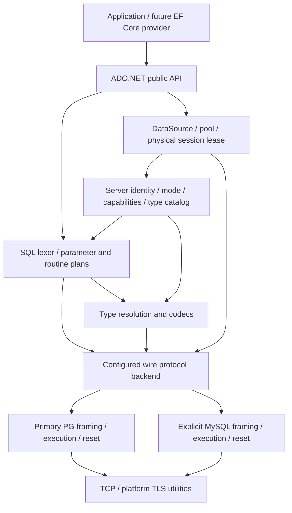

# KingbaseConnector Unified ADO.NET Driver Design

Baseline date: 2026-11-23. Last updated: 2026-11-24. Status: documentation baseline ready to guide development. Specific API, configuration, and release-policy proposals remain subject to confirmation. At this baseline, the repository contains no product projects or tests, and there are no live-server acceptance results. Ongoing implementation status is maintained in the [development guide](kbconnector-development.md) and [development progress](kbconnector-development-progress.md).

Current working directory: `D:/Code/dotnet/kbconnector-dotnet`. The earlier design and evidence inventory have been moved here, and source materials are tracked with repository-relative paths. Renaming the directory does not finalize the package ID or public type names.

Companion documents: [feature and version matrix](kbconnector-feature-matrix.md), [official DLL static evidence inventory](reference/official-driver-inventory.json), [development guide](kbconnector-development.md), and [development progress](kbconnector-development-progress.md). Feature IDs in the matrix provide a common index for implementation, tests, defects, and release notes. This design defines the intended contracts; the progress document records their current implementation and verification status.

## 1. Confirmed Goals and Design Proposals

### 1.1 Scope confirmed by the user

1. Independently develop a .NET ADO.NET driver for KingbaseES. Analyze the official driver's features, implementation approaches, and version differences without depending on the official DLL at runtime or treating all official behavior as a correct specification.
2. Ultimately support both V9 and V8, completing V9 first and then extending support to V8. V8 remains in scope; V9 work must not imply that V8 compatibility has already been established.
3. Cover PG, Oracle, MySQL, and SQL Server modes in V9 all-mode servers, together with the combinations actually available in the corresponding standalone compatibility editions. All deployment forms share one driver package.
4. Use `D:/Code/dotnet/obconnector-dotnet` as a reference for engineering organization: NuGet Central Package Management, `.slnx`, a shared project version, and multiple target frameworks.
5. Provide a stable ADO.NET, type, and metadata foundation for a separately developed EF Core provider. The initial deliverables are this design and the matrix; implementation proceeds according to the development documents.
6. Use PG v3 for normal deployments in all four compatibility modes. Also cover the exceptional deployment that disables the PG endpoint and exposes only a MySQL-protocol endpoint, through an explicit additional backend. This does not make MySQL the default protocol.
7. Provide built-in ADO.NET connection pooling, including ownership, bounded capacity, session isolation, clearing, and disposal for both protocol backends.

### 1.2 Specific proposals requiring confirmation

- The provisional package and namespace are `KingbaseConnector`, with public types such as `KingbaseConnection`. Binary replacement of the official `Kdbndp` API or assembly is not a compatibility goal.
- Use a fully managed core targeting `netstandard2.0;netstandard2.1;net8.0;net9.0;net10.0`. These are TFMs, not CPU architectures. Operating systems and x64/ARM64 require separate validation dimensions.
- Use the user-provided `V8R6C9B14` as the first V8 validation anchor. Earlier V8 releases remain explicit research items; one DLL does not establish their coverage.
- Default `CompatibilityMode` to Auto and identify the database mode from the server. An explicit value selects the driver's compatibility rules; it does not change the server mode or wire protocol. Keep expected-version validation separate. Return clear errors and diagnostics for unrecognized or conflicting server identities rather than silently assuming PG mode.
- Classify features as V9 required, V9 conditional, later independent work, or unconfirmed. The matrix defines classification and acceptance rules. Conditional features still require explicit conclusions before release.

These are design proposals, not a record that the user has individually approved each public API, default setting, or release rule.

## 2. What the Available Materials Establish

### 2.1 Local facts

- When research began, the repository contained only `.gitignore`, `.source-code`, and Git metadata, with no driver projects or tests.
- The official materials contain 25 copies of `Kdbndp.dll`, representing 10 distinct binaries after SHA-256 deduplication. Six receive detailed comparison; their aliases appear in matrix section 2. Hashes, TFMs, and assembly references are also retained for the other four older .NET Framework assets.
- The added `.source-code/V8R6C9B14/netstandard2.0/Kdbndp.dll` is a distinct binary. It declares `.NETStandard,Version=v2.0` and assembly version `4.0.7.1222`.
- Official V9 R1, R2, and R4 directories contain duplicate binaries. Different contents also share the same FileVersion. Neither directory names nor FileVersion alone establish implementation identity.
- The path containing `D9-100` includes `netstandard2.0`, but its actual TFM is `.NETFramework,Version=v4.5`. Assembly metadata takes precedence.
- The V8 DLL also contains a four-mode enumeration and MySQL/SQL Server handler classes. This establishes client implementation evidence, not that V8 servers provide every deployment/mode combination.

The inventory records complete SHA-256 hashes, relative paths, versions, actual TFMs, assembly dependencies, built-in type attributes, and key symbols. Decompiled source is used only for temporary analysis; it is neither product source nor a committed deliverable.

The 25 paths and 10 complete hashes were checked against the inventory. All built-in type attributes in the six principal samples were compared again, covering 525 attributes. Empty `builtInTypes`/`declaredTypes` arrays for the four older Framework samples mean extraction was incomplete, not that those assemblies lack types or APIs; `builtInTypeCount` was counted separately. Static implementation locations use the full sample hash, type, member, and token where available; temporary decompiler line numbers are not stable evidence locations. Additional static details are retained in the JSON `reviewDetails` field.

### 2.2 Evidence levels

| Marker | Meaning | Permitted conclusion |
| --- | --- | --- |
| DOC | Explicitly described in official documentation | The documented release line claims the behavior; the documentation version must still match |
| SYM | A DLL declaration or attribute exists | The API, type name, or OID table entry exists; correctness is not established |
| BODY | The implementation path was inspected statically | Describes the logic of that particular DLL; does not establish live interoperability |
| SIM | The new driver's protocol simulation/unit tests pass | Meets the tested contract for controlled inputs; does not replace server acceptance |
| LIVE | The new driver passes in a recorded real environment | Covers only the recorded server version, deployment form, mode, authentication, and test scope |

At the 2026-11-23 documentation baseline, evidence is DOC/SYM/BODY only; no new-driver SIM/LIVE results exist. Subsequent implementation and validation results belong in the progress document; update matrix requirements when new evidence changes a contract. The official DLL is one behavioral comparator. Server responses, official protocol/documentation, and independent validation also inform decisions; official defects must not be copied.

## 3. Implementation Approach

| Approach | Benefits | Costs and applicability | Design decision |
| --- | --- | --- | --- |
| Wrap or select official DLLs at runtime | Fast initial integration | Retains version differences, defects, and deployment restrictions; does not produce an independent core | Rejected: the user explicitly requested independent redevelopment |
| Use an existing driver such as Npgsql as the runtime core and add adapters | Some basic functionality already exists | Requires evaluating internal extension boundaries and Kingbase-specific authentication/messages/types; upstream behavior adds another compatibility surface | Not the proposed runtime dependency strategy |
| Implement one ADO.NET core and pool manager, a primary PG backend, and an explicit MySQL backend for exceptional deployments | Control over public APIs, failure semantics, and version policy; shared ownership and compatibility logic | Additional MySQL handshake, execution, codec, and pool-reset acceptance work | Recommended; PG remains the normal path |

The official static implementation writes protocol version `196608` in `StartupMessage`. Its Parse/Bind/Execute and COPY paths establish a PG v3-style connection path in those DLLs. They do not establish a native MySQL implementation. A database in MySQL compatibility mode normally still uses this PG path; selecting that mode does not require another wire protocol.

### 3.1 Normal PG path and exceptional MySQL endpoint

PG is the default and primary backend for all-mode servers and the corresponding standalone editions in PG, Oracle, MySQL, and SQL Server compatibility modes. An application using the normal PG endpoint needs no protocol setting. Most MySQL-compatible deployments therefore continue to use exactly the same PG path as the other modes.

The additional MySQL backend covers the exceptional installation that disables or does not expose the PG endpoint. Implement it in the same independent core package with the same ADO.NET API and pool management. Share transport utilities, deadlines, leases, diagnostics, and public value contracts where appropriate. Keep handshake/authentication, framing, command/result state machines, wire types, cancellation, and reset specific to each backend. Do not wrap an external driver's pool inside this pool or introduce a separately deployed driver/plugin per mode.

### 3.2 Protocol selection is separate from compatibility mode

The proposed canonical keyword/property is `WireProtocol`, with `KingbaseWireProtocol.PostgreSql` and `MySql` values. The default is PostgreSql; no Auto value is proposed. The canonical mode keyword/property remains `CompatibilityMode`, default Auto, as defined in section 6.3. A protocol is selected before the handshake; mode is selected after authentication from server information or explicit configuration.

| Endpoint and configuration | Connection behavior |
| --- | --- |
| Normal Kingbase PG endpoint; WireProtocol omitted or PostgreSql | PG v3; default port 54321. Auto detects any supported database mode after authentication. Explicit CompatibilityMode selects its client rules. |
| Exceptional MySQL-only endpoint; WireProtocol=MySql | Use the MySQL backend and require an explicit Port. Initial compatibility coverage is MySql mode only. Auto still requires verified server-mode discovery; the protocol name alone is not that discovery. |
| MySQL wire with explicit PostgreSql, Oracle, or SqlServer mode | Reject the unsupported combination during configuration validation. Further combinations require separate evidence and an explicit scope change. |
| Configured protocol does not match the endpoint | Fail with a bounded protocol/handshake diagnostic; do not switch protocols, scan ports, or retry through another protocol. |

Proposed connection strings, with placeholder credentials:

```text
Host=server.example;Port=54321;Database=app;Username=app;Password=<secret>;CompatibilityMode=Auto;Pooling=true
Host=server.example;Port=3307;Database=app;Username=app;Password=<secret>;WireProtocol=MySql;CompatibilityMode=Auto;Pooling=true
```

Port 3307 is the user's reported MySQL endpoint layout, not a universal default or protocol detector. Use the actual configured port; it may differ from both 3306 and 3307. Explicit `CompatibilityMode=MySql` can replace Auto in either example. It selects client semantics but still requires actual product/version/catalog facts and rejects a conflicting reported mode. Neither setting starts a disabled listener or changes the server's mode.

Do not infer MySQL merely from a port number or every startup failure. If received bytes positively identify a MySQL greeting while PG was selected, suggest configuring WireProtocol=MySql with the actual MySQL endpoint, or using the administrator-provided PG endpoint. Under MySQL selection, reject invalid/unsupported greetings without attempting a PG startup. All reads and errors remain length- and time-bounded; this diagnostic recognition does not implement protocol auto-selection.

### 3.3 Applicability and evidence boundary

The existing Kdbndp evidence concerns PG connections. W20 explicitly documents MySQL protocol compatibility in KingbaseES MySQL-compatible Release V009R003C010. This is DOC evidence for that release line, not evidence that every edition exposes that endpoint or that a given installation disables PG. MySQL protocol specifications W14-W16 define reference wire behavior; they do not prove that Kingbase implements every MySQL capability. U07 covers the actual Kingbase native-endpoint product/mode queries, authentication, catalogs, reset, and cancellation behavior. A generic MySQL greeting/version string or successful SELECT does not prove Kingbase identity, product build, or compatibility mode.

PG-specific APIs such as COPY, LISTEN/NOTIFY, OID large objects, and refcursor are not promised on MySQL wire. Record applicability per feature and protocol profile and reject unsupported calls before sending protocol-specific messages. Do not silently substitute LOAD DATA, emulate notifications, or invent PG OIDs. Shared ADO.NET commands, transactions, readers, metadata, and pooling still need their own native-endpoint acceptance. Native TDS and arbitrary MySQL-server compatibility are outside this extension's scope.

## 4. Engineering Structure and Packages

The proposed structure is shown below. The documentation baseline adds `docs/`; product scaffolding is tracked as development work.

```text
KingbaseConnector.slnx
Directory.Build.props
Directory.Packages.props
src/
  KingbaseConnector/
  KingbaseConnector.DependencyInjection/
tests/
  KingbaseConnector.UnitTests/
  KingbaseConnector.ProtocolTests/
  KingbaseConnector.IntegrationTests/
  KingbaseConnector.ConsumerTests/
eng/
docs/
```

- Enable CPM in `Directory.Packages.props`; individual `PackageReference` entries carry no versions. Introduce TFM-specific dependencies only where necessary.
- Use `Directory.Build.props` for shared versions, nullability, deterministic builds, and common compilation settings. Product packages share one version. Server V8/V9 does not determine the package major version or .NET TFM.
- Manage product and test projects in `KingbaseConnector.slnx`. Use an installed SDK that supports net10.0 and slnx; do not pin its version in `global.json`. Record the SDK used for validation. Do not copy test dependency versions from the reference repository without validation.
- Provide all modes in one core package, with an optional separate DI integration package. The core does not depend on EF Core, embed the official driver, or split V8/V9 into different core packages.
- Prefer the standard library. Use `Microsoft.Extensions.Logging.Abstractions` for logging and `ActivitySource`/`Meter` for diagnostics. If algorithms such as SM3 require dependencies, select maintained libraries instead of automatically retaining the old `BouncyCastle.dll` or copying an embedded TLS implementation.
- Validate minimum netstandard dependency versions on actual hosts. Running tests on net10.0 does not justify raising every product dependency to the same minimum. The NuGet dependency graph is an acceptance target.
- Execute real consumer tests for the .NET 8/9/10 assets. Validate netstandard2.0/2.1 assets using hosts that explicitly select those assets; automatic NuGet selection of a modern asset does not count as Standard testing.
- Validate Windows and Linux x64 by default. Add ARM64 as a separate validation item. Fully managed code does not certify untested platforms. Standard2.0 targeting alone does not establish .NET Framework host support.

DP01 engineering selection (2026-11-24): validation used SDK 10.0.403; the repository does not pin an SDK version, following the user's development preference. The shared package version is 0.1.0, with no prerelease suffix, as requested by the user. This version format does not establish release readiness. The five-target core has no explicit runtime dependency at this stage. VSTest 18.0.1, xUnit 2.9.3 and its Visual Studio adapter 3.1.5 are test-only. `eng/verify.ps1` is the local restore/build/test/pack/explicit-consumer entry point; the development guide defines host/asset selection and the fail-closed live opt-in. These engineering decisions do not settle U06 licensing/publication or validate server functionality.

## 5. Architecture and Public Contracts



### 5.1 Public objects

| Proposed type | Responsibility |
| --- | --- |
| `KingbaseConnection` | DbConnection; synchronous/asynchronous open and close, transactions, mode/version information, GetSchema |
| `KingbaseCommand` | DbCommand; execution, explicit Prepare, cancellation, parameter and result lifetimes |
| `KingbaseParameter` / `KingbaseDbType` | DbParameter; explicit provider type, type name, direction, precision, and scale |
| `KingbaseDataReader` / `KingbaseDbColumn` | DbDataReader; streaming, consistent CLR mappings within each mode, column metadata |
| `KingbaseTransaction` | DbTransaction; commit, rollback, savepoints, and error state |
| `KingbaseFactory` | DbProviderFactory; standard factory registration |
| `KingbaseDataAdapter` / `KingbaseCommandBuilder` | DataTable/DataSet and command generation based on keys and schema |
| `KingbaseDataSourceBuilder` / `KingbaseDataSource` | Immutable configuration, private pool, type registration, diagnostics, and lifetime |
| `KingbaseException` / server exception subtype | SQLSTATE, error classification, server fields, and execution outcome certainty |
| `KingbaseServerInfo` | Raw version, product version, mode, confirmed deployment form, and capability provenance |

Modern assets derive DataSource from `DbDataSource`; Standard assets provide an equivalent entry point with the same name without declaring an unavailable BCL base class. Use conditional compilation for BCL capabilities such as `DbBatch`, IAsyncDisposable, and DateOnly/TimeOnly. The matrix makes API differences explicit; these TFM differences do not change core behavior.

The deliverable includes a separate `KingbaseConnector.DependencyInjection` package, explicitly requested by the user on 2026-11-24 with `obconnector-dotnet` as the registration/lifetime reference. Applications opt into this package; shipping it is part of G02. It references the core and Microsoft DI abstractions, leaving the core independent of DI. Provide `AddKingbaseConnection` for closed transient connections and `AddKingbaseDataSource` for a container-owned singleton DataSource; modern assets also provide keyed DataSource registration. Preserve an existing unrelated unkeyed BCL alias, reject duplicate provider/key registrations before mutating services, and test typed/BCL resolution, service lifetimes and container disposal. Implement these entry points alongside usable Connection/DataSource ownership rather than placeholder services. This does not copy the reference driver's backend or accept its server behavior.

Each connection permits at most one active execution/Reader/COPY operation. Reject concurrent operations explicitly; concurrent applications obtain multiple connections from a DataSource. Do not initially implement a multiplexing state machine or interpret an official connection option with that name as proof of modern protocol multiplexing.

The standard connection contract also covers `State`/`StateChange`, reopening after close, disposed-object behavior, and `ChangeDatabase`. Changing databases must reject active transactions and Reader/COPY operations. The initial proposal rejects a change to another database on a DataSource-created connection before releasing its current lease; create another DataSource for the target database. This preserves the owner's immutable database identity, private pool, capacity, and disposal boundary. Directly constructed connections may close/reopen with the new database configuration: return the old session only to its original pool, and rebuild the target session's identity, catalog, and pool association. On failure, expose a clear connection state. Official D9-107 closes, changes configuration, and reopens. This does not promise an in-place server database switch or preservation of the old session on failure. Clone is an optional convenience API; if provided, it copies configuration only, never an active session or transaction.

### 5.2 Internal responsibilities

| Module | Initial responsibility; split files according to actual complexity rather than creating an assembly for every box |
| --- | --- |
| Transport | TCP, DNS, endpoint connections, platform SslStream, deadlines, cancellation |
| Protocol backends | Primary PG and explicit MySQL message boundaries, authentication, query/result state machines, and reset; no automatic switching |
| Session | Protocol-specific backend identity/status, transaction state, encoding, lease generations, resource ownership |
| Compatibility | Product version parsing, mode confirmation, deployment evidence, precise difference rules |
| TypeSystem | Type catalog, PG OID codecs or MySQL type-code/flag/collation codecs, parameter type resolution, provider values |
| Commands | Lexing, placeholder plans, routine resolution, Prepare, sequential Batch |
| Schema | SQL selected by catalog capabilities; stable ADO.NET metadata and metadata needed by a future EF provider |
| Pool | Bounded capacity, waiting, reset, expiry, clearing, disposal of failed sessions |
| Diagnostics | Logs, Activity, metrics, redaction, failure-stage classification |

## 6. Server Identity and Version Compatibility

### 6.1 Information model

Keep the following information separate rather than collapsing it into one `Version`:

| Information | Source and use |
| --- | --- |
| Raw handshake parameters such as `server_version` | Preserve verbatim as protocol/kernel clues; do not assume they equal the complete Kingbase product version |
| Kingbase product version and build | Confirmed read-only version query and explicit format parsing; selects verified release-specific rules |
| PG/Oracle/MySQL/SQL Server mode | PG status parameters or verified `SHOW database_mode`; on MySQL wire use independently verified Kingbase discovery (U07). Affects type and command semantics |
| All-mode/standalone compatibility edition | Confirm only from reliable returned information; otherwise record Unknown rather than guessing from directories or version strings |
| Catalog capabilities, session parameters, codec settings | Confirmed catalog structure, encoding, time zone, and other facts that determine operation availability |
| Identity source and confidence | Actual responses, documentation rules, controlled configuration; supports diagnosis and prevents unjustified capability promotion |

Public `DbConnection.ServerVersion` returns the confirmed Kingbase product version string. If that version cannot be confirmed, do not invent it: Open fails according to the following rules and retains redacted diagnostics. Expose the raw handshake string separately through ServerInfo.

### 6.2 Open sequence

1. Validate connection configuration and establish one overall connection timeout budget. Pool waiting, DNS, TCP, TLS, authentication, and initialization share that budget.
2. Rent an eligible session or reserve capacity for a new physical connection (section 9). For a new session, use the configured WireProtocol and endpoint; complete that backend's TLS and authentication. Version probing through application SQL is unavailable before authentication.
3. Collect PG ParameterStatus/BackendKeyData or the MySQL backend's verified identity, negotiated capabilities, status, and encoding. Use only implemented, validated authentication algorithms. Do not automatically downgrade to a weaker algorithm after failure.
4. On PG, read `database_mode` from server ParameterStatus when supplied. With CompatibilityMode=Auto, fall back to the verified read-only `SHOW database_mode` path if necessary. With an explicit CompatibilityMode, use the configured compatibility rules and reject a conflicting server-reported mode; a mode-selection query is not required solely to select an already configured mode. Identify the product version through the bounded version-query path and load the actual required catalog metadata in either case. Decode unknown result types using an explicitly requested text format; identifying the mode must not require loading the entire type system first. The official comparison paths remain D8-91 querying the mode and D9-107 reading the startup parameter and querying when its mode remains NoMode.
   For MySQL wire, replace PG-specific startup/mode/catalog queries with the separately verified Kingbase native-endpoint bootstrap (U07). Do not send PG SHOW/catalog syntax solely because it works through the normal endpoint. Auto fails if discovery cannot establish the mode. Explicit MySql can select semantics without pretending the server reported that value; product/version and required catalog facts must still be established. Reused sessions must have a valid reset/generation and compatible identity; expire or revalidate caches according to their contracts.

5. Select read-only catalog queries for the identity and confirm basic types, session encoding, and required capabilities. Use a fixed, bounded candidate query set; do not scan large numbers of system tables by trial and error or probe features through DDL/writes.
6. Validate any explicit compatibility-mode constraint and expected version, then produce the verified session compatibility context. For an ordinary rent/new session, publish Open only after confirming protocol idle state and absence of an unexpected transaction. A session reserved for the same active system transaction follows section 9.3 instead: preserve that transaction and verify its usable state, without applying an idle-session reset.
7. Close the physical session and return a clear classification for unsupported authentication, unconfirmed identity, an inadequate type catalog, unknown formats, or initialization failure.

The exact product-version SQL is a blocking investigation item for V9-0. Current evidence directly confirms only official use of `server_version` and `show database_mode`; functions such as `kingbase_version()` must not be invented in the design. The architecture uses automatic detection. The first stage must establish a bounded query set and full version syntax on a server reachable by the official driver before freezing this contract. This blocks a claim that full version adaptation is complete, but does not block engineering or basic protocol development.

### 6.3 Combining detection and version rules

- Version rules describe known differences and minimum applicable ranges; the actual catalog supplies current OIDs, namespaces, and structures. Both select codecs. A comparison such as `Major >= 9` is insufficient.
- Implement version rules as bounded internal data/selection functions, without a dynamically loadable adapter plugin system or a complete implementation copy for every patch version.
- Associate each difference rule with a matrix ID, source, and regression example. Share implementation across versions without demonstrated differences; add branches when evidence requires them.
- A version match does not enable capabilities absent from the client implementation. Unknown versions do not automatically inherit every newer proprietary capability. A verified common profile determines whether a basic subset may be exposed; experimental connections do not establish official support.
- Initially keep the type catalog on each physical session to avoid unsafe global caching across servers. Separate reusable immutable rules from each session's OID/encoding state.
- Use `CompatibilityMode`, not ExpectedMode, for the automatic/explicit selection contract below. `ExpectedServerVersion` remains a separate optional validation proposal, not a version override or a required connection setting. Do not provide a public fake-version bypass by default.
- Explicit CompatibilityMode is part of the connection contract. It selects driver behavior without claiming that the value was automatically discovered. A configured mode never enables unimplemented features or permits guessing unsupported wire formats.

### CompatibilityMode naming and behavior

The canonical keyword and C# property are `CompatibilityMode`; the proposed enum is `KingbaseCompatibilityMode`, with Auto, PostgreSql, Oracle, MySql, and SqlServer values. Normalize the server's `pg` value to PostgreSql. Connection-string keyword/value matching is case-insensitive. Do not introduce misspelled CompalibilityMode or the separate CompatibleMode/ExpectedMode aliases in this new API.

| Configuration | Mode selection |
| --- | --- |
| Omitted or CompatibilityMode=Auto | Obtain mode through the selected backend's verified discovery: PG parameters/SHOW database_mode, or the confirmed MySQL-endpoint bootstrap. Fail if it cannot be established. |
| Explicit PostgreSql/Oracle/MySql/SqlServer | Use the selected compatibility rules. If the server reports a different mode, fail Open rather than silently switching. Still establish the actual version, catalog, and codec facts required by the selected path. |

Keep configured mode, effective mode, and server-reported mode/source distinguishable in the session identity. Auto is a configuration policy, never the effective mode of an open session. Include the configured selection policy in pool identity so explicit and automatically selected contexts cannot be mixed accidentally. This property does not issue SET commands to change the server database mode, select another protocol, translate arbitrary application SQL, or change endpoints. Report unavailable server mode information as unavailable, not as an automatically confirmed value copied from configuration.

### 6.4 Session changes

Mode is part of the session compatibility context. After a user makes an unrecognized mode/encoding change, stale codecs must not continue operating. Handle PG ParameterStatus and verified MySQL session tracking/status for known mutable parameters. Track lexical settings as well as codec settings: PG standard_conforming_strings affects parameter parsing, and native MySQL SQL-mode/charset facts affect quoting and escape rules. Do not assume that either backend reports every application-issued state change. Where reliable tracking is impossible, mark the session ineligible for pooling and require reconnection before using affected APIs.

Support explicit type-catalog reload. External DDL, dropping/recreating types under the same name, and OID reuse require separate regression cases and a reload contract; a one-time cache is not permanently correct. Do not guess binary formats for unknown OIDs or replay an entire command after the application statement may already have executed.

### 6.5 Connection configuration, credentials, and transport policy

W4 describes the official product, not the new driver's defaults. Its settings already differ from local DLLs. Before implementation, centralize configuration names, aliases, units, zero/negative-value semantics, defaults, and the stage at which each takes effect. The initial proposal is WireProtocol=PostgreSql with port 54321 (explicit Port required for MySql), an explicitly specified database, Pooling=true, minimum pool size 0, maximum pool size 100, connection timeout 15 seconds, command timeout 30 seconds, and automatic preparation disabled. Section 9 defines additional proposed pool lifetimes and ownership. Review and test these as this project's contracts rather than attributing them to every official version.

The following DLL values come from `KdbndpConnectionStringBuilder` DefaultValue attributes and static constructor/Init paths that initialize properties. No Builder instance was created and no server was connected. Conclusions apply only to these two samples, not every V8/V9 package.

| Setting | W4 text | D8-91 | D9-107 | Proposed project treatment |
| --- | --- | --- | --- | --- |
| Port | 54321 | 5432 | 54321 | 54321 for PG; explicit Port required for MySql |
| Database | Required | No default on the Builder property | test | Require an explicit database; do not guess |
| Timeout, seconds | 15 | 15 | 1000 | Initially 15; 1000 is not a common documented default |
| Command Timeout, seconds | 20 | 30 | 30 | Initially 30; separately test 0 as unlimited |
| Minimum Pool Size | 1 | 0 | 0 | Initially 0 |
| Maximum Pool Size | 100 | 100 | 100 | Initially 100, with boundary validation |
| Use SSL Stream | false, misspelled SLL in the manual | true | true | Use platform SslStream; do not copy old internal TLS |

- Define parsing rules for unknown keywords, duplicate keywords, and alias conflicts. Use standard Builder semantics for connection-string quoting, semicolons, and Unicode. Hiding passwords does not make every setting safe to log; log only allowlisted fields.
- Separate password sources from authentication algorithms. The first release supports explicit passwords and a DataSource-level credential callback invoked for new authentication, normally physical creation and also a verified reset path that reauthenticates, with cancellation and token renewal. An ordinary pool rent does not invoke it. Reject simultaneous explicit-password and callback configuration as ambiguous; a failed callback must not fall back to an old password. Passfile/`KESPASSFILE` is conditional work requiring source precedence, escaping, permissions, and endpoint matching rules. Do not implicitly read PG-family environment variables by default.
- Pool isolation includes credential-source identity; host/user alone is insufficient. New authentication uses rotated credentials. Clear pools to close idle old sessions and retire active ones on return; immediate revocation also requires closing/terminating the active leases. Changing a callback does not refresh existing authentication.
- The initial TLS proposal requires encryption and certificate-chain/hostname validation by default. Plaintext requires explicit configuration. If Prefer is offered, state that it permits plaintext fallback. Skipping certificate validation is a separate explicit option. The official three-value `SslMode` and `Trust Server Certificate` do not define the new API's semantics. TLS enablement and certificate validation are separate concerns; the official W4/W5 SSL Disable default is not this project's security-policy contract. Verify fallback and identity-validation options with negative cases.
- Cover ApplicationName, SearchPath, ClientEncoding, and Timezone in startup settings. Restrict configurable parameters instead of concatenating arbitrary startup/initialization SQL. Distinguish server session settings, internal I/O buffers, and socket buffers; include reset and timeout behavior in the shared contract.

Configuration coverage must also define automatic Prepare thresholds and LRU behavior; total connection, command, and internal recovery budgets; SQL/TCP keepalive units and permitted states; composite-type loading and catalog reload; Enlist; and infinity-date behavior. A ConnectionStringBuilder class alone does not establish complete configuration support. Matrix groups C01-C21, P01-P03, Q05/Q07-Q08/Q18, G07/G11, T01/T10/T27/T32, and X04 track the relevant contracts.

#### Settled first configuration slice (DP03, 2026-11-24)

`KingbaseConnectionStringBuilder : DbConnectionStringBuilder` is shared across all five assets. `KingbaseWireProtocol`, `KingbaseCompatibilityMode` and `KingbaseSslMode` are public enums. Only the settings below are implemented; networking, factory registration, callbacks, and pool behavior remain later work. `Validate()` checks complete local configuration without contacting a server. Connection/command/Reader/exception signatures will be settled with their execution path instead of publishing unsupported stubs.

Keywords and enum names are case-insensitive; enum integers and undefined enum values are rejected. Canonical multi-word keys also accept their no-space form. Parsing/quoting follows the BCL builder, including Unicode and quoted semicolons. Repeated canonical or alias keys use the last occurrence consistently, including through a `DbConnectionStringBuilder` reference; this deterministic BCL rule resolves duplicate alias values. Programmatic reassignment replaces the old value. Unknown keywords and invalid values throw `ArgumentException` without including supplied values or conversion inner exceptions. Null assignment removes an explicit setting. Empty/default settings are not serialized until assigned. ContainsKey/ShouldSerialize mean explicitly assigned; TryGetValue returns defaults for supported unset keys and false for unknown keys.

| Canonical keyword / property | Additional aliases | Default / accepted values | Application point |
| --- | --- | --- | --- |
| Host / Host | Server, Data Source, DataSource | Empty; non-whitespace required by Validate | Endpoint selection |
| Port / Port | - | 54321; integer 1..65535; explicit assignment required for MySql wire | Transport |
| Database / Database | Initial Catalog, InitialCatalog | Empty; non-whitespace required | Startup |
| Username / Username | User ID, UserID, User Name, User, UID | Empty; non-whitespace required | Authentication |
| Password / Password | Pwd | Empty; explicit source only in this slice | Authentication |
| WireProtocol / WireProtocol | Wire Protocol | PostgreSql; PostgreSql or MySql, no Auto | Before handshake |
| CompatibilityMode / CompatibilityMode | Compatibility Mode | Auto; Auto/PostgreSql/Oracle/MySql/SqlServer | Bootstrap semantics |
| SSL Mode / SslMode | SslMode | VerifyFull; Disable/Require/VerifyFull | TLS negotiation |
| Root Certificate / RootCertificate | RootCertificate | Empty uses platform trust; otherwise certificate-file path | VerifyFull chain trust |
| Pooling / Pooling | - | true; bool or true/false text | Pool selection |
| Minimum Pool Size / MinPoolSize | Min Pool Size, MinPoolSize | 0; nonnegative integer, no greater than maximum | Pool retention |
| Maximum Pool Size / MaxPoolSize | Max Pool Size, MaxPoolSize | 100; positive integer | Pool capacity |
| Timeout / Timeout | Connection Timeout, ConnectionTimeout | 15 seconds; 0 means unlimited; negative rejected | Whole Open including pool wait/init |
| Command Timeout / CommandTimeout | CommandTimeout | 30 seconds; 0 means unlimited; negative rejected | Whole command |
| Cleanup Timeout / CleanupTimeout | CleanupTimeout | 5 seconds; strictly positive | Internal recovery independent of application cancellation |
| Connection Idle Lifetime / ConnectionIdleLifetime | ConnectionIdleLifetime | 300 seconds; 0 disables idle pruning | Pool lifecycle |
| Connection Pruning Interval / ConnectionPruningInterval | ConnectionPruningInterval | 10 seconds; strictly positive | Pool lifecycle |
| Connection Lifetime / ConnectionLifetime | ConnectionLifetime | 0 seconds disables total-age expiry; nonnegative | Pool lifecycle |
| Application Name / ApplicationName | ApplicationName | Empty | Startup/session baseline |
| Search Path / SearchPath | SearchPath | Empty | Startup/session baseline |
| Client Encoding / ClientEncoding | ClientEncoding | UTF8; UTF8/UTF-8 normalized to UTF8, other encodings rejected in this slice | Startup/codecs |
| Timezone / Timezone | Time Zone | Empty | Startup/session baseline |

All integer values are bounded by Int32.MaxValue unless a tighter range is shown; fractional/boolean object assignments are rejected rather than rounded. Text settings reject NUL before wire encoding. Validate requires explicit Host/Database/Username and coherent pool bounds. MySql wire accepts only Auto/MySql compatibility and an explicit port, even if that port is 54321. PG wire supports every listed mode; no setting infers another protocol or server identity. `Require` enforces encryption **without** authenticating the server certificate; `VerifyFull` requires both chain trust and hostname validation. There is no Prefer/fallback or Trust Server Certificate switch in this slice.

`ConnectionString` deliberately contains explicitly assigned credentials for caller round-tripping. `GetRedactedConnectionString()` returns a copy with Password removed and `ToString()` uses that copy. Redaction leaves all other settings intact and does not make them safe to log; diagnostics must still use an allowlist. Password callback/source precedence, rotation, factory registration and later settings remain open in C01/C16/G11. Do not read environment/passfile credentials implicitly.

#### PG password/MD5 authentication subset (DP03, 2026-11-24)

Implement standard PG AuthenticationOk (type 0), cleartext-password challenge (3) and four-byte-salt MD5 challenge (5) according to W21/W22. Send a PasswordMessage only for the algorithm explicitly requested by the server. Allow initial AuthenticationOk for trust authentication, or exactly one supported challenge followed by AuthenticationOk. Reject unsupported algorithms, invalid sizes, repeated challenges and messages after completion/failure without fallback. The internal handler performs no network I/O and does not establish TLS or a logged-in session. The caller owns/clears the generated password frame after transmission. Clear temporary credential/hash byte arrays; existing immutable credential strings cannot be erased. MD5 is legacy server-requested compatibility only. SCRAM and SM3 remain independent work; a standard-PG vector does not establish Kingbase LIVE support.

Official `Server Compatibility Mode=Redshift/NoTypeLoading` controls catalog-loading compatibility, not Oracle/MySQL/SQL Server mode selection. Do not copy it as a bypass for identity and type-catalog validation. Names such as `UseReadWriteSep` and `Multiplexing` do not establish automatic application SQL routing or concurrent-query support. Official No Reset On Close, Windows performance counters, and EF Template Database also do not automatically become public options: session isolation, Activity/Meter, and the future EF project determine the relevant contracts.

## 7. Protocol, Execution, and Failure Handling

### 7.1 Protocol core

The following messages belong to the primary PG backend:

- Explicitly handle startup, SSL requests, authentication, ParameterStatus, BackendKeyData, ReadyForQuery, and Error/Notice/Notification.
- Cover Simple Query and Parse/Bind/Describe/Execute/Sync/Close, with a shared state machine for multiple results. Register extension messages only after evidence confirms them.
- Validate packet lengths, row/column lengths, nesting, allocation budgets, truncation, and invalid message sequences. Fragmented reads and single reads must behave consistently.
- Track send stage, current result, transaction state, and session resynchronization per operation. Closing a partially read Reader performs bounded draining and confirms ReadyForQuery; destroy the session if recovery fails.

DP04's initial offline subset uses an internal `PgWire` that owns its stream and permits one framed read/write at a time. The materialized control/small-result path caps the PG length field at 64 MiB (including its four length bytes, excluding message code), rejects lengths below four or above the cap before allocating/reading payload, and handles fragmented sync/async reads exactly. A pre-cancelled async call performs no I/O; I/O failure, truncation, malformed length or cancellation after entry closes the stream exactly once and permanently rejects further use. This conservative retirement is not query cancellation/resynchronization or the separate CancelRequest-channel closure contract. Stream cancellation support is still required; network deadlines/transport abort are DP03 work.

Initial independent encoders cover PG v3 Startup (explicit user/database and UTF8), SSLRequest, CancelRequest, Simple Query, Sync and Terminate; their existence does not mean authentication, TLS, query execution or cancellation is implemented. UTF8 encoding rejects NUL and invalid Unicode. Strict parsers cover ParameterStatus, BackendKeyData, ReadyForQuery's I/T/E states, and ErrorResponse fields with a five-character uppercase/digit SQLSTATE. Raw server error fields remain internal and require explicit access; ToString only prints validated SQLSTATE. Public failure-stage/outcome exceptions, notices and state-machine dispatch remain later DP04 work. Large row/COPY streaming requires a separate bounded payload path; do not reuse this materializing helper to claim Q15/B01 support. W21 defines the standard layouts; Kingbase extensions still require profile evidence.

The additional MySQL backend must independently cover the following (W14-W16 are protocol references, not Kingbase acceptance):

- HandshakeV10, negotiated capabilities, packet sequence numbers, packet fragmentation/reassembly, maximum packet lengths, and bounded allocations. Negotiate only implemented features; leave compression and LOCAL INFILE disabled initially.
- Plugin authentication, AuthSwitch/AuthMoreData sequences, and capability-dependent TLS through SSLRequest followed by platform SslStream before credentials requiring protection. Record a positive list of implemented and Kingbase-verified plugins; reject unsupported plugins. No silent downgrade or unverified retrieval of authentication public keys. PG MD5/SCRAM/SM3 results do not certify MySQL plugins.
- COM_QUERY and COM_STMT_PREPARE/EXECUTE/CLOSE, including COM_STMT_SEND_LONG_DATA for streaming parameters where exposed; define COM_STMT_RESET behavior where used. Support text and binary result decoding, NULL bitmaps, OK/ERR/EOF variants according to negotiated flags, affected rows, last-insert identity, status, warnings, and multi-result completion. Multi-statement execution is a separate explicit capability; do not enable it merely to receive multiple routine result sets.
- Explicit affected-row semantics (matched versus changed rows), generated-value reporting, and warning/error mappings. Preserve native error number and SQLSTATE when supplied; never fabricate PG Notice/Notification or backend-key fields.
- The backend's terminal response and transaction status replace ReadyForQuery. Bounded draining must consume every result and status trailer before reuse; unknown state retires the connection. Close outstanding prepared handles or invalidate their caches after reset.

MySQL commands with parameters use protocol-prepared execution even without an explicit public Prepare call. This is the binding mechanism; the automatic-preparation setting controls retained handle caching/reuse, not whether values are safely bound. Close transient handles after complete result consumption, or retire the session on failure. Parameterless commands may use COM_QUERY. Do not replace binding with SQL interpolation when automatic preparation is disabled.

### 7.2 SQL and parameters

Ordinary `CommandText` remains application-authored SQL for the detected server mode; the ADO.NET driver does not automatically translate arbitrary SQL between dialects. Mode-aware driver behavior applies to parameter lexing/binding, generated routine calls, schema queries, and CommandBuilder SQL. The future EF provider owns LINQ and migration SQL generation, including its separate offline target-profile requirement in section 10.2.

- Prefer server-side parameter binding. Convert supported named parameters into a PG `$n` or MySQL `?` prepared binding plan for the selected backend. The lexer must recognize each mode's strings, quoted identifiers, comments, PG dollar quoting, Oracle blocks, `::`, and other relevant constructs; do not rewrite SQL with regular expressions.
- Select quoting/escape rules from verified session state as well as CompatibilityMode. D9-107 passes UseConformantStrings into ParseRawQuery and updates it from standard_conforming_strings. For MySQL wire, verify the effects and availability of SQL-mode flags such as NO_BACKSLASH_ESCAPES and ANSI_QUOTES under U07; a mode name or startup default cannot stand in for the current value. Include the relevant lexical-state fingerprint in cached binding plans. After a tracked change, invalidate those plans before parsing the next command. If the required state is unknown, reject parameter rewriting rather than guessing. Do not preparse a multi-statement command across an unhandled lexical-setting change; reject it or use an explicitly validated sequential path.
- Initially propose `@name` and `:name`, retaining native `$n` on PG and positional `?` on MySQL. Repeated MySQL named parameters require repeated positional values. Reject PG-native `$n` on MySQL and unbound/miscounted placeholders before sending; distinguish MySQL user variables from parameter names explicitly. Prohibit mixed binding styles within one command by default to avoid numbering conflicts. Provide examples when freezing public API rules.
- Generate an internal send snapshot without modifying the caller's Value, DbType, direction, or parameter collection. Repeated parameters, typed NULL, empty values, precision/scale, and Unicode require separate contracts.
- Resolve types in this order: explicit database type name, explicit provider type, explicit DbType, CLR inference. Reject inconsistent simultaneous constraints. Parameter precision/scale must not silently round values.
- Do not fall back to string concatenation that imitates parameterization when Prepare fails. Any necessary text path requires separately defined literal, encoding, SQL_MODE, and other boundaries before its support scope is approved.
- Multiple statements are a separate capability, enabled only when lexical boundaries and parameter semantics are established. Initially execute Batch sequentially, without automatic atomicity or retry.

### 7.3 Routines, output parameters, and cursors

- `CommandType.StoredProcedure` builds a call plan from an explicit routine kind and catalog resolution. PG functions/procedures, Oracle package procedures/functions, and MySQL/SQL Server-compatible routines cannot all be inferred from string prefixes.
- Allow necessary explicit routine-kind options. Require parameter types or an explicit selection for ambiguous overloads instead of choosing the first catalog record.
- Validate Input/Output/InputOutput/ReturnValue separately. Publish output parameters atomically only after successfully reading the contracted results and protocol trailer; preserve original values on failure.
- Do not automatically equate a function return value with the first column of the first row. Map ReturnValue only under an explicit contract.
- Bind refcursor as a resource constrained by its current session/transaction. Define ownership for child Readers, paged FETCH, parent Reader close, transaction completion, and pool return. Do not return invalidated cursors.
- Verify mode-specific output-parameter/result-trailer messages. Ordinary SELECT success does not establish routine support, and official output-conversion code is not a protocol specification to transplant.

### 7.4 Transactions, cancellation, and uncertain outcomes

- Use actually supported isolation levels and semantics for local transactions and savepoints. Do not silently substitute another isolation level for one the database lacks.
- Track PG ReadyForQuery idle/in-transaction/failed-transaction states and verified MySQL status/autocommit/transaction behavior separately. Query cancellation does not imply the transaction can continue. MySQL implicit DDL commits and isolation changes require native-endpoint tests.
- Send PG CancelRequest using the current backend identity and a verified path. PG cancellation has no ordinary query response: the cancellation channel must reach server closure/EOF within a bounded budget, in addition to synchronizing the original channel. A successful socket write alone is not a completion barrier. D9-107 DoCancelRequest reads for this closure; apply this project's explicit bounded recovery budget to that barrier. If cancellation completion cannot be established, destroy the target session before permitting another command or lease.
- MySQL has no PG CancelRequest: use a separately bounded control connection and KILL QUERY only after Kingbase support, permission, exact backend routing, and cancellation races are verified (U07, W19). Otherwise abort and retire the physical session. A proxy that cannot route control cancellation to the same backend makes that path ineligible. The initial proposal permits at most one extra control connection per pool, counted and diagnosed separately from Maximum Pool Size. Waiting for that allowance shares the cancellation budget; on expiry, abort the target session. Never wait for a normal pool slot while that pool is exhausted.
- The original lease remains owned until both cancellation delivery is terminal and the original result is synchronized, or the physical connection is destroyed. Do not run another command on it in that interval. Control-connection timeouts or ambiguous cancel delivery retire the target session, preventing a late cancel from reaching the next command/lease. Cancellation returns a stage/outcome-aware exception; physical abort does not prove that the statement or transaction was rolled back. No automatic SQL replay.
- Distinguish failure before sending, explicit server rejection, response loss after sending, and lost COMMIT responses. Do not automatically replay SQL with an uncertain write/commit outcome.
- Expose SQLSTATE and diagnosable failure stage/outcome certainty through public exceptions. Logs omit parameters, passwords, certificate keys, and complete application SQL by default. Detailed server errors may contain application data and require explicit access with a clear explanation.
- Track single-resource TransactionScope and distributed transactions as separate features. They are not implied by local transaction support. The V9 extension stage must validate them and establish explicit support/limitation conclusions.
- Permit only one local transaction at a time on a physical connection; different connections may each have one. W7's statement that a process can have only one transaction is not a driver constraint. Test explicit EnlistTransaction, automatic-enlist configuration, and escalation caused by concurrently opening a second connection separately. The official volatile resource enlistment does not establish durable recovery after a crash.
- Keep two-phase transaction mechanisms protocol-specific. On PG, investigate the release's PREPARE TRANSACTION/COMMIT PREPARED/ROLLBACK PREPARED path and permissions. On native MySQL, investigate Kingbase's actual XA behavior, backend/session affinity, and recovery capabilities independently; do not send PG transaction commands or assume XA exists from a MySQL greeting. X04/X05 support and recovery claims remain conditional per protocol/profile under U05/U07.

### 7.5 COPY and asynchronous notifications

This section applies to verified PG profiles. The initial MySQL backend does not expose these PG protocol operations; B05 ordinary LOB binding is assessed separately.

Binary import distinguishes completion from disposal. Report success only after explicit Complete succeeds and the server completion result is received. Disposal without Complete uses cancellation/recovery. Define closing semantics independently for text import and raw COPY streams; do not mechanically apply binary-importer rules. COPY failure or cancellation does not imply rollback of the enclosing transaction; inspect transaction state. Raw COPY preserves a transport stream for specified tables/columns, without promising database backup, cross-version migration, or CDC.

Dispatch notifications while reading command messages and during explicit Wait/WaitAsync. The first release does not promise continuous delivery by a background thread. Wait occupies the same session and obeys timeout/cancellation; user callbacks must not reenter commands on that connection. Notifications are not a durable queue, and reconnection/re-LISTEN does not replay missed messages. Send SQL keepalive only in protocol-permitted idle states. TCP/read timeouts and related mechanisms separately detect connection loss during long queries.

## 8. Type System and Mode Differences

### 8.1 Type descriptions and binding

For PG, catalog records include OID, qualified type name, category, base type, element/member types, typmod, and related information. Use actual server OIDs. Built-in tables supplement verified profiles rather than defining a global rule that an OID always represents one type.

Load codec-affecting session facts alongside the catalog. D9-107 reads integer_datetimes; do not select an integer or floating temporal payload solely from a type name or version. Any supported text temporal path must establish its relevant DateStyle/IntervalStyle/TimeZone rules; either use a verified baseline or reject an unsupported format. Reset and reload must restore or refresh these facts before reuse.

Types with the same name may have different wire formats across releases. Select a binary codec only when name, structure, and adaptation rules all match. Offer explicit text reading or a clear rejection for unknown types; never decode arbitrary binary as UTF-8. Reject parameters without a trustworthy type/OID before sending.

For MySQL wire, resolve the native type code, unsigned/binary flags, character set/collation, declared length, precision/scale, and verified Kingbase catalog identity. Do not manufacture OIDs or apply PG binary codecs to MySQL packets. Map to shared public/provider values only after each native text/binary path is verified. JSON, zero dates, large TIME values, BIT, UInt64, decimal and BLOB encodings require independent acceptance. Unavailable PG-only types remain explicitly inapplicable to that backend; an unavailable type is not a license to silently coerce values.

### 8.2 CLR and provider values

| Type family | Proposed default/explicit representation | Required boundaries |
| --- | --- | --- |
| Integers, unsigned values, Boolean, BIT | Exact-width integers, bool; bit arrays/explicit provider values for multi-bit BIT | tinyint signedness, BIT(n), UInt64/wide integers; names do not establish width |
| NUMERIC/NUMBER/DECIMAL/MONEY | decimal by default; explicit `KingbaseNumeric` preserves an arbitrary-precision integer and scale | Explicit exception for decimal overflow; lossless provider API; no row-by-row default CLR type changes |
| Character, NCHAR, binary, BLOB/CLOB | string, byte[], Stream/TextReader | NULL versus empty, character/byte lengths, strict encoding, sequential access |
| PG DATE/TIME/TIMESTAMP | DateTime/TimeSpan; explicit DateOnly/TimeOnly on modern TFMs | Time zones, DateTimeKind, infinity, BC dates/out-of-CLR-range values |
| Oracle DATE/INTERVAL | Preserve time in DATE; separate YM/DS provider interval values | Do not convert months to a fixed number of days; preserve specialized values when CLR precision is inadequate |
| MySQL-compatible date/time/YEAR | Appropriate temporal codecs and provider values | Zero dates, negative/over-24-hour TIME, version-specific YEAR OIDs |
| SQL Server-compatible temporal/numeric types | Independently confirm datetime/datetime2/money/numeric/bit formats | A shared mode name does not establish SQL Server TDS or CLR SqlTypes wire formats |
| JSON/JSONB/XML/UUID | Text/Guid by default; explicit access where necessary | JSON and JSONB have different binary prefixes; server JSON is not always original text that can be rebound unchanged |
| Arrays, range, enum, domain, composite | Catalog-driven recursive codecs and explicit type registration | Multidimensional/NULL/empty collections, member order, recursion limits, DDL invalidation |
| MySQL ENUM / SET | Verified label metadata and explicit string/provider-value contracts | W20 lists both types. Preserve labels, empty value versus NULL, and combinations; do not equate SET with an integer flags enum or assume its PG and MySQL wire formats match |
| Network, geometry, full-text search, others | First define text or provider-value contracts | V9 conditional capabilities; official enum entries alone do not establish support |

Freeze individual mappings against the matrix T series. Validate input, result, and output-parameter paths separately for every high-precision type. Ordinary-column success does not establish array, COPY, or routine-output success.

### 8.3 Applying observed differences

- Built-in `binary`/`varbinary` OIDs are `5022/5024` in some samples and `3383/3384` in others. Actual catalog resolution and confirmed codecs govern behavior.
- `year` is `7024` in some samples and `7025` in D9-107. Official release directories do not establish which value a particular server returns.
- D9-107 has separate SqlServerNumeric/Money/DateTime2 handler classes. Missing names in older samples do not establish complete absence of the feature; inspect shared handler paths and live behavior.
- D9-100 and D9-107 both have a built-in `datetime2=7690` attribute. The former shares mapping through SqlServerDateTimeHandlerFactory; the latter has a separate DateTime2 factory. Failure to find a dedicated class or the name `sqlserver_datetime2` does not establish a missing binding. The OID is still a client constant, not a live server observation.
- D9-107 Int128Handler.Read consumes two Int64 values but returns only the second; Write(long) prefixes a zero value. DateTime2.Read includes local-time conversion and a fixed subtraction of eight hours. Record these as precision/time-zone risks in the official sample, not correctness standards for the new driver. Wide-integer high bits/sign rules and UTC/non-UTC+8/DST need separate regression cases and server confirmation.
- D8-91, D9-100, and D9-82b already contain YM/DS interval classes; the corresponding declarations are incomplete in D9-63. Do not assume the V8 feature set is a strict subset of V9.

## 9. Pooling, Resources, and High Availability

### 9.1 Built-in pool and ownership

The provider implements the pool; deriving from DbConnection does not supply a complete connection pool. Pooling is part of the required ADO.NET contract, including Standard assets. Proposed `Pooling=true` makes Open/OpenAsync rent a physical session and Close/Dispose return it after cleanup. With `Pooling=false`, every Open creates a physical session and Close destroys it once resource/transaction ownership permits; an unresolved system enlistment retains it until completion instead of breaking that transaction.

Each KingbaseDataSource owns a private pool and immutable configuration. Connections constructed directly share a provider registry keyed by normalized configuration. Two private DataSources do not merge merely because their strings match, and direct construction must not accidentally borrow a DataSource's private session. DI should normally keep a DataSource for the application's service lifetime and create short-lived logical connections.

The direct-construction registry also needs a lifecycle. Reclaim unused entries after their sessions have expired/closed and no leases, waiters, opening/resetting/control operations, or system-transaction reservations remain. Remove/recreate entries atomically against concurrent rent/clear operations; keep active accounting attached to its existing owner. Repeated configuration or password changes must not retain an unlimited history of empty pools and credential-bearing configuration. This does not introduce another public cache setting.

Pool identity includes selected WireProtocol, normalized endpoint set/selection policy, database, user, credential-source identity, TLS/certificate policy, configured CompatibilityMode policy, critical session options, and type-mapping identity. PG and MySQL sessions can never share a pool bucket. Defaults and aliases normalize consistently; preserve meaningful differences and do not assume differently cased database/user names are equal. Explicit password changes isolate authentication contexts; callback identity is scoped to its owning DataSource/configuration. Never expose credentials, full connection strings, or raw pool keys in logs/metrics.

### 9.2 Proposed settings and capacity

These are new-driver proposals, not universal official defaults. Freeze keyword aliases and all zero/negative semantics under G11 before implementation.

| Canonical setting | Proposed default | Contract |
| --- | --- | --- |
| Pooling | true | Provider-managed physical-session reuse; false physically closes on return. |
| Minimum Pool Size | 0 | Lazy retention floor, not a promise to pre-open sessions. Cannot exceed maximum; never retains broken, cleared, expired-total-lifetime, or disposed sessions. |
| Maximum Pool Size | 100 | Positive hard limit per pool for ordinary sessions, including opening, leased, transaction-reserved, resetting, idle, and retiring sessions until physically closed. |
| Timeout | 15 seconds | One Open budget for waiting, connection creation, TLS/authentication, initialization, and required validation; cancellation removes the waiter/reservation. |
| Connection Idle Lifetime | 300 seconds | Idle eligibility for pruning above the minimum; 0 disables idle pruning. |
| Connection Pruning Interval | 10 seconds | Positive pruning cadence; does not excuse leasing an already expired session. |
| Connection Lifetime | 0 seconds | 0 disables total-age expiry; positive values retire sessions at a safe return/next-rent boundary without interrupting active work. |

Reserve capacity atomically before opening a session. A resetting or closing session remains counted until eligible for reuse or actually closed. Old-generation leased sessions still count after ClearPool; repeated clearing must not allow unbounded sockets. Queue waiters fairly without starvation, remove cancelled/expired waiters, and make the handoff/cancellation race release exactly one lease and reservation. If no capacity remains, wait within the Open budget and return a distinct pool-timeout failure stage. Never create an extra ordinary connection to escape exhaustion.

The ordinary physical lifecycle is Opening -> Leased -> Resetting -> Idle -> Leased. An unresolved system transaction adds Leased -> TransactionReserved -> Leased for eligible same-transaction reuse, or TransactionReserved -> Resetting after resolution. Failure, expiry, clearing, or disposal prevents further reuse and leads to Retired -> Closed once transaction ownership permits. A lease generation prevents an old Reader, transaction, command, or cancellation callback from touching a session after return. Repeated Close/Dispose must not release a lease twice. A thread-safe pool/DataSource does not make an individual Connection, Command, or Reader safe for concurrent operations.

### 9.3 Cleanup and protocol-specific reset

On ordinary return, revoke child resource access, finish or cancel outstanding work, drain bounded remaining results, roll back unfinished local transactions, and reset before marking the session Idle or handing it to another waiter. Close performs bounded synchronous cleanup; CloseAsync awaits the asynchronous equivalent. Neither reports a session as idle while reset is pending.

For an accepted X04 profile, a closed logical connection enlisted in a live system transaction instead leaves the physical session reserved by transaction identity and owning pool. Before ordinary pool waiting, a subsequent Open with the same active transaction and pool may exclusively reacquire that eligible session with a new logical lease generation. Do not reset or roll back between these logical leases; do not lend it to another transaction or to unenlisted work. It still counts toward Maximum Pool Size. W7 describes this sequential reuse, and D9-107 implements AddPendingEnlistedConnector/TryAllocateEnlistedPending; without an equivalent contract, two sequential opens in one TransactionScope can exhaust a pool of size 1 while the first session waits for scope completion.

Transaction completion races with reacquisition/Close must have one owner: on resolution, clean/reset before ordinary reuse, or retire if broken, expired, cleared, or disposed. Old logical resources remain invalid even while the physical transaction survives. Cleared generations and disposed owners cannot grant a fresh lease; they retain the reservation solely until transaction resolution, after which it is destroyed. Concurrent opens may need additional sessions and promotion; neither transaction affinity nor waiting authorizes exceeding capacity. With Pooling=false, keep an unresolved enlistment alive until completion but do not promise cross-connection reuse. Never reset a system transaction as though it were an abandoned local one.

Use a separate bounded internal cleanup budget (initial proposal: 5 seconds) independent of an already-cancelled application token. On cleanup timeout, malformed trailers, transport failure, uncertain transaction state, or failed reset, destroy the session and release capacity exactly once. Do not offer an unsafe No Reset On Close switch in the initial contract.

| Backend | Reset requirement before ordinary reuse |
| --- | --- |
| PG | A sequence proven for that Kingbase release/capability set; confirm ReadyForQuery in idle state. Do not assume one DISCARD/RESET sequence is universal or valid inside an unfinished transaction. |
| MySQL | COM_RESET_CONNECTION only on profiles where support and cleanup effects are verified. A verified COM_CHANGE_USER path may be used with its reauthentication/credential requirements. If neither can prove the full contract, close the session and create a new one on the next rent. ROLLBACK alone is insufficient. |

Reset must restore configured database, role, transaction/autocommit/isolation/read-only state, encoding/charset/collation, time zone, schema/search_path or SQL mode, session variables, temporary state, notifications/advisory resources where applicable, and prepared statements. Confirm each applicable category with two successive logical borrowers. Reapply allowlisted baseline settings after a server reset where required, then verify usable identity/status. Server-side prepared handles and client caches must agree: invalidate handles cleared by reset, and retain a handle only if its ownership and survival are proven. Unknown application state changes make the connection ineligible for reuse.

Some servers may require reconnection on every return because safe reset is unavailable. That is a documented loss of reuse for that profile, not permission to leak session state. Keep capacity/waiting/disposal behavior correct and report actual physical reuse separately from Pooling=true.

### 9.4 Clearing, disposal, credentials, and liveness

Proposed entry points are KingbaseConnection.ClearPool(connection), KingbaseConnection.ClearAllPools(), and KingbaseDataSource.ClearPool(), backed by the same generation mechanism. ClearPool(connection) targets the associated owning pool; ClearAllPools covers all currently registered direct and DataSource pools. With Pooling=false, ClearPool is a no-op. Close idle sessions immediately, let active leases finish, and destroy them on return without lending them again. A clear operation does not cancel another borrower's transaction.

Disposing a DataSource rejects new rents, wakes queued waiters with a disposed-owner failure, and closes idle sessions. Leased sessions retire when returned; disposal neither force-kills their transactions nor waits indefinitely for application code. A returned connection cannot reopen through that disposed owner. Idle/total-age expiry follows the same ownership rule. Broken idle sessions are discarded on detection; validate liveness where the profile requires it, without promising to prevent all failures after Open.

Credential callbacks run only for new authentication, including a reset path that reauthenticates. New sessions use rotated credentials; existing authenticated sessions persist until closed. Clearing a pool retires active old credentials on return. If immediate revocation of active sessions is required, the application/administrator must also terminate or close those leases; ClearPool alone does not revoke an active server login.

### 9.5 High availability, diagnostics, and acceptance

Select endpoints only for new physical connections; never migrate a running transaction or replay application SQL. Redetect each node's version, mode, catalog, role, protocol capabilities, and reset support. A multi-host configuration uses the explicitly selected protocol on every endpoint; it does not fall back from PG to MySQL during failover. Separate retry of connection establishment from command execution and share the original Open deadline.

Expose low-cardinality pool metrics for idle/leased/opening/resetting/retiring and transaction-reserved sessions, waiters, wait duration/timeouts, created/closed sessions, reset failures, registry pool counts, and bounded control connections. Protocol labels are permissible; usernames, endpoints, SQL, and credential-derived keys are not default metric labels. Diagnostic events distinguish pool waiting, transport/authentication, initialization, reset, and execution failures.

P01-P03/P06 and acceptance groups A07/A17 require deterministic races and sustained tests for both backends: capacity during failed opening/reset/clear/dispose, cancellation at handoff, pool exhaustion, lazy minimums and expiry, two-borrower state isolation, dirty-session retirement, credential changes/registry reclamation, transaction-affine reacquisition at maximum size 1, transaction completion races, old resource access, and leaked sockets/reservations. Test Pooling=false separately and X04 only on profiles accepted for enlistment. A17 includes a MySQL-only endpoint with the PG listener inaccessible, proving that reuse and cleanup use no hidden PG connection.

## 10. Metadata and EF Core Boundaries

### 10.1 ADO.NET metadata

Proposed GetSchema collections include at least MetaDataCollections, Restrictions, DataSourceInformation, DataTypes, ReservedWords, Databases, Users, Schemas, Tables, Columns, Views, Indexes, IndexColumns, Constraints, ConstraintColumns, PrimaryKeys, UniqueKeys, ForeignKeys, ForeignKeyColumns, Sequences, Procedures, Functions, ProcedureParameters, and UserDefinedTypes. The latter names are this provider's collection contract, not a universal ADO.NET requirement for every driver.

Distinguish this from official D9-107: it uses names such as `Schemata` and `PrimaryKey`, its `DataTypes` branch directly throws NotSupportedException, and the existence of GetSchema does not establish collections such as Sequences or routines. Propose read-only aliases Schemata to Schemas and PrimaryKey to PrimaryKeys, with canonical names and ordering documented in MetaDataCollections/Restrictions. Binary replacement of the official driver is not promised.

Freeze collection names and column schemas before implementation. Keep common collections consistent across modes and expose mode-specific fields through explicit extensions. Bind restriction values rather than concatenating SQL; document case, empty-string, NULL, and permission semantics. Lack of permission must not be reported as absence of a server feature.

GetColumnSchema/GetSchemaTable provide actual type names, lengths, precision, scale, nullability, keys/uniqueness, identity/generated status, read-only status, and base table/column information. Expose protocol-specific type identity where the API permits it: PG OIDs or MySQL type codes/flags, without fabricated cross-protocol identifiers. The basic Reader path must not query catalogs again for every row.

Leave column properties unknown when expressions, JOINs, or restricted catalogs prevent determination; do not invent false/0. DeriveParameters (Q19) must reuse routine resolution, schema/package names, overload and direction rules, and define how it replaces the user's parameter collection. It neither executes the routine automatically nor replaces manual parameter declarations.

### 10.2 Future EF Core provider

Keep the EF provider independent of the core package, organized for the actual APIs and TFMs of EF Core 8/9/10. Do not depend on official EF DLLs. The supplied V8 EF DLL references EF Core 2.2.4; it is research material for an older implementation only.

ADO.NET automatic identification handles connection, binding, and reading. EF may generate SQL, migration scripts, or offline reverse-engineering configuration without an open connection, so it needs an explicit target profile containing product generation/target version, mode, and necessary capability limits.

- An EF ServiceProvider/model cache must not mix SQL-dialect profiles. Include target configuration in cache keys.
- On connection open, validate the actual server against the target profile. Defined compatibility rules may allow compatible newer patches; string comparison is insufficient. Report mismatches before execution.
- EF mappings and metadata consume stable core value/description models rather than Protocol, session internals, or reflection over private implementation.
- Establish identity, sequences, RETURNING/result-return behavior, concurrency tokens, batch row counts, transaction savepoints, and error classification as ADO-stage contracts.
- LINQ translation, migration generation, and EF packages are outside the current ADO implementation scope. The matrix records their later boundaries; ADO completion does not establish EF completion.

## 11. Feature Completion and Validation

### 11.1 Test layers

| Layer | Purpose | Evidence limits |
| --- | --- | --- |
| Unit/property tests | Version parsing, SQL lexing, encoding, numeric/temporal values, size boundaries | Does not establish server compatibility |
| Protocol simulation | Fragmentation, authentication, cancellation, invalid message order, unknown results, partial messages, failure synchronization, pool reset | Does not establish support for real Kingbase deployments |
| Official differential comparison | Run different official DLLs and the new driver in separate processes against the same SQL/parameters/server | Official results are not automatically correct; retain differences and independent explanations |
| Live integration | Each registered full V9 version by deployment form, mode, and selected wire protocol; add V8 in its stage | Record per profile and feature; do not extrapolate across versions |
| Package consumption | Select and run each corresponding NuGet TFM asset on Windows/Linux | A successful build alone does not establish target-host runtime support |
| Failure/load/security | Concurrent pooling, connection loss, cancellation races, lost commit acknowledgments, negative TLS/authentication cases | Establish resource and outcome semantics, beyond throughput statistics |

For each live profile, record the complete raw product version, raw handshake version, deployment form, database mode and source, configured protocol/actual endpoint, reset/cancel capabilities, encoding/case settings, authentication/TLS, endpoint topology, OS/CPU, driver commit/package hash, test IDs, and cleanup results. Store credentials in User Secrets or process environment variables; do not store passwords or real connection strings in the matrix.

Use isolated test schemas/prefixes and explicitly clean up DDL performed outside transactions. Separate read-only investigation from acceptance tests that write data. Live tests require explicit opt-in; ordinary `dotnet test` must not connect to a database automatically.

### 11.2 V9 release gates

1. Every matrix item classified as V9 required has implementation and all applicable acceptance evidence. Server-facing features require simulation tests and applicable live-profile evidence. Engineering-only units such as G01 may record SIM/LIVE as N/A with a concrete reason and appropriate build/structure evidence, following development guide section 6. Missing environments or unimplemented tests never justify N/A. Record every existing all-mode/standalone and four-mode combination included in release scope. Also accept the explicitly selected MySQL backend on a MySQL-only endpoint with PG unavailable; a MySQL-mode test through PG does not cover it. Unsupported protocol/feature combinations need evidence-based applicability records, not unconditional feature parity.
2. Complete evidence collection for V9 conditional items. Accept available in-scope features; document genuine server/deployment limitations with version-specific comparator evidence. Unconfirmed items remain unconfirmed and do not count as complete.
3. No item changes from unverified to unsupported merely because a server is unavailable. Missing environments explicitly limit release scope; they do not permit a claim of complete V9 compatibility.
4. Pass critical negative cases for pooling, cancellation, output publication, uncertain outcomes, precision, metadata, and consumption of every TFM.
5. Documentation and package README describe verified scope without unconditional claims covering all historical/future versions. New server releases require additional validation.

The V9 core milestone may be completed first, but basic CRUD alone is not V9 completion. Undecided later independent features need explicitly approved boundaries; requirements must not be removed at the moment completion is announced.

## 12. Development Stages

| Stage | Work | Exit criteria |
| --- | --- | --- |
| V9-0 | Stabilize evidence, select live server profiles, confirm version/mode queries and proprietary messages | Repeatable read-only evidence and compatibility profile rules; traceable unconfirmed items |
| V9-1 | Engineering, protocol, basic authentication, basic four-mode types/parameters/Reader/transactions, basic pooling, metadata | Minimal working public API flow and failure boundaries; still not a complete V9 release |
| V9-2 | Per-mode routines/outputs/cursors, full in-scope types, Prepare, COPY/LOB, Schema, modern APIs, exceptional MySQL backend | Complete V9 required matrix features and resolve conditional capabilities individually |
| V9-3 | Multi-version all-mode/standalone acceptance, exceptional MySQL-only endpoint and both-backend pooling, high availability, authentication extensions, security/load/package consumption | Meet section 11.2 and produce an explicit V9 release support table |
| V8-1 | Verify identity, catalogs, OIDs, authentication, and mode availability starting with V8R6C9B14 | Add only evidence-required difference rules; do not fork the whole driver |
| V8-2 | Extend to other agreed V8 releases and actual modes; rerun V9 regression | Add an explicit V8 support table to the same NuGet package without regressing V9 |
| Later EF work | Develop a provider on stable ADO/API, metadata, and error contracts | Separate EF design and acceptance matrix; excluded from current ADO completion |

Stage numbers express implementation order, not schedule commitments. The [development guide's delivery order](kbconnector-development.md#3-delivery-order-and-dependencies) connects these stages to work packages. The [development progress tracker](kbconnector-development-progress.md) defines the actual packages and records completed work, evidence, blockers, and next steps. Begin with DP01 (engineering) and DP02 (profile discovery) where environments permit, followed by DP03-DP07 (connection through basic pooling), subject to their stated dependencies. This document's baseline status must not be read as a permanent claim that every feature remains unimplemented.

## 13. Open Evidence Items and Ownership

| ID | Unconfirmed fact | Owner/timing | Effect on the design |
| --- | --- | --- | --- |
| U01 | Available real V9 releases and standalone compatibility-edition test environments | Project owner provides authorized test endpoints before live acceptance; credentials stay outside documentation | Does not block architecture; blocks corresponding LIVE claims |
| U02 | Exact query and reliable syntax for the complete product version; whether deployment form is automatically identifiable | V9-0 read-only live investigation; official KingbaseESVersion still derives from parsed server_version, so its name does not establish a complete product build | Blocks final version-identification contract; arbitrary user-supplied fake versions do not resolve it |
| U03 | Actual routine output/return-code formats in each mode and need for extension messages | V9-0/2 protocol comparison and evidence collection | Blocks acceptance of affected features; generic SELECT is not routine support |
| U04 | Mode availability in V8R6C9B14 and whether earlier V8 releases are required | Register profiles during V8 work; add new material directly to the matrix | Remains unconfirmed; a SqlServer enum in the V8 DLL does not resolve it |
| U05 | Target environments for SCRAM-SM3, SM4, Chinese cryptographic-standard TLS, GSS/SSPI, and distributed transactions | Collect evidence and decide V9 conditional/later items separately under the matrix | Separate from basic SM3 authentication; neither implicitly supported nor permanently cancelled |
| U06 | Package ID, license, and public release configuration | Confirm names and provenance before release; retain independent code/dependency provenance during implementation | KingbaseConnector remains provisional; do not copy official decompiled code |
| U07 | Kingbase native MySQL endpoint product/build/mode queries, authentication plugins/TLS, catalogs/type semantics, reset and cancellation capabilities | V9-0/2 discovery and DP20-DP22 acceptance on a MySQL-only profile, including PG being unavailable | Blocks native-endpoint LIVE claims and final bootstrap/reset/cancel rules; does not change the default PG path |

These unknowns cannot become assumed success. The baseline defines architecture, completion criteria, and handling rules; staged investigation resolves unknown server facts. Writing development documentation does not require every database instance to be available first.

## 14. Sources and Traceability

### Principal local sources

- **L1**: Official binaries supplied by the user in `.source-code/`. The [JSON inventory](reference/official-driver-inventory.json) records complete paths/hashes and key classes/members. Use SHA-256, type, member, and token as lookup keys rather than temporary decompiler line numbers.
- **L2**: `D:/Code/dotnet/obconnector-dotnet`, master HEAD `45c73b6` at investigation time. References include Directory.Build.props, Directory.Packages.props, slnx, the core csproj, tests, and package-consumer organization. This is an engineering/contract reference; do not assume OceanBase MySQL wire-protocol or mode behavior is a Kingbase specification.
- **L3**: AssemblyRef metadata in the supplied V8 EF DLL references EF Core/Relational/Abstractions `2.2.4.0` and Kdbndp `4.0.7.1222`. This describes the local files, not all official EF driver versions.

### Official sources checked on 2026-11-23

The v8/v9 URL path, selected website version, driver package names in the body, and local DLLs represent different identities. The `/v9/` ADO.NET pages displayed V009R001C001B0024 with a footer update date of 2023-10-17. The `/v8/` overview displayed V008R006C009B0014 while its body listed Kdbndp_V9. Website navigation menus are not chapter-specific support declarations.

The baseline source check found all 13 official URLs returned HTTP 200 with matching titles. This verifies source availability at that time, not current availability or live-driver compatibility. W4-W9 are chapters 5/6/7/8/10/13 of the same V9 manual; W10-W13 are chapters 9/11/12/4. Chapter numbers differ by one from URL filename suffixes: for example, `ado-net-12.html` is chapter 13 on COPY. Official pages contain spelling/type-name errors such as Use SLL Stream, Scoket, Kdbnpg, and DataTime. Use correct API concepts and confirm declarations in specific DLLs instead of making typographical errors compatibility aliases. W13 describes KingbaseESVersion as a method, whereas the inspected DLL exposes `KingbaseESVersion` as a property of type `Version`, derived from parsed `server_version`.

- **W1**: [V8R6C9B14 Linux installation guide](https://help.kingbase.com.cn/v8/install-updata/install-linux/install-linux-3.html): chapter 4 initialization offers Oracle, PG, and MySQL, with separately listed authentication options. Menus for other versions in the page header do not establish V8 SQL Server mode.
- **W2**: [ADO.NET overview under the V8 path](https://help.kingbase.com.cn/v8/development/client-interfaces/ado-net/ado-net-1.html): the section 2.1.1 driver table lists v9/Kdbndp_V9 packages and PG, Oracle, MySQL, and SQLServer modes. This is a driver claim, not evidence of four V8 server modes or standalone deployments.
- **W3**: [V9 ADO.NET overview](https://help.kingbase.com.cn/v9/development/client-interfaces/ado-net/ado-net-1.html): section 2.5 is a framework/driver-package table. The checked body did not contain the previously attributed multi-mode/single-mode package declaration and does not establish candidate deployment combinations.
- **W4**: [V9 ADO.NET connection-string parameters](https://help.kingbase.com.cn/v9/development/client-interfaces/ado-net/ado-net-4.html): reference for configuration categories, without automatically inheriting every switch or default. Section 6.5 records concrete document/DLL differences.
- **W5**: [V9 ADO.NET security and encryption](https://help.kingbase.com.cn/v9/development/client-interfaces/ado-net/ado-net-5.html): collect authentication and transport evidence separately instead of combining them into one Chinese cryptographic-standard support claim.
- **W6**: [V9 ADO.NET type mappings](https://help.kingbase.com.cn/v9/development/client-interfaces/ado-net/ado-net-6.html): reference for official type features, not the new driver's precision/overflow contract.
- **W7**: [V9 ADO.NET transactions](https://help.kingbase.com.cn/v9/development/client-interfaces/ado-net/ado-net-7.html): track local, system, and distributed transactions separately.
- **W8**: [V9 ADO.NET prepared statements](https://help.kingbase.com.cn/v9/development/client-interfaces/ado-net/ado-net-9.html): accept explicit and automatic preparation separately.
- **W9**: [V9 ADO.NET COPY](https://help.kingbase.com.cn/v9/development/client-interfaces/ado-net/ado-net-12.html): this chapter covers binary, text, and raw binary COPY. Its original title does not expand scope to logical-replication subscription APIs.
- **W10**: [V9 ADO.NET performance](https://help.kingbase.com.cn/v9/development/client-interfaces/ado-net/ado-net-8.html): pool reset, buffers, SequentialAccess, Enlist, and Unix sockets. It describes the official driver's deferred reset, not this driver's reset timing.
- **W11**: [V9 ADO.NET waiting for notifications](https://help.kingbase.com.cn/v9/development/client-interfaces/ado-net/ado-net-10.html): command interaction and Wait/asynchronous waiting separately drive notification dispatch.
- **W12**: [V9 ADO.NET keepalive](https://help.kingbase.com.cn/v9/development/client-interfaces/ado-net/ado-net-11.html): SQL and TCP keepalive differ; OS restrictions are claims of that documentation version.
- **W13**: [V9 Data Provider driver introduction](https://help.kingbase.com.cn/v9/development/client-interfaces/ado-net/ado-net-3.html): reference for Connection/Command/Reader/Parameter/DataAdapter contracts. Confirm API spelling and version meaning against specific DLLs.

### Additional protocol and provider references checked on 2026-11-24

These six pages returned HTTP 200 with matching titles on this date. They establish protocol definitions and other providers' documented contracts, not Kingbase native-endpoint interoperability or this driver's implementation. The exceptional endpoint requirement comes from the user; Kingbase-specific discovery and capability evidence remains U07.

- **W14**: [MySQL Connection Phase](https://dev.mysql.com/doc/dev/mysql-server/latest/page_protocol_connection_phase.html): reference for handshake, capability negotiation, authentication, and TLS sequencing.
- **W15**: [MySQL Command Phase](https://dev.mysql.com/doc/dev/mysql-server/latest/page_protocol_command_phase.html): reference for commands, prepared execution, and result-state handling.
- **W16**: [MySQL COM_RESET_CONNECTION](https://dev.mysql.com/doc/dev/mysql-server/latest/page_protocol_com_reset_connection.html): session-reset command; its availability and exact effects on Kingbase require independent acceptance.
- **W17**: [Npgsql connection-string parameters](https://www.npgsql.org/doc/connection-string-parameters.html): primary provider reference for pooling, capacity, idle/total lifetime, timeouts, and reset options. Proposed defaults here remain this project's decisions.
- **W18**: [MySqlConnector connection options](https://mysqlconnector.net/connection-options/): primary provider reference for pooling, session reset, and connection ownership options; no automatic inheritance of all switches or defaults.
- **W19**: [MySqlConnector command cancellation](https://mysqlconnector.net/overview/command-cancellation/): distinction between a separate-connection KILL QUERY and physical abort, including backend-routing limitations. Kingbase support is U07, not established by this reference.

### Additional Kingbase release evidence checked on 2026-11-24

- **W20**: [MySQL-compatible Release V009R003C010](https://help.kingbase.com.cn/v9.3.11/intro/releasenotes-external-v9/V9.3.10.html): section 4.3.3.1 explicitly states MySQL protocol compatibility; section 4.3.1.1 lists ENUM and SET among its types. The page is the C010 release entry inside the C011 documentation tree, not evidence for every R003 build, every deployment, a fixed port, or this driver's wire interoperability. Endpoint-specific authentication/reset/cancellation/catalog details remain U07.

The original thirteen Kingbase references and the six protocol/provider references were fetched again on 2026-11-24, together with W20; all twenty returned HTTP 200. Availability and documented claims do not establish live acceptance. Additional static inspection reconfirmed D9-107's transaction-reserved pool lookup, standard_conforming_strings handling, and cancellation-channel read. Keep these observations separate from the new driver's proposed contracts.

### PG framing reference checked during DP04 (2026-11-24)

- **W21**: [PostgreSQL 14 frontend/backend message formats](https://www.postgresql.org/docs/14/protocol-message-formats.html), HTTP 200. Standard v3.0 lengths/network order, StartupMessage protocol 196608, SSLRequest 80877103, CancelRequest 80877102, Query/Sync/Terminate, ParameterStatus, BackendKeyData, ReadyForQuery and ErrorResponse field framing. This independently defines standard byte layouts; it is not Kingbase live compatibility, extension-message evidence, or validation of newer protocol versions.
- **W22**: [PostgreSQL 14 protocol flow](https://www.postgresql.org/docs/14/protocol-flow.html), HTTP 200, checked 2026-11-24. AuthenticationOk, server-requested cleartext/MD5 challenge and PasswordMessage behavior, lowercase inner MD5 hex plus raw four-byte salt, and subsequent startup messages. Used for independent password/MD5 implementation only; not Kingbase live login, SCRAM, SM3 or extension evidence.

### Reproducing static inspection

```powershell
Get-FileHash -Algorithm SHA256 <path-to-Kdbndp.dll>
ilspycmd <path-to-Kdbndp.dll>
ilspycmd --dump-table Assembly --json <path-to-Kdbndp.dll>
ilspycmd --dump-table AssemblyRef --json <path-to-Kdbndp.dll>
```

The baseline used ilspycmd `11.2.0.10050`. It read/decompiled binaries without executing official DLLs, modifying the reference OceanBase repository, or connecting to a real Kingbase database. No product build, protocol simulation, performance test, or database interoperability test was possible at this documentation-only baseline. Later development and verification results must be recorded with their own evidence in the development progress document. Update the design and matrix when those findings change requirements or support boundaries.
